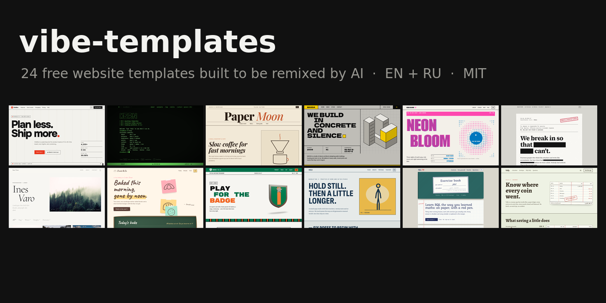
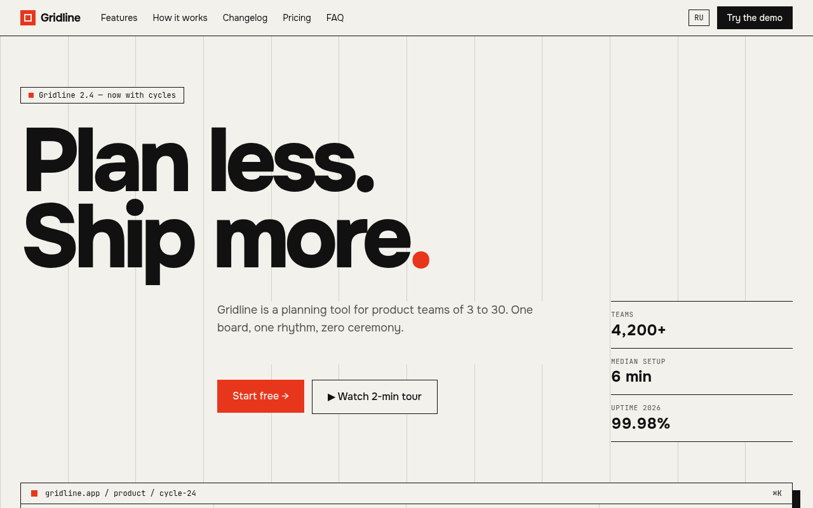
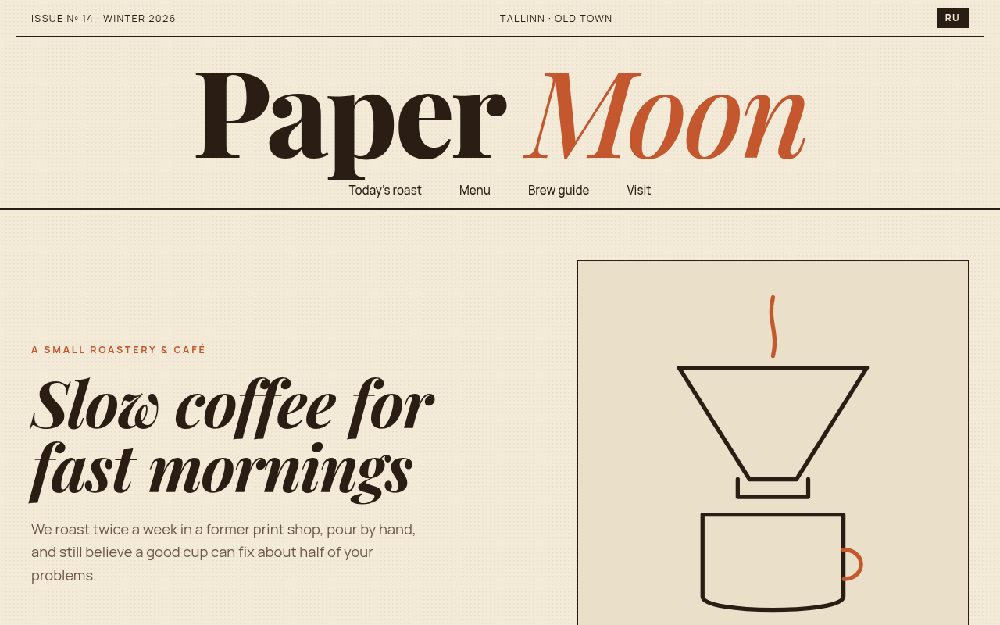
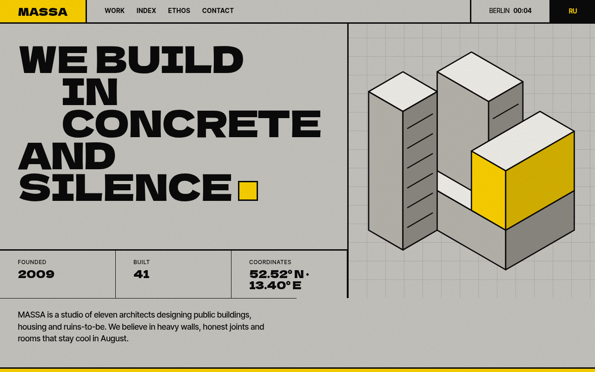
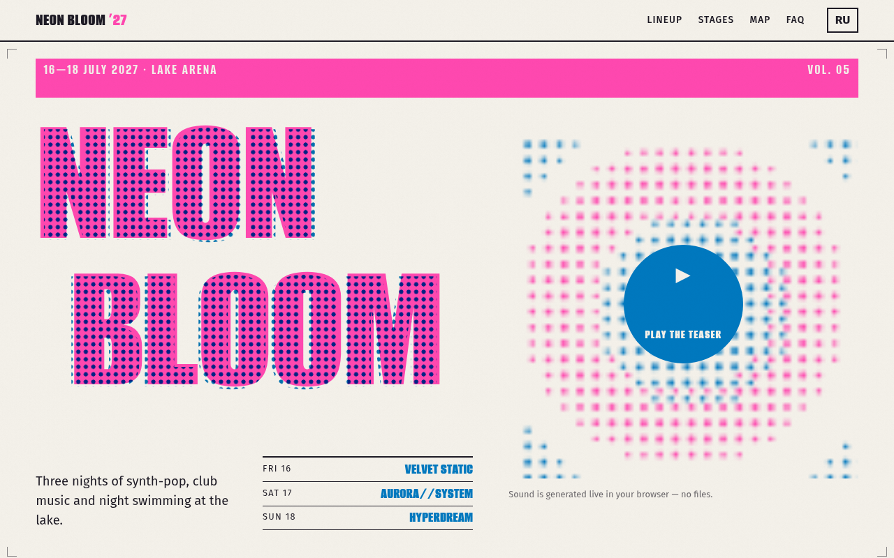
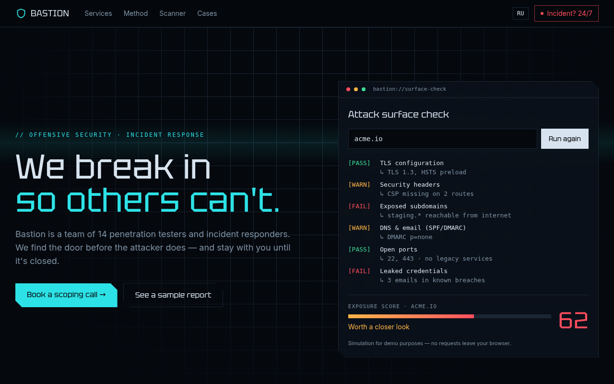
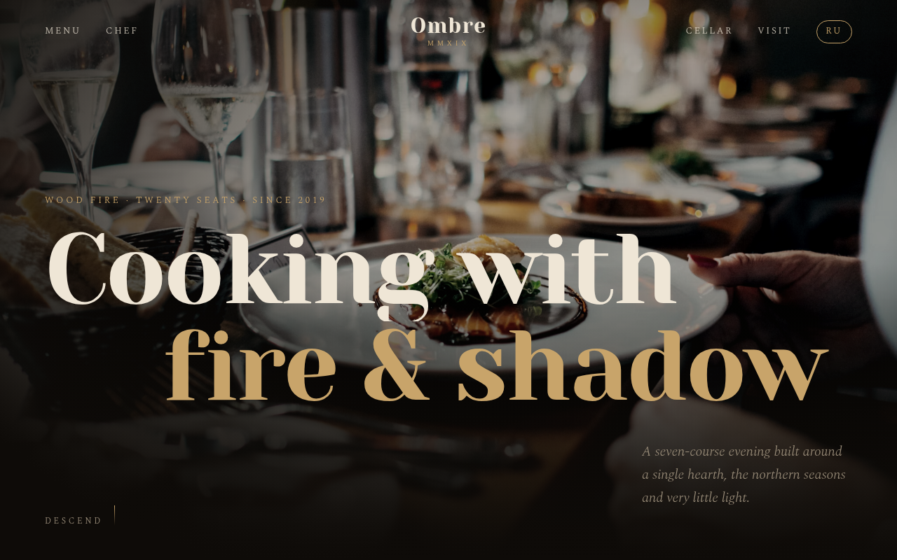

<div align="center">



# vibe-templates

**24 free, open-source website templates built to be remixed by AI.**
Every template has its own look, its own stack and a design contract your coding agent can follow.

[](LICENSE)
[](#catalog)
[](#bilingual)
[](CONTRIBUTING.md)
[](https://github.com/unicorn-rm/vibe-templates/stargazers)

[**Live gallery**](https://unicorn-rm.github.io/vibe-templates/) · [Catalog](#catalog) · [Use with AI](#use-with-ai) · [Русская версия](README.ru.md)

</div>

---

## Why this exists

Most template packs look like the same landing page in different colors. And when you ask an AI to "make it mine", it quietly turns any design into the same average gradient-and-rounded-cards site.

**vibe-templates** fixes both:

- **Really different designs.** Swiss grid, CRT terminal, Y2K chrome, candle-lit luxury, brutalism, Japandi, 8-bit… Each template has its own palette, font pair, graphics and at least one **signature block** you will not find in the others.
- **Different stacks.** Plain HTML, React, Next.js, Vite, Tailwind CSS, Astro, Vue/Nuxt, SvelteKit, Three.js. Pick the one you know, or learn from one you don't.
- **AI-ready by design.** Every template ships with `DESIGN.md` (the visual rules) and `AGENTS.md` (instructions for coding agents), plus a copy-paste prompt. Claude Code, Cursor, Copilot or Codex keep the style instead of flattening it.
- **Tokens, not hard-coded values.** Colors, fonts, radii and spacing live in one place at the top of the styles.
- **Bilingual.** English by default, Russian built in, Cyrillic-ready fonts everywhere.
- **Static and free.** No backend, no accounts, no tracking. MIT license.

## Gallery

<!-- gallery:start -->
<table>
<tr>
<td width="50%" valign="top"><a href="templates/01-swiss-saas/README.md"></a><br /><b>01 · Gridline</b> — Swiss grid<br /><sub>Next.js 16 · Tailwind CSS 4 · TypeScript · <a href="https://unicorn-rm.github.io/vibe-templates/01-swiss-saas/">demo</a></sub></td>
<td width="50%" valign="top"><a href="templates/02-terminal-portfolio/README.md"></a><br /><b>02 · Alex Kern</b> — Retro CRT terminal<br /><sub>HTML · CSS · Vanilla JS · <a href="https://unicorn-rm.github.io/vibe-templates/02-terminal-portfolio/">demo</a></sub></td>
</tr>
<tr>
<td width="50%" valign="top"><a href="templates/03-coffee-editorial/README.md"></a><br /><b>03 · Paper Moon</b> — Warm paper editorial<br /><sub>Astro 7 · Vanilla TS · <a href="https://unicorn-rm.github.io/vibe-templates/03-coffee-editorial/">demo</a></sub></td>
<td width="50%" valign="top"><a href="templates/04-brutalist-architecture/README.md"></a><br /><b>04 · MASSA</b> — Brutalism<br /><sub>HTML · CSS · GSAP + ScrollTrigger · <a href="https://unicorn-rm.github.io/vibe-templates/04-brutalist-architecture/">demo</a></sub></td>
</tr>
<tr>
<td width="50%" valign="top"><a href="templates/05-neon-festival/README.md"></a><br /><b>05 · Neon Bloom</b> — Neon Y2K, chrome<br /><sub>React 19 · Vite · Motion · <a href="https://unicorn-rm.github.io/vibe-templates/05-neon-festival/">demo</a></sub></td>
<td width="50%" valign="top"><a href="templates/06-cyber-security/README.md"></a><br /><b>06 · Bastion</b> — Dark grid, cyan<br /><sub>Next.js 16 · Tailwind CSS 4 · TypeScript · <a href="https://unicorn-rm.github.io/vibe-templates/06-cyber-security/">demo</a></sub></td>
</tr>
<tr>
<td width="50%" valign="top"><a href="templates/07-photographer/README.md"></a><br /><b>07 · Ines Varo</b> — Airy minimal<br /><sub>SvelteKit 3 · Svelte 5 · <a href="https://unicorn-rm.github.io/vibe-templates/07-photographer/">demo</a></sub></td>
<td width="50%" valign="top"><a href="templates/14-fine-dining/README.md"></a><br /><b>14 · Ombre</b> — Dark luxury, candlelight<br /><sub>HTML · CSS · GSAP + ScrollTrigger · <a href="https://unicorn-rm.github.io/vibe-templates/14-fine-dining/">demo</a></sub></td>
</tr>
</table>
<!-- gallery:end -->

## Catalog

<!-- catalog:start -->
| # | Template | Style | Stack | Signature block |
|---|---|---|---|---|
| 01 | [**Gridline** · SaaS landing](templates/01-swiss-saas/README.md) | Swiss grid | Next.js 16, Tailwind CSS 4, TypeScript | Bento grid with live mini-demos (typing command palette, burndown, keycaps) + changelog timeline |
| 02 | [**Alex Kern** · Developer portfolio](templates/02-terminal-portfolio/README.md) | Retro CRT terminal | HTML, CSS, Vanilla JS | A working command line: help, projects, theme, lang, history, Tab completion |
| 03 | [**Paper Moon** · Specialty coffee](templates/03-coffee-editorial/README.md) | Warm paper editorial | Astro 7, Vanilla TS | Menu whose rows draw a hand-made line illustration on hover + a working pour-over brew timer |
| 04 | [**MASSA** · Architecture studio](templates/04-brutalist-architecture/README.md) | Brutalism | HTML, CSS, GSAP + ScrollTrigger | Pinned horizontal project scroll with generated isometric massing models — no images at all |
| 05 | [**Neon Bloom** · Music festival](templates/05-neon-festival/README.md) | Neon Y2K, chrome | React 19, Vite, Motion | Live audio visualizer — a tiny Web Audio synth drawn as a radial spectrum, no audio files |
| 06 | [**Bastion** · Security consultancy](templates/06-cyber-security/README.md) | Dark grid, cyan | Next.js 16, Tailwind CSS 4, TypeScript | Simulated attack-surface scanner: type a domain, watch six checks resolve to PASS/WARN/FAIL and an exposure score (no network requests) |
| 07 | [**Ines Varo** · Photographer](templates/07-photographer/README.md) | Airy minimal | SvelteKit 3, Svelte 5 | Masonry gallery with series filter and a keyboard/swipe lightbox showing EXIF |
| 08 | Home bakery <sub>soon</sub> | Hand-drawn pastel | Tailwind CSS, Alpine.js | — |
| 09 | Esports club <sub>soon</sub> | Game HUD | React, Three.js (R3F) | — |
| 10 | Yoga & wellness <sub>soon</sub> | Soft organic | Astro, Tailwind CSS | — |
| 11 | Online course <sub>soon</sub> | Playful blocks | Vue 3, Vite | — |
| 12 | Personal finance app <sub>soon</sub> | Dark glass | React, Tailwind CSS, Recharts | — |
| 13 | Fashion brand <sub>soon</sub> | Magazine lookbook | Next.js | — |
| 14 | [**Ombre** · Fine-dining restaurant](templates/14-fine-dining/README.md) | Dark luxury, candlelight | HTML, CSS, GSAP + ScrollTrigger | Pinned tasting menu: a sticky photo and roman numeral change with every course you scroll past |
| 15 | Eco nonprofit <sub>soon</sub> | Earthy craft | Astro | — |
| 16 | Open-source library <sub>soon</sub> | Clean docs | Astro, MDX | — |
| 17 | Podcast <sub>soon</sub> | Bold color blocks | SvelteKit | — |
| 18 | Space museum <sub>soon</sub> | WebGL starfield | HTML, Three.js | — |
| 19 | Barbershop / tattoo <sub>soon</sub> | Vintage poster | Tailwind CSS, Alpine.js | — |
| 20 | AI startup <sub>soon</sub> | Shader gradient | Next.js, Tailwind CSS | — |
| 21 | Tech conference <sub>soon</sub> | Acid poster grid | React, Vite | — |
| 22 | Interior studio <sub>soon</sub> | Japandi | Nuxt 3 | — |
| 23 | Blog & newsletter <sub>soon</sub> | Reading-first | Astro, MDX | — |
| 24 | Indie game <sub>soon</sub> | 8-bit pixel | HTML, Canvas | — |
<!-- catalog:end -->

## Quick start

```bash
git clone https://github.com/unicorn-rm/vibe-templates.git
cd vibe-templates/templates/01-swiss-saas   # pick any folder
npm install && npm run dev                  # or just open index.html for plain-HTML templates
```

Each template is self-contained: copy its folder into your project and delete the rest.

## Use with AI

1. Copy one template folder into a new repo.
2. Open it in your coding agent.
3. Paste the prompt from the template's README, for example:

```text
You are adapting the "14-fine-dining" template from vibe-templates.
Read DESIGN.md and AGENTS.md in this folder first and keep every rule in DESIGN.md.
My project: a small Georgian wine bar in Tbilisi with a short seasonal menu.
Replace all copy and data with content for my project, in English and Russian.
Keep the layout, the fonts, the signature block and the motion.
Do not add new dependencies. When done, list what you changed.
```

`DESIGN.md` tells the agent *what must not change* (the idea, tokens, rules). `AGENTS.md` tells it *where things live* and what "done" means.

## Bilingual

Every template renders English by default. Switch with the language button or `?lang=ru`. The choice is remembered in `localStorage`. All copy sits in one content file per template, so adding a third language means adding one more object.

## Repository structure

```text
vibe-templates/
├── templates/
│   └── NN-name/
│       ├── README.md · README.ru.md   how to run, blocks, AI prompt
│       ├── DESIGN.md                  visual contract (idea, tokens, rules)
│       ├── AGENTS.md                  instructions for coding agents
│       ├── preview.png
│       └── …source
├── gallery/                           GitHub Pages landing
├── scripts/build-docs.mjs             regenerates docs from templates.json
├── templates.json                     the catalog — single source of truth
└── AGENTS.md                          repo-wide rules for agents
```

## Contributing

New templates, fixes and translations are welcome — read [CONTRIBUTING.md](CONTRIBUTING.md). The short version: one folder, one distinct style, a signature block, EN + RU, tokens, accessibility, no backend.

## License

[MIT](LICENSE) © 2026 unicorn-rm. Fonts are from Google Fonts under the SIL Open Font License. Demo photos (where used) come from Unsplash and are hot-linked; replace them before production.

<sub>Keywords: website templates, free landing page templates, HTML CSS templates, React templates, Next.js templates, Tailwind CSS templates, Astro themes, Vue templates, Svelte templates, Three.js, portfolio template, SaaS landing page, restaurant website template, AI-ready templates, vibe coding, design system, open source.</sub>
