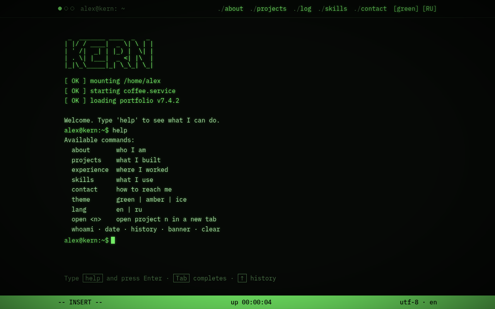
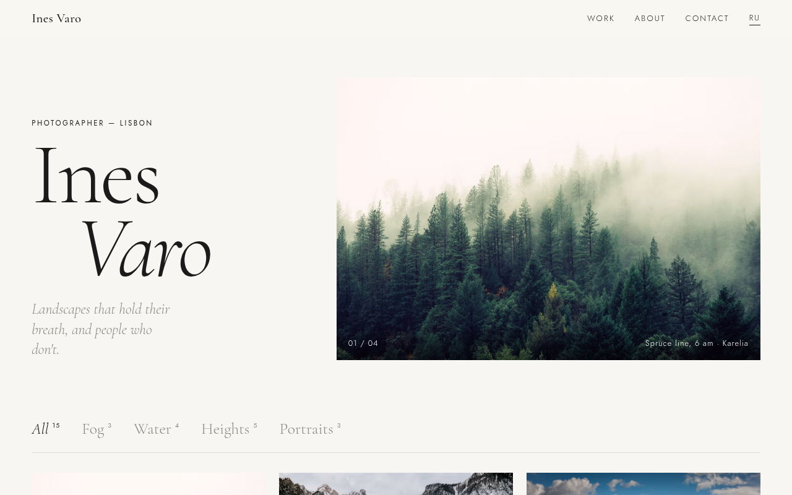
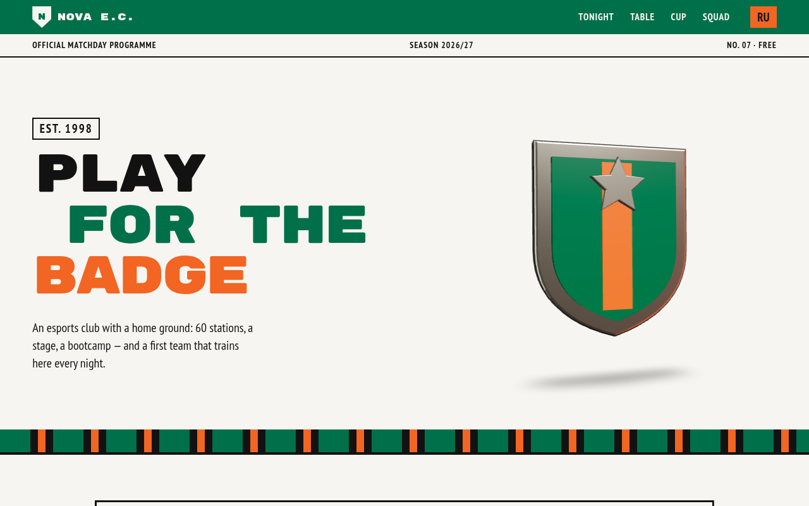
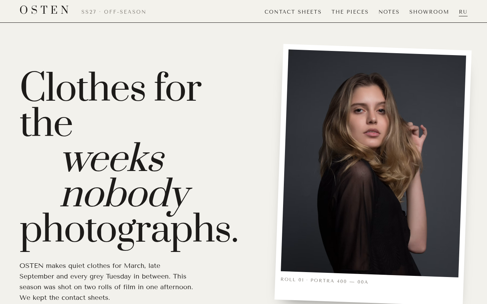
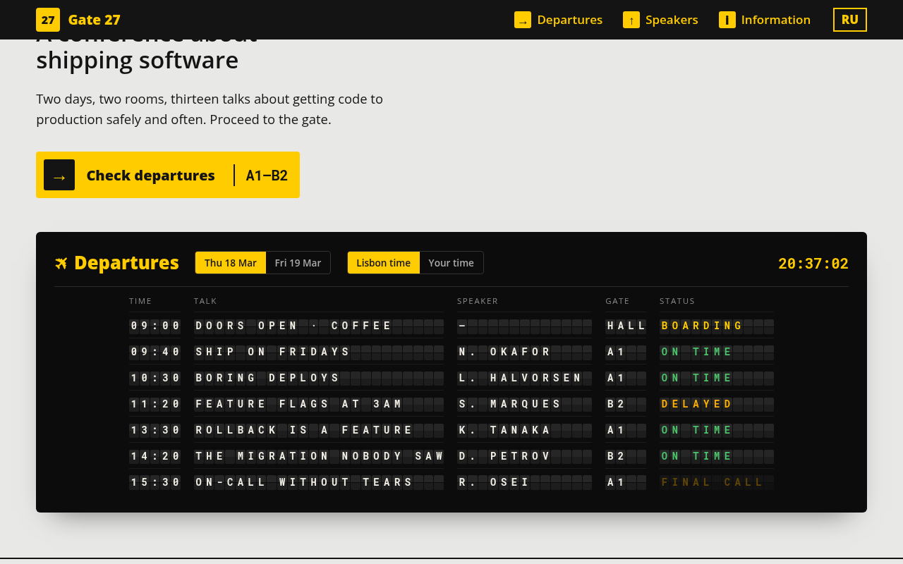

<div align="center">


# vibe-templates

**24 free, open-source website templates built to be remixed by AI.**
Every template has its own look, its own stack and a design contract your coding agent can follow.

[](LICENSE)
[](#catalog)
[](#bilingual)
[](CONTRIBUTING.md)
[](https://github.com/unicorn-rm/vibe-templates/stargazers)

[**Live gallery**](https://unicorn-rm.github.io/vibe-templates/) · [Catalog](#catalog) · [Use with AI](#use-with-ai) · [Русская версия](README.ru.md)

</div>

---

## Why this exists

Most template packs look like the same landing page in different colors. And when you ask an AI to "make it mine", it quietly turns any design into the same average gradient-and-rounded-cards site.

**vibe-templates** fixes both:

- **Really different designs.** A risograph gig poster, a declassified pentest file, a Braun radio you tune, a 19th-century star atlas, an arXiv paper, a split-flap departures board, an 8-bit cartridge box… Each template has its own palette, font pair, graphics and at least one **signature block** you will not find in the others.
- **Different stacks.** Plain HTML, React, Next.js, Vite, Tailwind CSS, Astro, Vue/Nuxt, SvelteKit, Three.js. Pick the one you know, or learn from one you don't.
- **AI-ready by design.** Every template ships with `DESIGN.md` (the visual rules) and `AGENTS.md` (instructions for coding agents), plus a copy-paste prompt. Claude Code, Cursor, Copilot or Codex keep the style instead of flattening it.
- **Tokens, not hard-coded values.** Colors, fonts, radii and spacing live in one place at the top of the styles.
- **Bilingual.** English by default, Russian built in, Cyrillic-ready fonts everywhere.
- **Static and free.** No backend, no accounts, no tracking. MIT license.

## Gallery

<!-- gallery:start -->
<table>
<tr>
<td width="50%" valign="top"><a href="templates/01-swiss-saas/README.md"></a><br /><b>01 · Gridline</b> — Swiss grid<br /><sub>Next.js 16 · Tailwind CSS 4 · TypeScript · <a href="https://unicorn-rm.github.io/vibe-templates/01-swiss-saas/">demo</a></sub></td>
<td width="50%" valign="top"><a href="templates/02-terminal-portfolio/README.md"></a><br /><b>02 · Alex Kern</b> — Retro CRT terminal<br /><sub>HTML · CSS · Vanilla JS · <a href="https://unicorn-rm.github.io/vibe-templates/02-terminal-portfolio/">demo</a></sub></td>
</tr>
<tr>
<td width="50%" valign="top"><a href="templates/03-coffee-editorial/README.md"></a><br /><b>03 · Paper Moon</b> — Warm paper editorial<br /><sub>Astro 7 · Vanilla TS · <a href="https://unicorn-rm.github.io/vibe-templates/03-coffee-editorial/">demo</a></sub></td>
<td width="50%" valign="top"><a href="templates/04-brutalist-architecture/README.md"></a><br /><b>04 · MASSA</b> — Brutalism<br /><sub>HTML · CSS · GSAP + ScrollTrigger · <a href="https://unicorn-rm.github.io/vibe-templates/04-brutalist-architecture/">demo</a></sub></td>
</tr>
<tr>
<td width="50%" valign="top"><a href="templates/05-neon-festival/README.md"></a><br /><b>05 · Neon Bloom</b> — Risograph gig poster<br /><sub>React 19 · Vite · Motion · <a href="https://unicorn-rm.github.io/vibe-templates/05-neon-festival/">demo</a></sub></td>
<td width="50%" valign="top"><a href="templates/06-cyber-security/README.md"></a><br /><b>06 · Bastion</b> — Declassified file<br /><sub>Next.js 16 · Tailwind CSS 4 · TypeScript · <a href="https://unicorn-rm.github.io/vibe-templates/06-cyber-security/">demo</a></sub></td>
</tr>
<tr>
<td width="50%" valign="top"><a href="templates/07-photographer/README.md"></a><br /><b>07 · Ines Varo</b> — Airy minimal<br /><sub>SvelteKit 3 · Svelte 5 · <a href="https://unicorn-rm.github.io/vibe-templates/07-photographer/">demo</a></sub></td>
<td width="50%" valign="top"><a href="templates/08-bakery/README.md"></a><br /><b>08 · Crumb & Co.</b> — Hand-drawn pastel<br /><sub>Tailwind CSS 4 · Alpine.js · Vite · <a href="https://unicorn-rm.github.io/vibe-templates/08-bakery/">demo</a></sub></td>
</tr>
<tr>
<td width="50%" valign="top"><a href="templates/09-esports-club/README.md"></a><br /><b>09 · NOVA E.C.</b> — Football matchday programme<br /><sub>React 19 · Three.js (R3F) · Vite · <a href="https://unicorn-rm.github.io/vibe-templates/09-esports-club/">demo</a></sub></td>
<td width="50%" valign="top"><a href="templates/10-yoga-wellness/README.md"></a><br /><b>10 · Hold Studio</b> — 1960s exercise booklet<br /><sub>Astro 7 · Tailwind CSS 4 · <a href="https://unicorn-rm.github.io/vibe-templates/10-yoga-wellness/">demo</a></sub></td>
</tr>
<tr>
<td width="50%" valign="top"><a href="templates/11-online-course/README.md"></a><br /><b>11 · SQL in 30 Evenings</b> — Squared exercise book, red pen<br /><sub>Vue 3 · Vite · <a href="https://unicorn-rm.github.io/vibe-templates/11-online-course/">demo</a></sub></td>
<td width="50%" valign="top"><a href="templates/12-finance-app/README.md"></a><br /><b>12 · Tally</b> — Accountant's ledger<br /><sub>React 19 · Tailwind CSS 4 · Recharts · Vite · <a href="https://unicorn-rm.github.io/vibe-templates/12-finance-app/">demo</a></sub></td>
</tr>
<tr>
<td width="50%" valign="top"><a href="templates/13-fashion-lookbook/README.md"></a><br /><b>13 · OSTEN</b> — 35mm contact sheet on a light table<br /><sub>Next.js 16 · TypeScript · plain CSS · <a href="https://unicorn-rm.github.io/vibe-templates/13-fashion-lookbook/">demo</a></sub></td>
<td width="50%" valign="top"><a href="templates/14-fine-dining/README.md"></a><br /><b>14 · Ombre</b> — Dark luxury, candlelight<br /><sub>HTML · CSS · GSAP + ScrollTrigger · <a href="https://unicorn-rm.github.io/vibe-templates/14-fine-dining/">demo</a></sub></td>
</tr>
<tr>
<td width="50%" valign="top"><a href="templates/15-eco-nonprofit/README.md"></a><br /><b>15 · Second Growth</b> — Field survey notebook<br /><sub>Astro 7 · <a href="https://unicorn-rm.github.io/vibe-templates/15-eco-nonprofit/">demo</a></sub></td>
<td width="50%" valign="top"><a href="templates/16-oss-docs/README.md"></a><br /><b>16 · Ferry</b> — 1980s printed reference manual<br /><sub>Astro 7 · MDX · <a href="https://unicorn-rm.github.io/vibe-templates/16-oss-docs/">demo</a></sub></td>
</tr>
<tr>
<td width="50%" valign="top"><a href="templates/17-podcast/README.md"></a><br /><b>17 · Long Wave</b> — Braun-era radio receiver<br /><sub>SvelteKit 3 · Svelte 5 · Web Audio · <a href="https://unicorn-rm.github.io/vibe-templates/17-podcast/">demo</a></sub></td>
<td width="50%" valign="top"><a href="templates/18-space-museum/README.md"></a><br /><b>18 · Kepler Hall</b> — Printed star atlas<br /><sub>Vanilla JS · Three.js · Vite · <a href="https://unicorn-rm.github.io/vibe-templates/18-space-museum/">demo</a></sub></td>
</tr>
<tr>
<td width="50%" valign="top"><a href="templates/19-barbershop/README.md"></a><br /><b>19 · Sharp & Sons</b> — Wood-type letterpress broadside<br /><sub>Tailwind CSS 4 · Alpine.js · Vite · <a href="https://unicorn-rm.github.io/vibe-templates/19-barbershop/">demo</a></sub></td>
<td width="50%" valign="top"><a href="templates/20-ai-startup/README.md"></a><br /><b>20 · Tern</b> — arXiv research paper<br /><sub>Next.js 16 · Tailwind CSS 4 · TypeScript · <a href="https://unicorn-rm.github.io/vibe-templates/20-ai-startup/">demo</a></sub></td>
</tr>
<tr>
<td width="50%" valign="top"><a href="templates/21-tech-conference/README.md"></a><br /><b>21 · Gate 27</b> — Airport wayfinding<br /><sub>React 19 · Vite · <a href="https://unicorn-rm.github.io/vibe-templates/21-tech-conference/">demo</a></sub></td>
<td width="50%" valign="top"><a href="templates/22-interior-studio/README.md"></a><br /><b>22 · Atelier Hira</b> — Architect's material sample board<br /><sub>Nuxt 4 · Vue 3 · <a href="https://unicorn-rm.github.io/vibe-templates/22-interior-studio/">demo</a></sub></td>
</tr>
<tr>
<td width="50%" valign="top"><a href="templates/23-blog-newsletter/README.md"></a><br /><b>23 · Marginalia</b> — Pocket paperback<br /><sub>Astro 7 · MDX · <a href="https://unicorn-rm.github.io/vibe-templates/23-blog-newsletter/">demo</a></sub></td>
<td width="50%" valign="top"><a href="templates/24-pixel-game/README.md"></a><br /><b>24 · LAMPLIGHTER</b> — 8-bit cartridge box & manual<br /><sub>Vanilla JS · Canvas · Vite · <a href="https://unicorn-rm.github.io/vibe-templates/24-pixel-game/">demo</a></sub></td>
</tr>
</table>
<!-- gallery:end -->

## Catalog

<!-- catalog:start -->
| # | Template | Style | Stack | Signature block |
|---|---|---|---|---|
| 01 | [**Gridline** · SaaS landing](templates/01-swiss-saas/README.md) | Swiss grid | Next.js 16, Tailwind CSS 4, TypeScript | Bento grid with live mini-demos (typing command palette, burndown, keycaps) + changelog timeline |
| 02 | [**Alex Kern** · Developer portfolio](templates/02-terminal-portfolio/README.md) | Retro CRT terminal | HTML, CSS, Vanilla JS | A working command line: help, projects, theme, lang, history, Tab completion |
| 03 | [**Paper Moon** · Specialty coffee](templates/03-coffee-editorial/README.md) | Warm paper editorial | Astro 7, Vanilla TS | Menu whose rows draw a hand-made line illustration on hover + a working pour-over brew timer |
| 04 | [**MASSA** · Architecture studio](templates/04-brutalist-architecture/README.md) | Brutalism | HTML, CSS, GSAP + ScrollTrigger | Pinned horizontal project scroll with generated isometric massing models — no images at all |
| 05 | [**Neon Bloom** · Music festival](templates/05-neon-festival/README.md) | Risograph gig poster | React 19, Vite, Motion | Two-ink halftone audio visualizer — a live Web Audio synth printed as riso dots, pink and blue off-register |
| 06 | [**Bastion** · Security consultancy](templates/06-cyber-security/README.md) | Declassified file | Next.js 16, Tailwind CSS 4, TypeScript | Redaction bars that declassify on hover + a printed request form that gets rubber-stamped (simulated check, no network) |
| 07 | [**Ines Varo** · Photographer](templates/07-photographer/README.md) | Airy minimal | SvelteKit 3, Svelte 5 | Masonry gallery with series filter and a keyboard/swipe lightbox showing EXIF |
| 08 | [**Crumb & Co.** · Home bakery](templates/08-bakery/README.md) | Hand-drawn pastel | Tailwind CSS 4, Alpine.js, Vite | Chalkboard of today's bake with a live countdown to the next batch + allergen filters |
| 09 | [**NOVA E.C.** · Esports club](templates/09-esports-club/README.md) | Football matchday programme | React 19, Three.js (R3F), Vite | 3D enamel club crest built from extruded shapes (no model files) + clickable cup bracket |
| 10 | [**Hold Studio** · Yoga & wellness](templates/10-yoga-wellness/README.md) | 1960s exercise booklet | Astro 7, Tailwind CSS 4 | Stick-figure pose diagram that morphs between six poses + a 4-4-6 breath counter |
| 11 | [**SQL in 30 Evenings** · Online course](templates/11-online-course/README.md) | Squared exercise book, red pen | Vue 3, Vite | A quiz graded by the teacher's red pen: ticks, crosses, ringed right answers and a circled school mark |
| 12 | [**Tally** · Personal finance app](templates/12-finance-app/README.md) | Accountant's ledger | React 19, Tailwind CSS 4, Recharts, Vite | Savings calculator that writes each year into ledger rows and plots the curve like pen on graph paper |
| 13 | [**OSTEN** · Fashion brand](templates/13-fashion-lookbook/README.md) | 35mm contact sheet on a light table | Next.js 16, TypeScript, plain CSS | Lookbook as film contact sheets: black-and-white frames, grease-pencil circles on selects, crosses on rejects, a round loupe that shows the frame in colour |
| 14 | [**Ombre** · Fine-dining restaurant](templates/14-fine-dining/README.md) | Dark luxury, candlelight | HTML, CSS, GSAP + ScrollTrigger | Pinned tasting menu: a sticky photo and roman numeral change with every course you scroll past |
| 15 | [**Second Growth** · Eco nonprofit](templates/15-eco-nonprofit/README.md) | Field survey notebook | Astro 7 | Tree-ring impact chart: one ring per year, width = trees planted, tap a ring for the numbers |
| 16 | [**Ferry** · Open-source library](templates/16-oss-docs/README.md) | 1980s printed reference manual | Astro 7, MDX | Thumb-index tabs on the page edge that track the chapter you're reading + ⌘K search over the manual |
| 17 | [**Long Wave** · Podcast](templates/17-podcast/README.md) | Braun-era radio receiver | SvelteKit 3, Svelte 5, Web Audio | Episodes are stations on a frequency scale: drag the tuning knob (or use arrow keys) — static between stations, a tone when tuned |
| 18 | [**Kepler Hall** · Space museum](templates/18-space-museum/README.md) | Printed star atlas | Vanilla JS, Three.js, Vite | Draggable 3D celestial sphere drawn as an atlas plate — RA/Dec grid, real constellations; pick one and the sky turns to it |
| 19 | [**Sharp & Sons** · Barbershop / tattoo](templates/19-barbershop/README.md) | Wood-type letterpress broadside | Tailwind CSS 4, Alpine.js, Vite | Woodcut before/after: drag the razor across two hand-drawn profiles (shaggy vs. fresh cut) |
| 20 | [**Tern** · AI startup](templates/20-ai-startup/README.md) | arXiv research paper | Next.js 16, Tailwind CSS 4, TypeScript | Figure 1: the model's answer streams token by token, underlined by confidence; hover a token for alternatives — low confidence triggers an honest 'I don't know' |
| 21 | [**Gate 27** · Tech conference](templates/21-tech-conference/README.md) | Airport wayfinding | React 19, Vite | Schedule as a split-flap departures board: letters flip when you switch day or time zone; statuses like BOARDING and FINAL CALL |
| 22 | [**Atelier Hira** · Interior studio](templates/22-interior-studio/README.md) | Architect's material sample board | Nuxt 4, Vue 3 | Room elevation re-dressed by material schemes: walls, floor, sofa, rug and lamp switch to textured swatches (oak, linen, terrazzo, plaster) |
| 23 | [**Marginalia** · Blog & newsletter](templates/23-blog-newsletter/README.md) | Pocket paperback | Astro 7, MDX | Margin footnotes (sidenotes) that become tap-to-open notes on phones + a page counter ('p. 9 of 18') instead of a progress bar |
| 24 | [**LAMPLIGHTER** · Indie game](templates/24-pixel-game/README.md) | 8-bit cartridge box & manual | Vanilla JS, Canvas, Vite | A playable one-screen 8-bit game on canvas (keyboard + touch pad): light lamps across the rooftops, dodge bats |
<!-- catalog:end -->

## Quick start

```bash
git clone https://github.com/unicorn-rm/vibe-templates.git
cd vibe-templates/templates/01-swiss-saas   # pick any folder
npm install && npm run dev                  # or just open index.html for plain-HTML templates
```

Each template is self-contained: copy its folder into your project and delete the rest.

## Use with AI

1. Copy one template folder into a new repo.
2. Open it in your coding agent.
3. Paste the prompt from the template's README, for example:

```text
You are adapting the "14-fine-dining" template from vibe-templates.
Read DESIGN.md and AGENTS.md in this folder first and keep every rule in DESIGN.md.
My project: a small Georgian wine bar in Tbilisi with a short seasonal menu.
Replace all copy and data with content for my project, in English and Russian.
Keep the layout, the fonts, the signature block and the motion.
Do not add new dependencies. When done, list what you changed.
```

`DESIGN.md` tells the agent *what must not change* (the idea, tokens, rules). `AGENTS.md` tells it *where things live* and what "done" means.

## Bilingual

Every template renders English by default. Switch with the language button or `?lang=ru`. The choice is remembered in `localStorage`. All copy sits in one content file per template, so adding a third language means adding one more object.

## Repository structure

```text
vibe-templates/
├── templates/
│   └── NN-name/
│       ├── README.md · README.ru.md   how to run, blocks, AI prompt
│       ├── DESIGN.md                  visual contract (idea, tokens, rules)
│       ├── AGENTS.md                  instructions for coding agents
│       ├── preview.png
│       └── …source
├── gallery/                           GitHub Pages landing
├── scripts/build-docs.mjs             regenerates docs from templates.json
├── templates.json                     the catalog — single source of truth
└── AGENTS.md                          repo-wide rules for agents
```

## Contributing

New templates, fixes and translations are welcome — read [CONTRIBUTING.md](CONTRIBUTING.md). The short version: one folder, one distinct style, a signature block, EN + RU, tokens, accessibility, no backend.

## License

[MIT](LICENSE) © 2026 unicorn-rm. Fonts are from Google Fonts under the SIL Open Font License. Demo photos (where used) come from Unsplash and are hot-linked; replace them before production.

<sub>Keywords: website templates, free landing page templates, HTML CSS templates, React templates, Next.js templates, Tailwind CSS templates, Astro themes, Vue templates, Svelte templates, Three.js, portfolio template, SaaS landing page, restaurant website template, AI-ready templates, vibe coding, design system, open source.</sub>
