<div align="center">

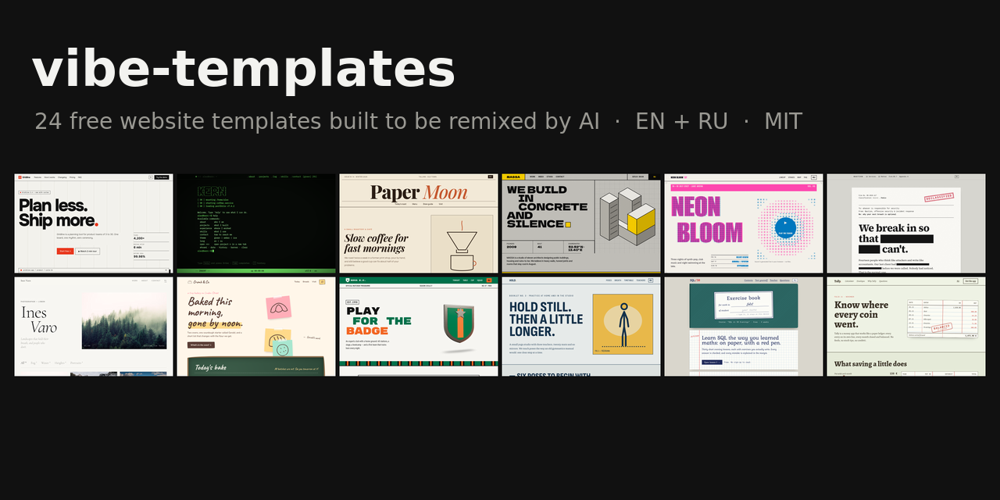

# vibe-templates

**24 бесплатных open-source шаблона сайтов, созданных для доработки с помощью ИИ.**
У каждого шаблона свой вид, свой стек и дизайн-контракт, которому следует ваш ИИ-агент.

[](LICENSE)
[](#каталог)
[](#два-языка)
[](CONTRIBUTING.md)
[](https://github.com/unicorn-rm/vibe-templates/stargazers)

[**Живая галерея**](https://unicorn-rm.github.io/vibe-templates/) · [Каталог](#каталог) · [Работа с ИИ](#работа-с-ии) · [English](README.md)

</div>

---

## Зачем это

Большинство наборов шаблонов — один и тот же лендинг в разных цветах. А когда просишь ИИ «сделать под меня», он тихо превращает любой дизайн в усреднённый сайт с градиентами и скруглёнными карточками.

**vibe-templates** решает обе проблемы:

- **Действительно разные дизайны.** Швейцарская сетка, ЭЛТ-терминал, хром Y2K, роскошь при свечах, брутализм, Japandi, 8 бит… У каждого шаблона своя палитра, своя пара шрифтов, своя графика и хотя бы один **фирменный блок**, которого нет в остальных.
- **Разные стеки.** Чистый HTML, React, Next.js, Vite, Tailwind CSS, Astro, Vue/Nuxt, SvelteKit, Three.js. Берите знакомый или учитесь на незнакомом.
- **Готовы к ИИ.** В каждом шаблоне есть `DESIGN.md` (визуальные правила), `AGENTS.md` (инструкции для агентов) и готовый промпт. Claude Code, Cursor, Copilot или Codex сохраняют стиль, а не размывают его.
- **Токены вместо захардкоженных значений.** Цвета, шрифты, скругления и отступы собраны в одном месте вверху стилей.
- **Два языка.** Английский по умолчанию, русский встроен, все шрифты с кириллицей.
- **Статика и бесплатно.** Без бэкенда, аккаунтов и трекинга. Лицензия MIT.

## Галерея

<!-- gallery:start -->
<table>
<tr>
<td width="50%" valign="top"><a href="templates/01-swiss-saas/README.ru.md">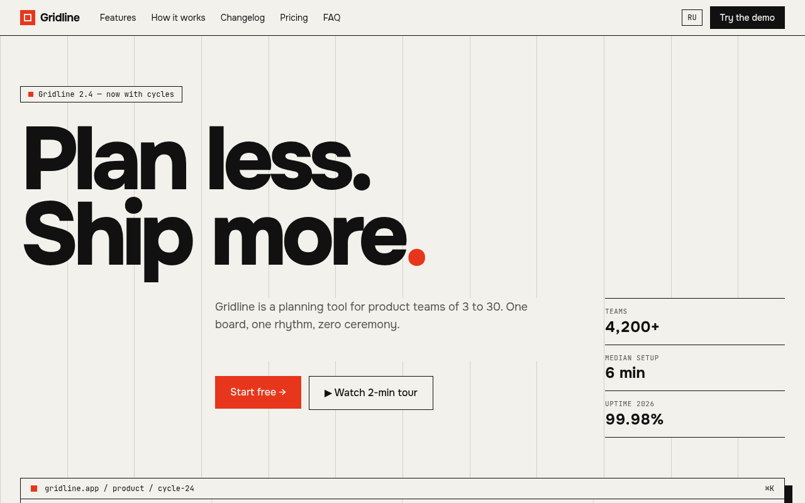</a><br /><b>01 · Gridline</b> — Швейцарская сетка<br /><sub>Next.js 16 · Tailwind CSS 4 · TypeScript · <a href="https://unicorn-rm.github.io/vibe-templates/01-swiss-saas/">demo</a></sub></td>
<td width="50%" valign="top"><a href="templates/02-terminal-portfolio/README.ru.md">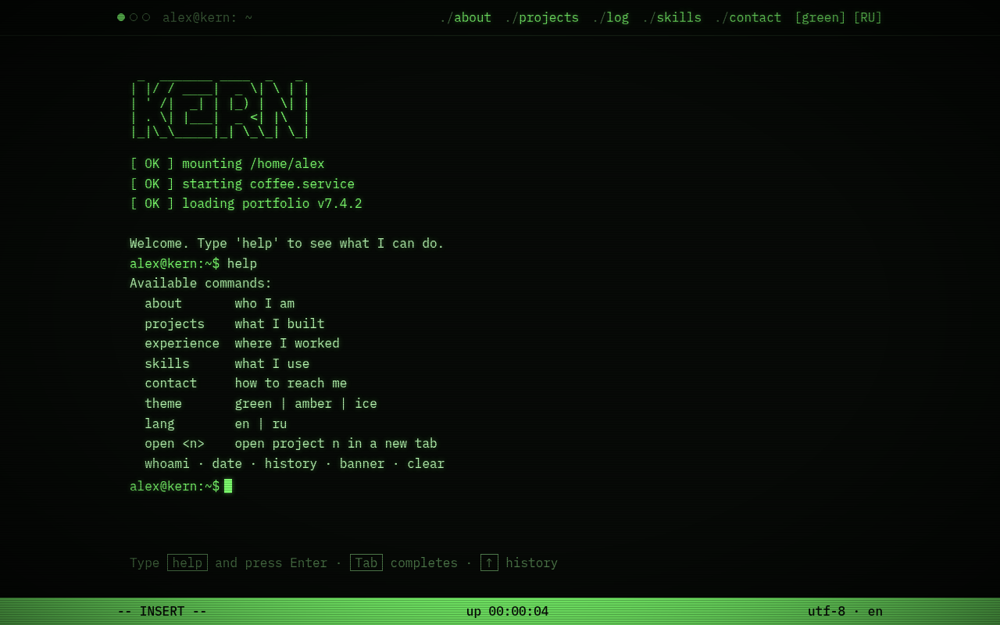</a><br /><b>02 · Alex Kern</b> — Ретро-терминал<br /><sub>HTML · CSS · Vanilla JS · <a href="https://unicorn-rm.github.io/vibe-templates/02-terminal-portfolio/">demo</a></sub></td>
</tr>
<tr>
<td width="50%" valign="top"><a href="templates/03-coffee-editorial/README.ru.md">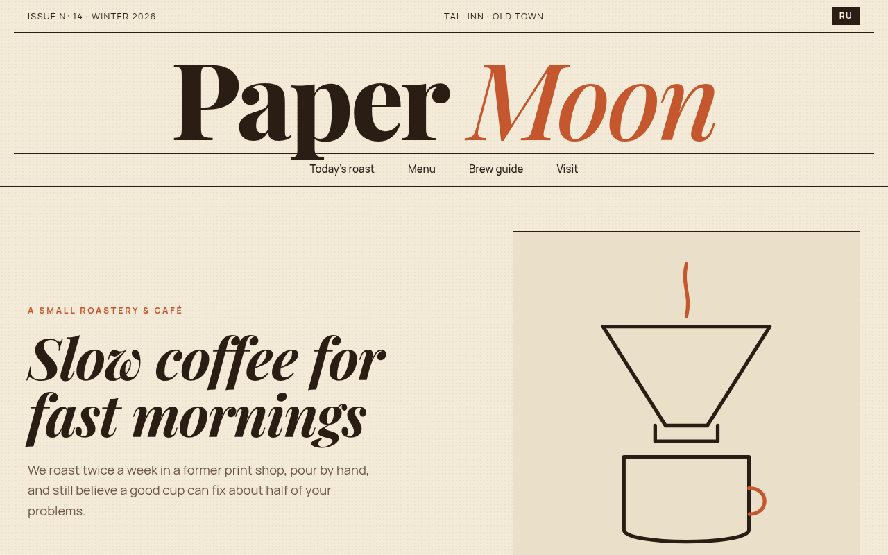</a><br /><b>03 · Paper Moon</b> — Тёплая бумага, editorial<br /><sub>Astro 7 · Vanilla TS · <a href="https://unicorn-rm.github.io/vibe-templates/03-coffee-editorial/">demo</a></sub></td>
<td width="50%" valign="top"><a href="templates/04-brutalist-architecture/README.ru.md">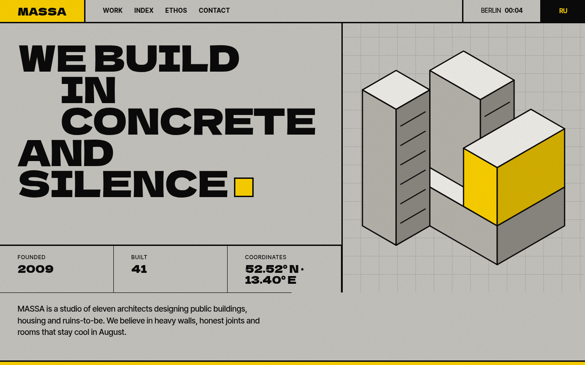</a><br /><b>04 · MASSA</b> — Брутализм<br /><sub>HTML · CSS · GSAP + ScrollTrigger · <a href="https://unicorn-rm.github.io/vibe-templates/04-brutalist-architecture/">demo</a></sub></td>
</tr>
<tr>
<td width="50%" valign="top"><a href="templates/05-neon-festival/README.ru.md">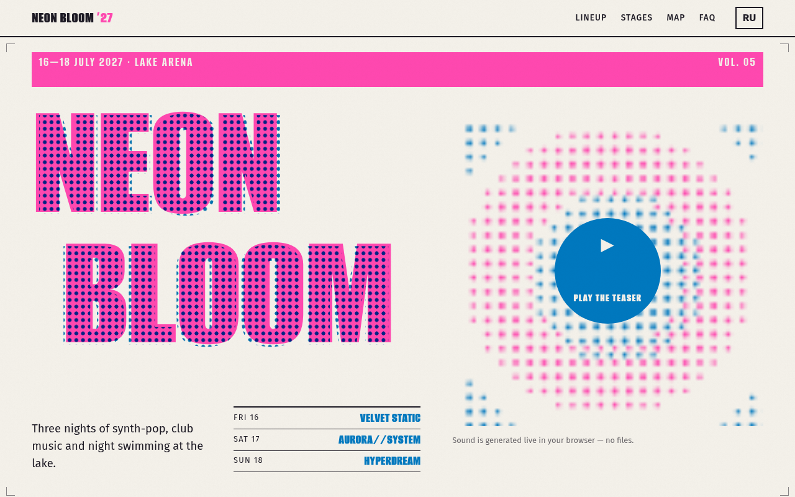</a><br /><b>05 · Neon Bloom</b> — Ризограф-афиша<br /><sub>React 19 · Vite · Motion · <a href="https://unicorn-rm.github.io/vibe-templates/05-neon-festival/">demo</a></sub></td>
<td width="50%" valign="top"><a href="templates/06-cyber-security/README.ru.md">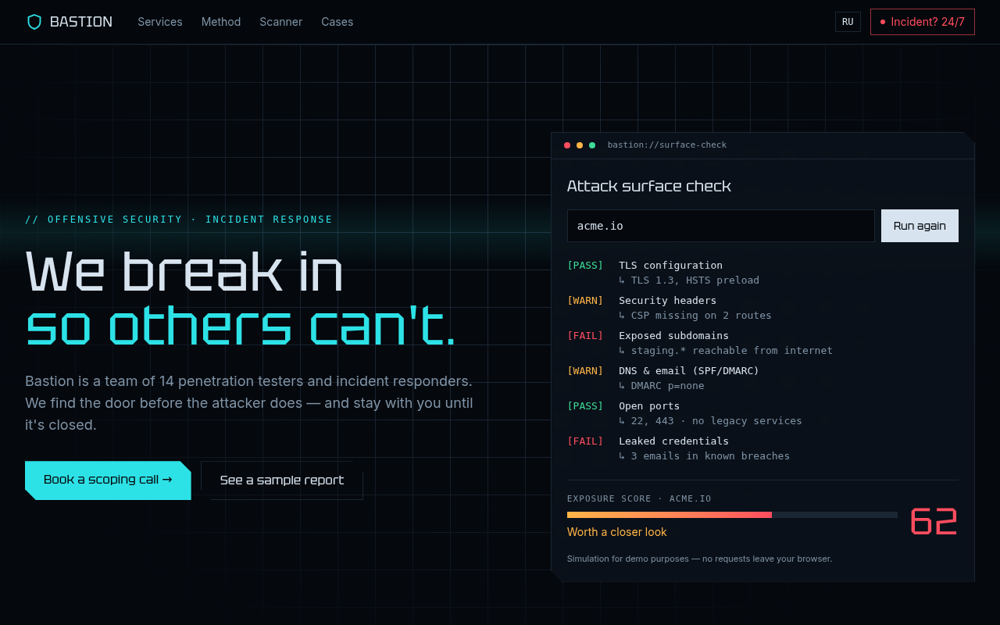</a><br /><b>06 · Bastion</b> — Рассекреченное досье<br /><sub>Next.js 16 · Tailwind CSS 4 · TypeScript · <a href="https://unicorn-rm.github.io/vibe-templates/06-cyber-security/">demo</a></sub></td>
</tr>
<tr>
<td width="50%" valign="top"><a href="templates/07-photographer/README.ru.md">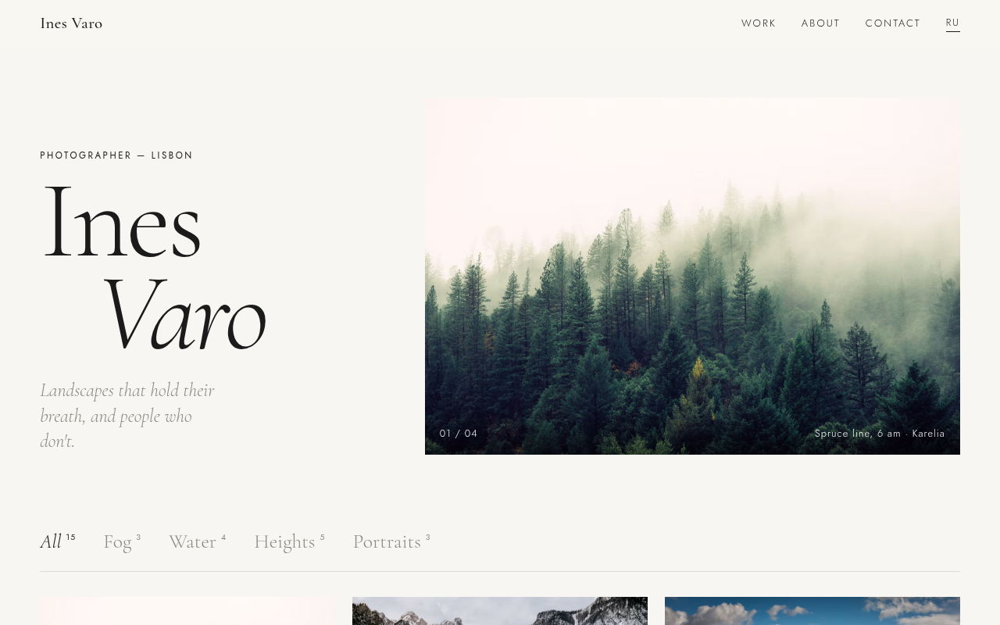</a><br /><b>07 · Ines Varo</b> — Воздушный минимализм<br /><sub>SvelteKit 3 · Svelte 5 · <a href="https://unicorn-rm.github.io/vibe-templates/07-photographer/">demo</a></sub></td>
<td width="50%" valign="top"><a href="templates/08-bakery/README.ru.md">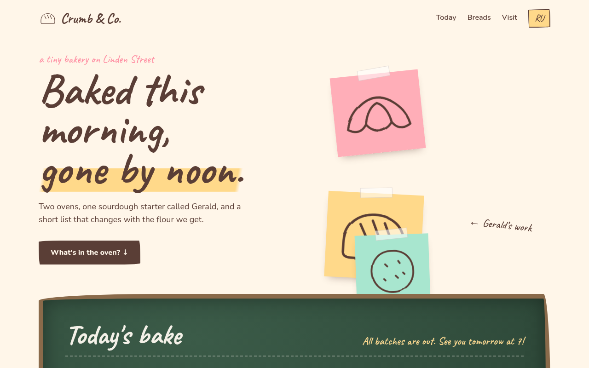</a><br /><b>08 · Crumb & Co.</b> — Рисованная пастель<br /><sub>Tailwind CSS 4 · Alpine.js · Vite · <a href="https://unicorn-rm.github.io/vibe-templates/08-bakery/">demo</a></sub></td>
</tr>
<tr>
<td width="50%" valign="top"><a href="templates/09-esports-club/README.ru.md">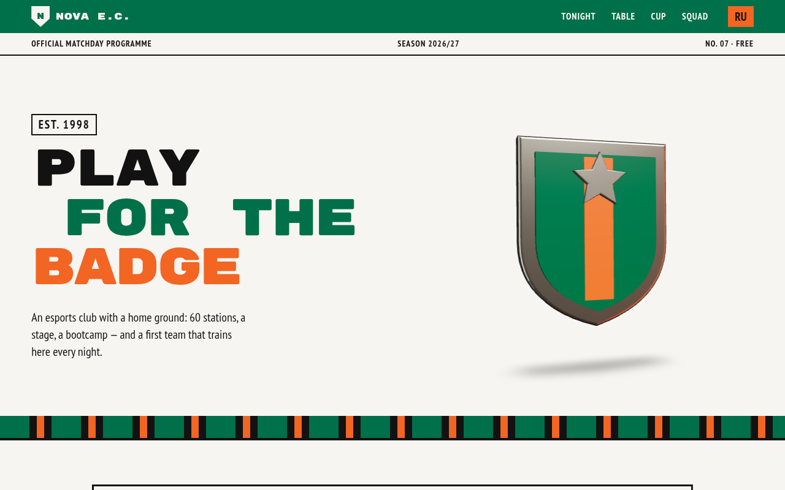</a><br /><b>09 · NOVA E.C.</b> — Программка футбольного матча<br /><sub>React 19 · Three.js (R3F) · Vite · <a href="https://unicorn-rm.github.io/vibe-templates/09-esports-club/">demo</a></sub></td>
<td width="50%" valign="top"><a href="templates/10-yoga-wellness/README.ru.md">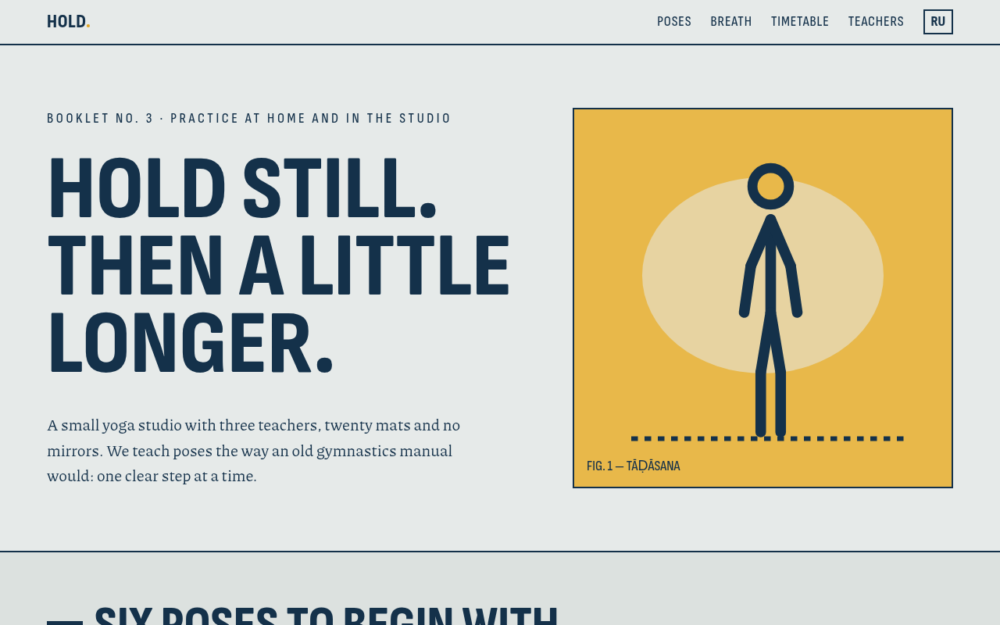</a><br /><b>10 · Hold Studio</b> — Гимнастическая брошюра 1960-х<br /><sub>Astro 7 · Tailwind CSS 4 · <a href="https://unicorn-rm.github.io/vibe-templates/10-yoga-wellness/">demo</a></sub></td>
</tr>
<tr>
<td width="50%" valign="top"><a href="templates/11-online-course/README.ru.md">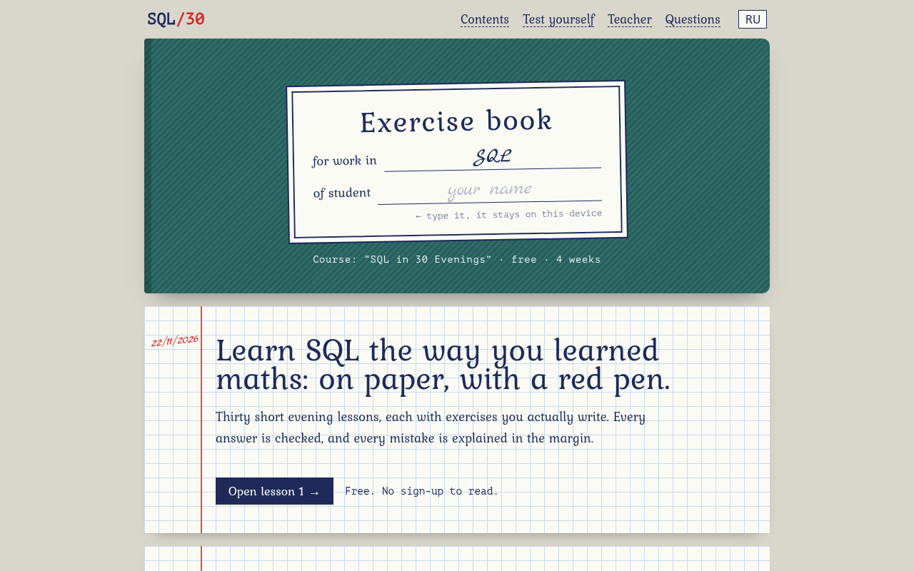</a><br /><b>11 · SQL in 30 Evenings</b> — Тетрадь в клетку, красная ручка<br /><sub>Vue 3 · Vite · <a href="https://unicorn-rm.github.io/vibe-templates/11-online-course/">demo</a></sub></td>
<td width="50%" valign="top"><a href="templates/12-finance-app/README.ru.md">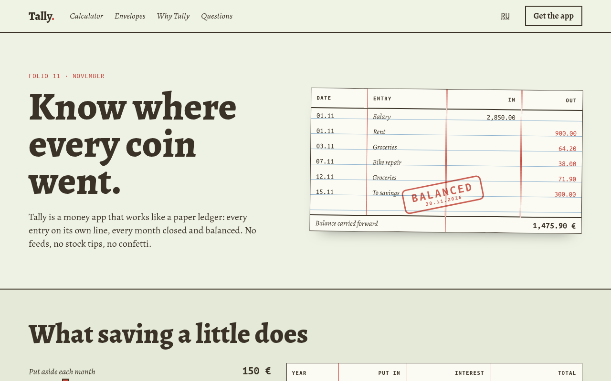</a><br /><b>12 · Tally</b> — Бухгалтерская книга<br /><sub>React 19 · Tailwind CSS 4 · Recharts · Vite · <a href="https://unicorn-rm.github.io/vibe-templates/12-finance-app/">demo</a></sub></td>
</tr>
<tr>
<td width="50%" valign="top"><a href="templates/13-fashion-lookbook/README.ru.md">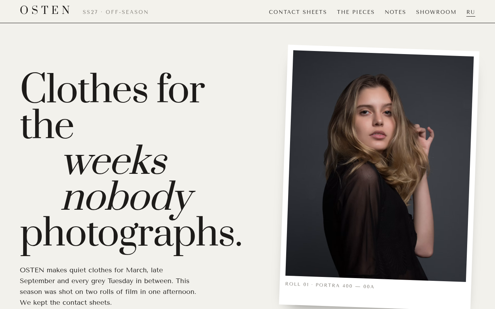</a><br /><b>13 · OSTEN</b> — Контактный лист 35 мм на световом столе<br /><sub>Next.js 16 · TypeScript · plain CSS · <a href="https://unicorn-rm.github.io/vibe-templates/13-fashion-lookbook/">demo</a></sub></td>
<td width="50%" valign="top"><a href="templates/14-fine-dining/README.ru.md">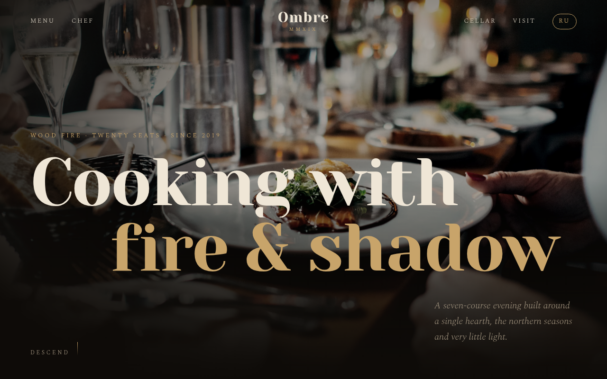</a><br /><b>14 · Ombre</b> — Тёмная роскошь, свет свечи<br /><sub>HTML · CSS · GSAP + ScrollTrigger · <a href="https://unicorn-rm.github.io/vibe-templates/14-fine-dining/">demo</a></sub></td>
</tr>
<tr>
<td width="50%" valign="top"><a href="templates/15-eco-nonprofit/README.ru.md">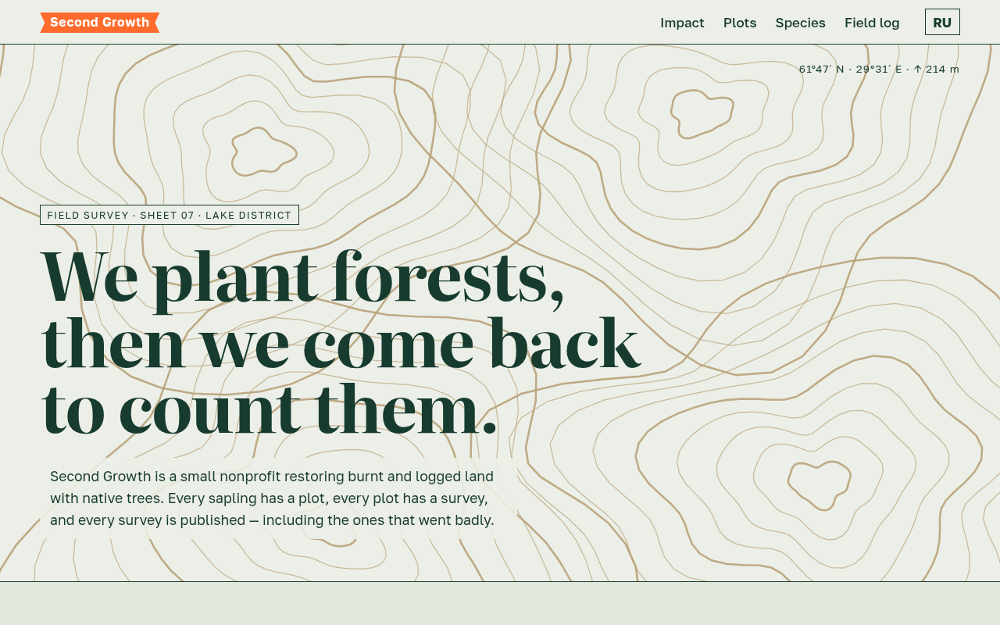</a><br /><b>15 · Second Growth</b> — Полевой дневник<br /><sub>Astro 7 · <a href="https://unicorn-rm.github.io/vibe-templates/15-eco-nonprofit/">demo</a></sub></td>
<td width="50%" valign="top"><a href="templates/16-oss-docs/README.ru.md">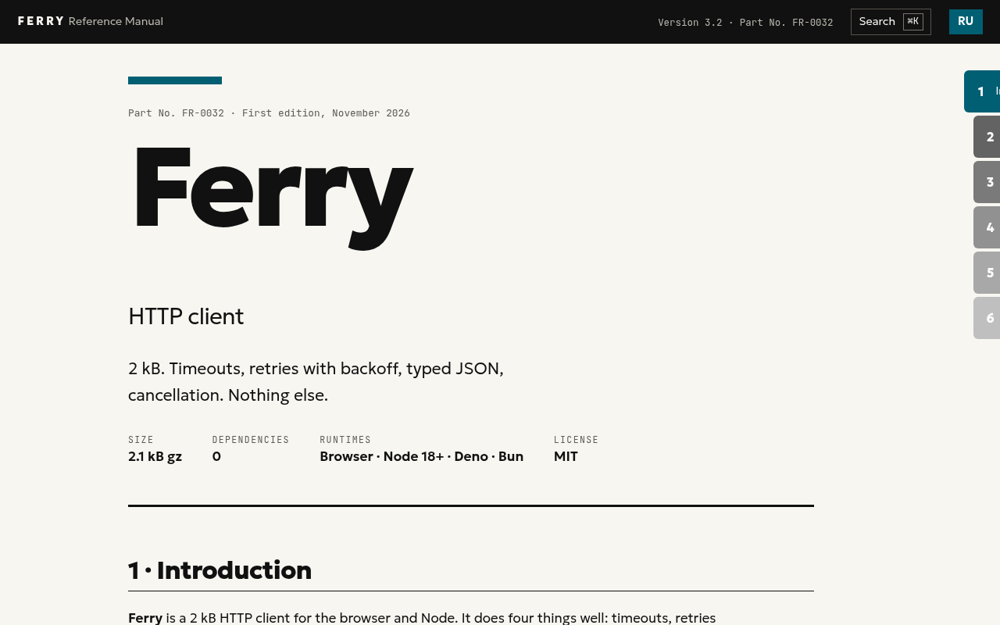</a><br /><b>16 · Ferry</b> — Печатный справочник 1980-х<br /><sub>Astro 7 · MDX · <a href="https://unicorn-rm.github.io/vibe-templates/16-oss-docs/">demo</a></sub></td>
</tr>
</table>
<!-- gallery:end -->

## Каталог

<!-- catalog:start -->
| # | Шаблон | Стиль | Стек | Фирменный блок |
|---|---|---|---|---|
| 01 | [**Gridline** · Лендинг SaaS](templates/01-swiss-saas/README.ru.md) | Швейцарская сетка | Next.js 16, Tailwind CSS 4, TypeScript | Bento-сетка с живыми мини-демо (палитра команд с печатью, график сгорания, клавиши) + таймлайн изменений |
| 02 | [**Alex Kern** · Портфолио разработчика](templates/02-terminal-portfolio/README.ru.md) | Ретро-терминал | HTML, CSS, Vanilla JS | Рабочая командная строка: help, projects, theme, lang, history, автодополнение по Tab |
| 03 | [**Paper Moon** · Спешелти-кофейня](templates/03-coffee-editorial/README.ru.md) | Тёплая бумага, editorial | Astro 7, Vanilla TS | Меню, строки которого рисуют линейную иллюстрацию при наведении, + рабочий таймер заваривания пуровера |
| 04 | [**MASSA** · Архитектурное бюро](templates/04-brutalist-architecture/README.ru.md) | Брутализм | HTML, CSS, GSAP + ScrollTrigger | Закреплённая горизонтальная прокрутка проектов с генерируемыми изометрическими моделями зданий — без единой картинки |
| 05 | [**Neon Bloom** · Музыкальный фестиваль](templates/05-neon-festival/README.ru.md) | Ризограф-афиша | React 19, Vite, Motion | Двухкрасочный растровый визуализатор звука — живой синтезатор Web Audio, отпечатанный ризо-точками розовым и синим со сдвигом |
| 06 | [**Bastion** · ИБ-консалтинг](templates/06-cyber-security/README.ru.md) | Рассекреченное досье | Next.js 16, Tailwind CSS 4, TypeScript | Плашки цензуры, которые снимаются при наведении, + бумажный бланк-заявка, на который ставится штамп (симуляция, без сети) |
| 07 | [**Ines Varo** · Фотограф](templates/07-photographer/README.ru.md) | Воздушный минимализм | SvelteKit 3, Svelte 5 | Masonry-галерея с фильтром серий и лайтбоксом (клавиатура/свайп) с данными EXIF |
| 08 | [**Crumb & Co.** · Домашняя пекарня](templates/08-bakery/README.ru.md) | Рисованная пастель | Tailwind CSS 4, Alpine.js, Vite | Меловая доска «сегодня в печи» с живым отсчётом до следующей партии + фильтр по аллергенам |
| 09 | [**NOVA E.C.** · Киберспорт-клуб](templates/09-esports-club/README.ru.md) | Программка футбольного матча | React 19, Three.js (R3F), Vite | 3D-эмалевый герб клуба из выдавленных фигур (без файлов моделей) + кликабельная сетка кубка |
| 10 | [**Hold Studio** · Йога и велнес](templates/10-yoga-wellness/README.ru.md) | Гимнастическая брошюра 1960-х | Astro 7, Tailwind CSS 4 | Схема-человечек, плавно перетекающий между шестью позами, + дыхательный счётчик 4-4-6 |
| 11 | [**SQL in 30 Evenings** · Онлайн-курс](templates/11-online-course/README.ru.md) | Тетрадь в клетку, красная ручка | Vue 3, Vite | Квиз, который проверяет красная ручка учителя: галочки, крестики, обведённый верный ответ и оценка в кружке |
| 12 | [**Tally** · Приложение финансов](templates/12-finance-app/README.ru.md) | Бухгалтерская книга | React 19, Tailwind CSS 4, Recharts, Vite | Калькулятор накоплений, который вписывает каждый год строкой в книгу и чертит кривую, как пером на миллиметровке |
| 13 | [**OSTEN** · Модный бренд](templates/13-fashion-lookbook/README.ru.md) | Контактный лист 35 мм на световом столе | Next.js 16, TypeScript, plain CSS | Лукбук как контактные листы плёнки: чёрно-белые кадры, круги жирным карандашом на отобранных, крестики на отбракованных и круглая лупа, показывающая кадр в цвете |
| 14 | [**Ombre** · Ресторан высокой кухни](templates/14-fine-dining/README.ru.md) | Тёмная роскошь, свет свечи | HTML, CSS, GSAP + ScrollTrigger | Закреплённое дегустационное меню: фото и римская цифра меняются на каждом блюде при прокрутке |
| 15 | [**Second Growth** · Эко-НКО](templates/15-eco-nonprofit/README.ru.md) | Полевой дневник | Astro 7 | Годовые кольца как отчёт: одно кольцо на год, ширина — число посаженных деревьев, нажмите на кольцо, чтобы увидеть цифры |
| 16 | [**Ferry** · Open-source библиотека](templates/16-oss-docs/README.ru.md) | Печатный справочник 1980-х | Astro 7, MDX | Вырубные закладки-индексы по краю страницы, отслеживающие текущую главу, + поиск по ⌘K |
| 17 | Подкаст <sub>скоро</sub> | Крупные цветные плашки | SvelteKit | — |
| 18 | Музей космоса <sub>скоро</sub> | WebGL, звёздное небо | HTML, Three.js | — |
| 19 | Барбершоп / тату <sub>скоро</sub> | Винтажный плакат | Tailwind CSS, Alpine.js | — |
| 20 | ИИ-стартап <sub>скоро</sub> | Шейдерный градиент | Next.js, Tailwind CSS | — |
| 21 | IT-конференция <sub>скоро</sub> | Кислотная плакатная сетка | React, Vite | — |
| 22 | Студия интерьеров <sub>скоро</sub> | Japandi | Nuxt 3 | — |
| 23 | Блог и рассылка <sub>скоро</sub> | Для чтения | Astro, MDX | — |
| 24 | Инди-игра <sub>скоро</sub> | Пиксель-арт, 8 бит | HTML, Canvas | — |
<!-- catalog:end -->

## Быстрый старт

```bash
git clone https://github.com/unicorn-rm/vibe-templates.git
cd vibe-templates/templates/01-swiss-saas   # любая папка
npm install && npm run dev                  # для шаблонов на чистом HTML просто откройте index.html
```

Каждый шаблон самодостаточен: скопируйте его папку в свой проект, остальное удалите.

## Работа с ИИ

1. Скопируйте папку шаблона в новый репозиторий.
2. Откройте её в своём ИИ-агенте.
3. Вставьте промпт из README шаблона, например:

```text
Ты адаптируешь шаблон "14-fine-dining" из vibe-templates.
Сначала прочитай DESIGN.md и AGENTS.md в этой папке и соблюдай все правила из DESIGN.md.
Мой проект: небольшой грузинский винный бар в Тбилиси с коротким сезонным меню.
Замени весь текст и данные на контент моего проекта, на английском и русском.
Сохрани сетку, шрифты, фирменный блок и анимации.
Не добавляй новые зависимости. В конце перечисли, что изменил.
```

`DESIGN.md` говорит агенту, *что нельзя менять* (идея, токены, правила). `AGENTS.md` — *где что лежит* и что считается готовым результатом.

## Два языка

По умолчанию шаблоны на английском. Переключение — кнопкой языка или `?lang=ru`, выбор запоминается в `localStorage`. Весь текст лежит в одном файле контента на шаблон, поэтому третий язык — это ещё один объект.

## Структура репозитория

```text
vibe-templates/
├── templates/
│   └── NN-name/
│       ├── README.md · README.ru.md   запуск, блоки, промпт для ИИ
│       ├── DESIGN.md                  визуальный контракт (идея, токены, правила)
│       ├── AGENTS.md                  инструкции для ИИ-агентов
│       ├── preview.png
│       └── …исходники
├── gallery/                           лендинг для GitHub Pages
├── scripts/build-docs.mjs             пересобирает документацию из templates.json
├── templates.json                     каталог — единый источник правды
└── AGENTS.md                          общие правила для агентов
```

## Участие

Новые шаблоны, исправления и переводы приветствуются — см. [CONTRIBUTING.md](CONTRIBUTING.md). Коротко: одна папка, свой стиль, фирменный блок, EN + RU, токены, доступность, без бэкенда.

## Лицензия

[MIT](LICENSE) © 2026 unicorn-rm. Шрифты — Google Fonts по лицензии SIL Open Font License. Демо-фото (где есть) — с Unsplash, подключены ссылками; замените их перед продакшеном.
