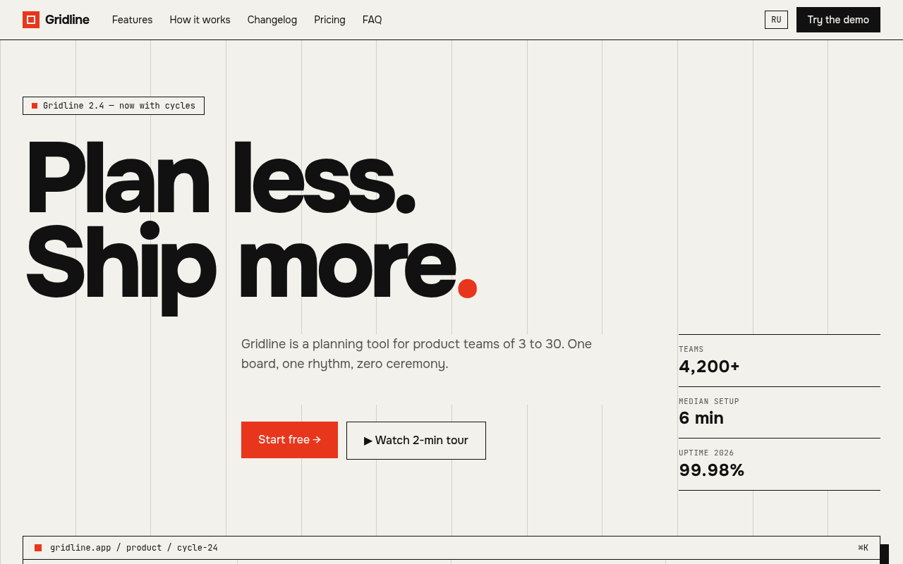

<!-- generated by scripts/build-docs.mjs from templates.json — edit there -->
# 01 · Gridline — SaaS landing

[Русская версия](README.ru.md) · [Live demo](https://unicorn-rm.github.io/vibe-templates/01-swiss-saas/) · [All templates](../../README.md)



- **Style:** Swiss grid
- **Stack:** Next.js 16 · Tailwind CSS 4 · TypeScript
- **Fonts:** [Onest](https://fonts.google.com/specimen/Onest), [JetBrains Mono](https://fonts.google.com/specimen/JetBrains+Mono) (Latin + Cyrillic)
- **Signature block:** Bento grid with live mini-demos (typing command palette, burndown, keycaps) + changelog timeline

## Run it

```bash
npm install
npm run dev
npm run build   # static export to ./out
```

## Blocks inside

- sticky header
- hero with stats
- product board mock
- logo strip
- bento features
- numbered steps
- stats band
- changelog
- pricing toggle
- FAQ (details)
- CTA band
- footer

## Where things live

| File | What to edit there |
|---|---|
| `lib/content.ts` | all copy (EN + RU), board issues, logos |
| `app/page.tsx` | every section as a small component |
| `app/globals.css` | design tokens in Tailwind `@theme` |
| `app/layout.tsx` | fonts and metadata |

The page speaks English by default. Russian: the language button, or `?lang=ru`.

## Make it yours with AI

Open this folder in Claude Code, Cursor, Copilot or any coding agent and paste:

```text
You are adapting the "01-swiss-saas" template from vibe-templates.
Read DESIGN.md and AGENTS.md in this folder first and keep every rule in DESIGN.md.
My project: <what it is, who it is for, 2–3 sentences>.
Replace all copy and data in lib/content.ts with content for my project, in English and Russian.
Keep the layout, the fonts, the signature block and the motion. You may change the palette tokens only if you keep the same number of accents and contrast of at least 4.5:1 for body text.
Do not add new dependencies. When done, list what you changed.
```

Design rules the agent must keep are in [DESIGN.md](DESIGN.md).

## License

MIT — use it for anything, credit appreciated. 
