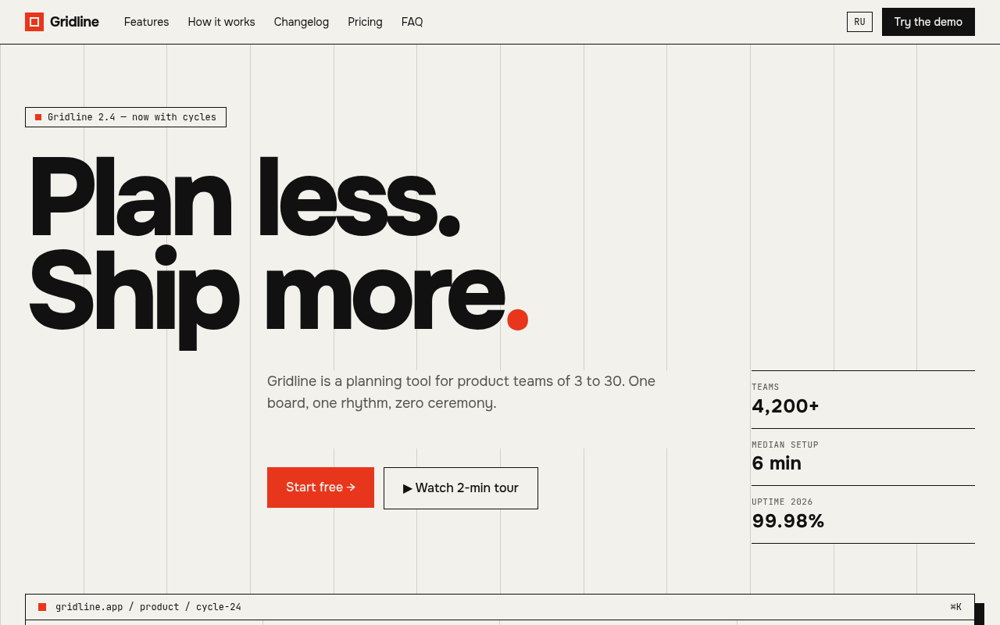

<!-- generated by scripts/build-docs.mjs from templates.json — edit there -->
# 01 · Gridline — Лендинг SaaS

[English version](README.md) · [Демо](https://unicorn-rm.github.io/vibe-templates/01-swiss-saas/) · [Все шаблоны](../../README.ru.md)



- **Стиль:** Швейцарская сетка
- **Стек:** Next.js 16 · Tailwind CSS 4 · TypeScript
- **Шрифты:** [Onest](https://fonts.google.com/specimen/Onest), [JetBrains Mono](https://fonts.google.com/specimen/JetBrains+Mono) (латиница + кириллица)
- **Фирменный блок:** Bento-сетка с живыми мини-демо (палитра команд с печатью, график сгорания, клавиши) + таймлайн изменений

## Запуск

```bash
npm install
npm run dev
npm run build   # static export to ./out
```

## Какие блоки внутри

- sticky header
- hero with stats
- product board mock
- logo strip
- bento features
- numbered steps
- stats band
- changelog
- pricing toggle
- FAQ (details)
- CTA band
- footer

## Где что лежит

| Файл | Что там менять |
|---|---|
| `lib/content.ts` | all copy (EN + RU), board issues, logos |
| `app/page.tsx` | every section as a small component |
| `app/globals.css` | design tokens in Tailwind `@theme` |
| `app/layout.tsx` | fonts and metadata |

По умолчанию страница на английском. Русский — кнопкой языка или `?lang=ru`.

## Переделать под себя с ИИ

Откройте эту папку в Claude Code, Cursor, Copilot или другом агенте и вставьте:

```text
Ты адаптируешь шаблон "01-swiss-saas" из vibe-templates.
Сначала прочитай DESIGN.md и AGENTS.md в этой папке и соблюдай все правила из DESIGN.md.
Мой проект: <что это, для кого, 2–3 предложения>.
Замени весь текст и данные в lib/content.ts на контент моего проекта, на английском и русском.
Сохрани сетку, шрифты, фирменный блок и анимации. Палитру можно менять только в токенах, сохранив число акцентов и контраст текста не ниже 4.5:1.
Не добавляй новые зависимости. В конце перечисли, что изменил.
```

Правила дизайна, которые агент должен сохранить, — в [DESIGN.md](DESIGN.md).

## Лицензия

MIT — используйте как угодно, ссылка на репозиторий приветствуется. 
