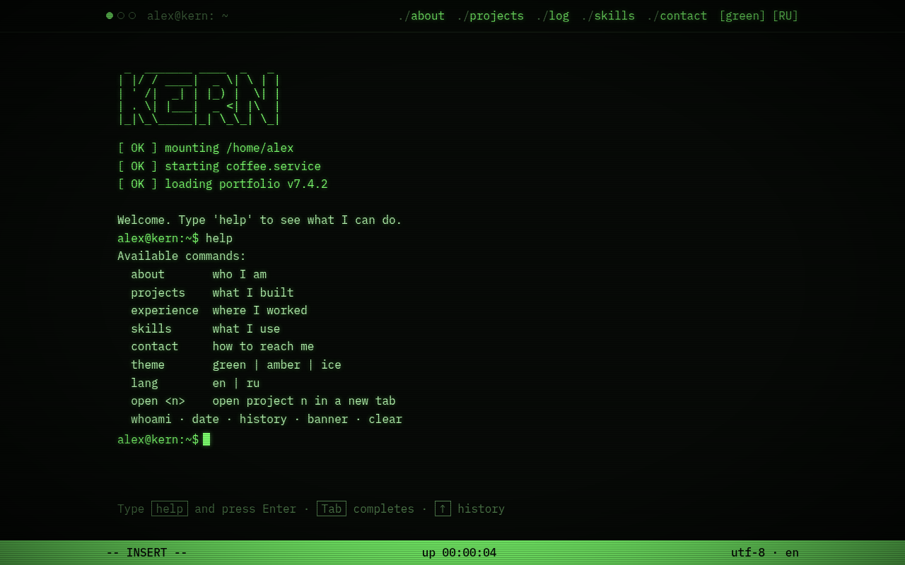

<!-- generated by scripts/build-docs.mjs from templates.json — edit there -->
# 02 · Alex Kern — Developer portfolio

[Русская версия](README.ru.md) · [Live demo](https://unicorn-rm.github.io/vibe-templates/02-terminal-portfolio/) · [All templates](../../README.md)



- **Style:** Retro CRT terminal
- **Stack:** HTML · CSS · Vanilla JS
- **Fonts:** [IBM Plex Mono](https://fonts.google.com/specimen/IBM+Plex+Mono) (Latin + Cyrillic)
- **Signature block:** A working command line: help, projects, theme, lang, history, Tab completion

## Run it

```bash
open index.html   # or any static server: npx serve .
```

## Blocks inside

- window title bar
- boot sequence
- interactive terminal
- man-page about
- ls -la project list with README drawers
- git log career timeline
- htop skill meters
- keyboard contact links
- vim status bar footer

## Where things live

| File | What to edit there |
|---|---|
| `content.js` | all copy (EN + RU), projects, career log, skills, command output |
| `main.js` | terminal engine, renderers, language/theme switch |
| `styles.css` | tokens + themes at the top |
| `index.html` | page skeleton |

The page speaks English by default. Russian: the language button, or `?lang=ru`.

## Make it yours with AI

Open this folder in Claude Code, Cursor, Copilot or any coding agent and paste:

```text
You are adapting the "02-terminal-portfolio" template from vibe-templates.
Read DESIGN.md and AGENTS.md in this folder first and keep every rule in DESIGN.md.
My project: <what it is, who it is for, 2–3 sentences>.
Replace all copy and data in content.js with content for my project, in English and Russian.
Keep the layout, the fonts, the signature block and the motion. You may change the palette tokens only if you keep the same number of accents and contrast of at least 4.5:1 for body text.
Do not add new dependencies. When done, list what you changed.
```

Design rules the agent must keep are in [DESIGN.md](DESIGN.md).

## License

MIT — use it for anything, credit appreciated. 
