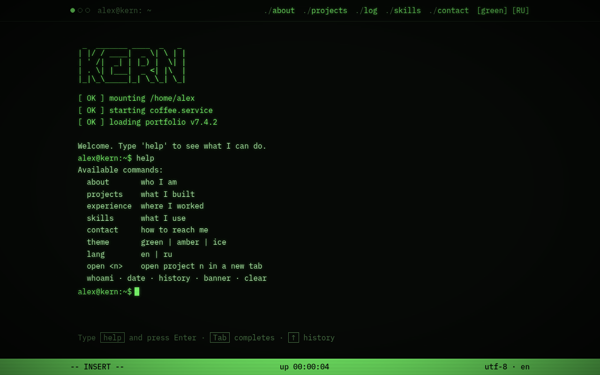

<!-- generated by scripts/build-docs.mjs from templates.json — edit there -->
# 02 · Alex Kern — Портфолио разработчика

[English version](README.md) · [Демо](https://unicorn-rm.github.io/vibe-templates/02-terminal-portfolio/) · [Все шаблоны](../../README.ru.md)



- **Стиль:** Ретро-терминал
- **Стек:** HTML · CSS · Vanilla JS
- **Шрифты:** [IBM Plex Mono](https://fonts.google.com/specimen/IBM+Plex+Mono) (латиница + кириллица)
- **Фирменный блок:** Рабочая командная строка: help, projects, theme, lang, history, автодополнение по Tab

## Запуск

```bash
open index.html   # or any static server: npx serve .
```

## Какие блоки внутри

- window title bar
- boot sequence
- interactive terminal
- man-page about
- ls -la project list with README drawers
- git log career timeline
- htop skill meters
- keyboard contact links
- vim status bar footer

## Где что лежит

| Файл | Что там менять |
|---|---|
| `content.js` | all copy (EN + RU), projects, career log, skills, command output |
| `main.js` | terminal engine, renderers, language/theme switch |
| `styles.css` | tokens + themes at the top |
| `index.html` | page skeleton |

По умолчанию страница на английском. Русский — кнопкой языка или `?lang=ru`.

## Переделать под себя с ИИ

Откройте эту папку в Claude Code, Cursor, Copilot или другом агенте и вставьте:

```text
Ты адаптируешь шаблон "02-terminal-portfolio" из vibe-templates.
Сначала прочитай DESIGN.md и AGENTS.md в этой папке и соблюдай все правила из DESIGN.md.
Мой проект: <что это, для кого, 2–3 предложения>.
Замени весь текст и данные в content.js на контент моего проекта, на английском и русском.
Сохрани сетку, шрифты, фирменный блок и анимации. Палитру можно менять только в токенах, сохранив число акцентов и контраст текста не ниже 4.5:1.
Не добавляй новые зависимости. В конце перечисли, что изменил.
```

Правила дизайна, которые агент должен сохранить, — в [DESIGN.md](DESIGN.md).

## Лицензия

MIT — используйте как угодно, ссылка на репозиторий приветствуется. 
