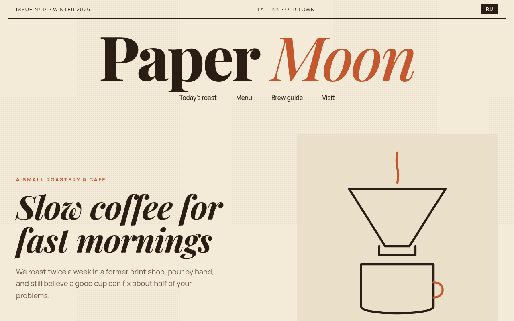

<!-- generated by scripts/build-docs.mjs from templates.json — edit there -->
# 03 · Paper Moon — Specialty coffee

[Русская версия](README.ru.md) · [Live demo](https://unicorn-rm.github.io/vibe-templates/03-coffee-editorial/) · [All templates](../../README.md)



- **Style:** Warm paper editorial
- **Stack:** Astro 7 · Vanilla TS
- **Fonts:** [Playfair Display](https://fonts.google.com/specimen/Playfair+Display), [Manrope](https://fonts.google.com/specimen/Manrope) (Latin + Cyrillic)
- **Signature block:** Menu whose rows draw a hand-made line illustration on hover + a working pour-over brew timer

## Run it

```bash
npm install          # Node 22.23+ (Astro 7)
npm run dev
npm run build   # ./dist
```

## Blocks inside

- newspaper masthead
- editorial hero with animated line drawing
- coffee bag label card
- pull quote + drop-cap columns
- menu with dotted leaders and drawing frame
- brew timer with steps
- hours table
- colophon footer

## Where things live

| File | What to edit there |
|---|---|
| `src/content.ts` | all copy (EN + RU), menu, roast, brew steps |
| `src/pages/index.astro` | page markup + small client script (lang, menu, timer) |
| `src/components/Illo.astro` | line illustrations (add your own paths) |
| `src/components/T.astro` | bilingual text helper |
| `src/styles/global.css` | tokens at the top |

The page speaks English by default. Russian: the language button, or `?lang=ru`.

## Make it yours with AI

Open this folder in Claude Code, Cursor, Copilot or any coding agent and paste:

```text
You are adapting the "03-coffee-editorial" template from vibe-templates.
Read DESIGN.md and AGENTS.md in this folder first and keep every rule in DESIGN.md.
My project: <what it is, who it is for, 2–3 sentences>.
Replace all copy and data in src/content.ts with content for my project, in English and Russian.
Keep the layout, the fonts, the signature block and the motion. You may change the palette tokens only if you keep the same number of accents and contrast of at least 4.5:1 for body text.
Do not add new dependencies. When done, list what you changed.
```

Design rules the agent must keep are in [DESIGN.md](DESIGN.md).

## License

MIT — use it for anything, credit appreciated. 
