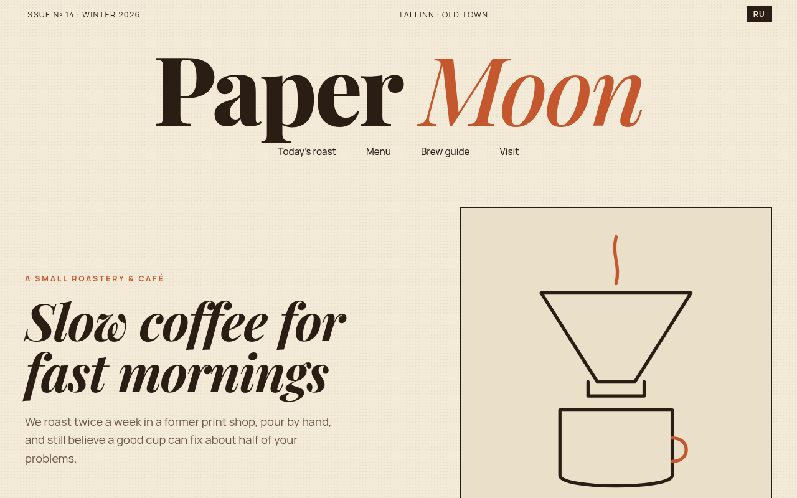

<!-- generated by scripts/build-docs.mjs from templates.json — edit there -->
# 03 · Paper Moon — Спешелти-кофейня

[English version](README.md) · [Демо](https://unicorn-rm.github.io/vibe-templates/03-coffee-editorial/) · [Все шаблоны](../../README.ru.md)



- **Стиль:** Тёплая бумага, editorial
- **Стек:** Astro 7 · Vanilla TS
- **Шрифты:** [Playfair Display](https://fonts.google.com/specimen/Playfair+Display), [Manrope](https://fonts.google.com/specimen/Manrope) (латиница + кириллица)
- **Фирменный блок:** Меню, строки которого рисуют линейную иллюстрацию при наведении, + рабочий таймер заваривания пуровера

## Запуск

```bash
npm install          # Node 22.23+ (Astro 7)
npm run dev
npm run build   # ./dist
```

## Какие блоки внутри

- newspaper masthead
- editorial hero with animated line drawing
- coffee bag label card
- pull quote + drop-cap columns
- menu with dotted leaders and drawing frame
- brew timer with steps
- hours table
- colophon footer

## Где что лежит

| Файл | Что там менять |
|---|---|
| `src/content.ts` | all copy (EN + RU), menu, roast, brew steps |
| `src/pages/index.astro` | page markup + small client script (lang, menu, timer) |
| `src/components/Illo.astro` | line illustrations (add your own paths) |
| `src/components/T.astro` | bilingual text helper |
| `src/styles/global.css` | tokens at the top |

По умолчанию страница на английском. Русский — кнопкой языка или `?lang=ru`.

## Переделать под себя с ИИ

Откройте эту папку в Claude Code, Cursor, Copilot или другом агенте и вставьте:

```text
Ты адаптируешь шаблон "03-coffee-editorial" из vibe-templates.
Сначала прочитай DESIGN.md и AGENTS.md в этой папке и соблюдай все правила из DESIGN.md.
Мой проект: <что это, для кого, 2–3 предложения>.
Замени весь текст и данные в src/content.ts на контент моего проекта, на английском и русском.
Сохрани сетку, шрифты, фирменный блок и анимации. Палитру можно менять только в токенах, сохранив число акцентов и контраст текста не ниже 4.5:1.
Не добавляй новые зависимости. В конце перечисли, что изменил.
```

Правила дизайна, которые агент должен сохранить, — в [DESIGN.md](DESIGN.md).

## Лицензия

MIT — используйте как угодно, ссылка на репозиторий приветствуется. 
