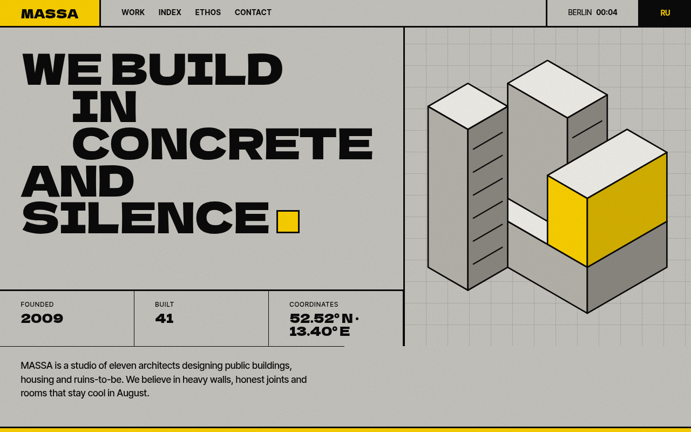

<!-- generated by scripts/build-docs.mjs from templates.json — edit there -->
# 04 · MASSA — Architecture studio

[Русская версия](README.ru.md) · [Live demo](https://unicorn-rm.github.io/vibe-templates/04-brutalist-architecture/) · [All templates](../../README.md)



- **Style:** Brutalism
- **Stack:** HTML · CSS · GSAP + ScrollTrigger
- **Fonts:** [Dela Gothic One](https://fonts.google.com/specimen/Dela+Gothic+One), [Inter Tight](https://fonts.google.com/specimen/Inter+Tight) (Latin + Cyrillic)
- **Signature block:** Pinned horizontal project scroll with generated isometric massing models — no images at all

## Run it

```bash
open index.html   # or any static server: npx serve .
```

## Blocks inside

- boxed header with live city clock
- hero with giant type + isometric model
- marquee tape
- horizontal pinned project cards
- index table with cursor-follow preview
- ethos list on black
- stats with yellow cell
- giant email link
- footer

## Where things live

| File | What to edit there |
|---|---|
| `content.js` | projects (with massing boxes), ethos, all copy (EN + RU) |
| `massing.js` | isometric SVG renderer |
| `main.js` | rendering, language, clock, GSAP choreography |
| `styles.css` | tokens at the top |

The page speaks English by default. Russian: the language button, or `?lang=ru`.

## Make it yours with AI

Open this folder in Claude Code, Cursor, Copilot or any coding agent and paste:

```text
You are adapting the "04-brutalist-architecture" template from vibe-templates.
Read DESIGN.md and AGENTS.md in this folder first and keep every rule in DESIGN.md.
My project: <what it is, who it is for, 2–3 sentences>.
Replace all copy and data in content.js with content for my project, in English and Russian.
Keep the layout, the fonts, the signature block and the motion. You may change the palette tokens only if you keep the same number of accents and contrast of at least 4.5:1 for body text.
Do not add new dependencies. When done, list what you changed.
```

Design rules the agent must keep are in [DESIGN.md](DESIGN.md).

## License

MIT — use it for anything, credit appreciated. 
