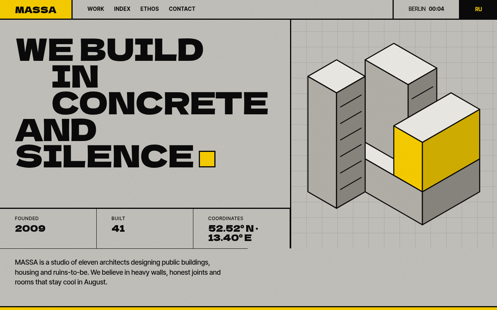

<!-- generated by scripts/build-docs.mjs from templates.json — edit there -->
# 04 · MASSA — Архитектурное бюро

[English version](README.md) · [Демо](https://unicorn-rm.github.io/vibe-templates/04-brutalist-architecture/) · [Все шаблоны](../../README.ru.md)



- **Стиль:** Брутализм
- **Стек:** HTML · CSS · GSAP + ScrollTrigger
- **Шрифты:** [Dela Gothic One](https://fonts.google.com/specimen/Dela+Gothic+One), [Inter Tight](https://fonts.google.com/specimen/Inter+Tight) (латиница + кириллица)
- **Фирменный блок:** Закреплённая горизонтальная прокрутка проектов с генерируемыми изометрическими моделями зданий — без единой картинки

## Запуск

```bash
open index.html   # or any static server: npx serve .
```

## Какие блоки внутри

- boxed header with live city clock
- hero with giant type + isometric model
- marquee tape
- horizontal pinned project cards
- index table with cursor-follow preview
- ethos list on black
- stats with yellow cell
- giant email link
- footer

## Где что лежит

| Файл | Что там менять |
|---|---|
| `content.js` | projects (with massing boxes), ethos, all copy (EN + RU) |
| `massing.js` | isometric SVG renderer |
| `main.js` | rendering, language, clock, GSAP choreography |
| `styles.css` | tokens at the top |

По умолчанию страница на английском. Русский — кнопкой языка или `?lang=ru`.

## Переделать под себя с ИИ

Откройте эту папку в Claude Code, Cursor, Copilot или другом агенте и вставьте:

```text
Ты адаптируешь шаблон "04-brutalist-architecture" из vibe-templates.
Сначала прочитай DESIGN.md и AGENTS.md в этой папке и соблюдай все правила из DESIGN.md.
Мой проект: <что это, для кого, 2–3 предложения>.
Замени весь текст и данные в content.js на контент моего проекта, на английском и русском.
Сохрани сетку, шрифты, фирменный блок и анимации. Палитру можно менять только в токенах, сохранив число акцентов и контраст текста не ниже 4.5:1.
Не добавляй новые зависимости. В конце перечисли, что изменил.
```

Правила дизайна, которые агент должен сохранить, — в [DESIGN.md](DESIGN.md).

## Лицензия

MIT — используйте как угодно, ссылка на репозиторий приветствуется. 
