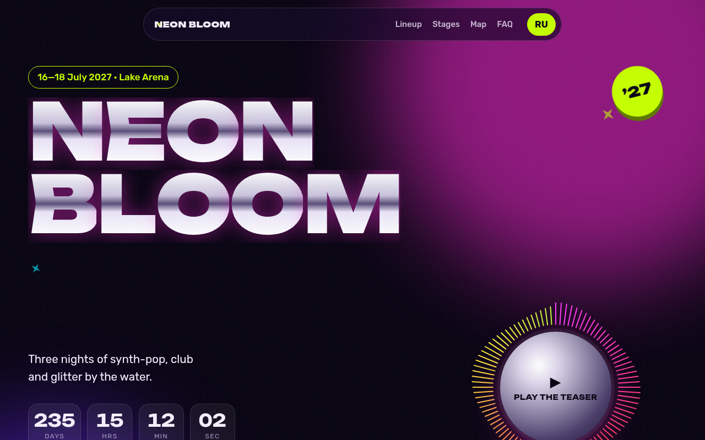

<!-- generated by scripts/build-docs.mjs from templates.json — edit there -->
# 05 · Neon Bloom — Music festival

[Русская версия](README.ru.md) · [Live demo](https://unicorn-rm.github.io/vibe-templates/05-neon-festival/) · [All templates](../../README.md)



- **Style:** Neon Y2K, chrome
- **Stack:** React 19 · Vite · Motion
- **Fonts:** [Unbounded](https://fonts.google.com/specimen/Unbounded), [Rubik](https://fonts.google.com/specimen/Rubik) (Latin + Cyrillic)
- **Signature block:** Live audio visualizer — a tiny Web Audio synth drawn as a radial spectrum, no audio files

## Run it

```bash
npm install
npm run dev
npm run build   # ./dist
```

## Blocks inside

- floating pill nav
- chrome letter-by-letter title
- countdown
- audio visualizer
- rotated marquee
- lineup with day tabs and stage filter
- stage cards
- interactive site map
- add-to-calendar (.ics)
- FAQ accordion
- outlined giant footer

## Where things live

| File | What to edit there |
|---|---|
| `src/content.js` | festival data, lineup, map spots, all copy (EN + RU) |
| `src/App.jsx` | page sections as components |
| `src/Visualizer.jsx` | Web Audio synth + canvas spectrum |
| `src/styles.css` | tokens at the top, then sections |

The page speaks English by default. Russian: the language button, or `?lang=ru`.

## Make it yours with AI

Open this folder in Claude Code, Cursor, Copilot or any coding agent and paste:

```text
You are adapting the "05-neon-festival" template from vibe-templates.
Read DESIGN.md and AGENTS.md in this folder first and keep every rule in DESIGN.md.
My project: <what it is, who it is for, 2–3 sentences>.
Replace all copy and data in src/content.js with content for my project, in English and Russian.
Keep the layout, the fonts, the signature block and the motion. You may change the palette tokens only if you keep the same number of accents and contrast of at least 4.5:1 for body text.
Do not add new dependencies. When done, list what you changed.
```

Design rules the agent must keep are in [DESIGN.md](DESIGN.md).

## License

MIT — use it for anything, credit appreciated. 
