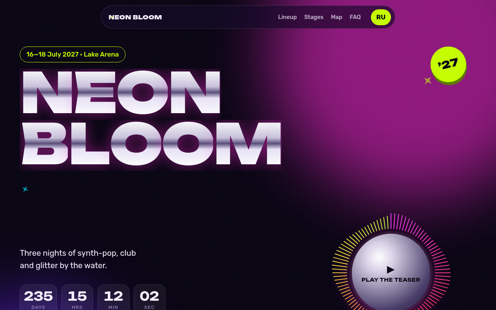

<!-- generated by scripts/build-docs.mjs from templates.json — edit there -->
# 05 · Neon Bloom — Музыкальный фестиваль

[English version](README.md) · [Демо](https://unicorn-rm.github.io/vibe-templates/05-neon-festival/) · [Все шаблоны](../../README.ru.md)



- **Стиль:** Неон Y2K, хром
- **Стек:** React 19 · Vite · Motion
- **Шрифты:** [Unbounded](https://fonts.google.com/specimen/Unbounded), [Rubik](https://fonts.google.com/specimen/Rubik) (латиница + кириллица)
- **Фирменный блок:** Живой визуализатор звука — маленький синтезатор на Web Audio, нарисованный радиальным спектром, без аудиофайлов

## Запуск

```bash
npm install
npm run dev
npm run build   # ./dist
```

## Какие блоки внутри

- floating pill nav
- chrome letter-by-letter title
- countdown
- audio visualizer
- rotated marquee
- lineup with day tabs and stage filter
- stage cards
- interactive site map
- add-to-calendar (.ics)
- FAQ accordion
- outlined giant footer

## Где что лежит

| Файл | Что там менять |
|---|---|
| `src/content.js` | festival data, lineup, map spots, all copy (EN + RU) |
| `src/App.jsx` | page sections as components |
| `src/Visualizer.jsx` | Web Audio synth + canvas spectrum |
| `src/styles.css` | tokens at the top, then sections |

По умолчанию страница на английском. Русский — кнопкой языка или `?lang=ru`.

## Переделать под себя с ИИ

Откройте эту папку в Claude Code, Cursor, Copilot или другом агенте и вставьте:

```text
Ты адаптируешь шаблон "05-neon-festival" из vibe-templates.
Сначала прочитай DESIGN.md и AGENTS.md в этой папке и соблюдай все правила из DESIGN.md.
Мой проект: <что это, для кого, 2–3 предложения>.
Замени весь текст и данные в src/content.js на контент моего проекта, на английском и русском.
Сохрани сетку, шрифты, фирменный блок и анимации. Палитру можно менять только в токенах, сохранив число акцентов и контраст текста не ниже 4.5:1.
Не добавляй новые зависимости. В конце перечисли, что изменил.
```

Правила дизайна, которые агент должен сохранить, — в [DESIGN.md](DESIGN.md).

## Лицензия

MIT — используйте как угодно, ссылка на репозиторий приветствуется. 
