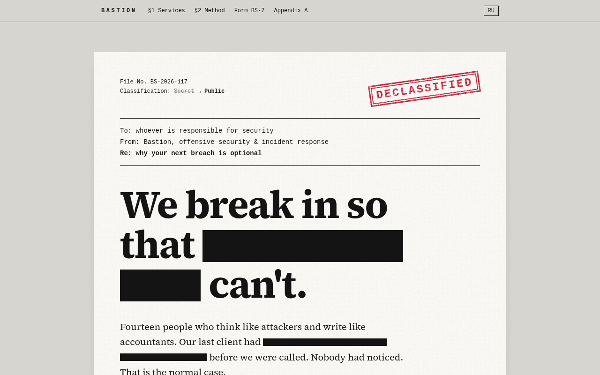

<!-- generated by scripts/build-docs.mjs from templates.json — edit there -->
# 06 · Bastion — Security consultancy

[Русская версия](README.ru.md) · [Live demo](https://unicorn-rm.github.io/vibe-templates/06-cyber-security/) · [All templates](../../README.md)



- **Style:** Declassified file
- **Stack:** Next.js 16 · Tailwind CSS 4 · TypeScript
- **Fonts:** [Source Serif 4](https://fonts.google.com/specimen/Source+Serif+4), [Cousine](https://fonts.google.com/specimen/Cousine) (Latin + Cyrillic)
- **Signature block:** Redaction bars that declassify on hover + a printed request form that gets rubber-stamped (simulated check, no network)

## Run it

```bash
npm install
npm run dev
npm run build   # static export to ./out
```

## Blocks inside

- folder-tab top bar
- memo cover sheet with stamp
- redacted headline and lead
- services table
- numbered method clauses with margin note
- request form BS-7 with stamp
- hatched severity tally
- incident log appendix
- case file cards
- cut-out incident coupon

## Where things live

| File | What to edit there |
|---|---|
| `lib/content.ts` | all copy (EN + RU) with [[redactions]], form results |
| `app/page.tsx` | sheets, redaction helper, request form |
| `app/globals.css` | tokens in Tailwind `@theme`, paper, stamp, hatch utilities |
| `app/layout.tsx` | fonts and metadata |

The page speaks English by default. Russian: the language button, or `?lang=ru`.

## Make it yours with AI

Open this folder in Claude Code, Cursor, Copilot or any coding agent and paste:

```text
You are adapting the "06-cyber-security" template from vibe-templates.
Read DESIGN.md and AGENTS.md in this folder first and keep every rule in DESIGN.md.
My project: <what it is, who it is for, 2–3 sentences>.
Replace all copy and data in lib/content.ts with content for my project, in English and Russian.
Keep the layout, the fonts, the signature block and the motion. You may change the palette tokens only if you keep the same number of accents and contrast of at least 4.5:1 for body text.
Do not add new dependencies. When done, list what you changed.
```

Design rules the agent must keep are in [DESIGN.md](DESIGN.md).

## License

MIT — use it for anything, credit appreciated. 
