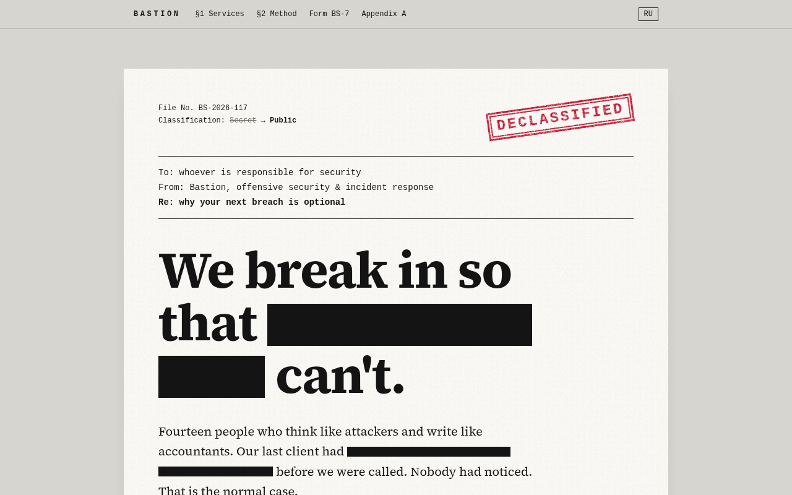

<!-- generated by scripts/build-docs.mjs from templates.json — edit there -->
# 06 · Bastion — ИБ-консалтинг

[English version](README.md) · [Демо](https://unicorn-rm.github.io/vibe-templates/06-cyber-security/) · [Все шаблоны](../../README.ru.md)



- **Стиль:** Рассекреченное досье
- **Стек:** Next.js 16 · Tailwind CSS 4 · TypeScript
- **Шрифты:** [Source Serif 4](https://fonts.google.com/specimen/Source+Serif+4), [Cousine](https://fonts.google.com/specimen/Cousine) (латиница + кириллица)
- **Фирменный блок:** Плашки цензуры, которые снимаются при наведении, + бумажный бланк-заявка, на который ставится штамп (симуляция, без сети)

## Запуск

```bash
npm install
npm run dev
npm run build   # static export to ./out
```

## Какие блоки внутри

- folder-tab top bar
- memo cover sheet with stamp
- redacted headline and lead
- services table
- numbered method clauses with margin note
- request form BS-7 with stamp
- hatched severity tally
- incident log appendix
- case file cards
- cut-out incident coupon

## Где что лежит

| Файл | Что там менять |
|---|---|
| `lib/content.ts` | all copy (EN + RU) with [[redactions]], form results |
| `app/page.tsx` | sheets, redaction helper, request form |
| `app/globals.css` | tokens in Tailwind `@theme`, paper, stamp, hatch utilities |
| `app/layout.tsx` | fonts and metadata |

По умолчанию страница на английском. Русский — кнопкой языка или `?lang=ru`.

## Переделать под себя с ИИ

Откройте эту папку в Claude Code, Cursor, Copilot или другом агенте и вставьте:

```text
Ты адаптируешь шаблон "06-cyber-security" из vibe-templates.
Сначала прочитай DESIGN.md и AGENTS.md в этой папке и соблюдай все правила из DESIGN.md.
Мой проект: <что это, для кого, 2–3 предложения>.
Замени весь текст и данные в lib/content.ts на контент моего проекта, на английском и русском.
Сохрани сетку, шрифты, фирменный блок и анимации. Палитру можно менять только в токенах, сохранив число акцентов и контраст текста не ниже 4.5:1.
Не добавляй новые зависимости. В конце перечисли, что изменил.
```

Правила дизайна, которые агент должен сохранить, — в [DESIGN.md](DESIGN.md).

## Лицензия

MIT — используйте как угодно, ссылка на репозиторий приветствуется. 
