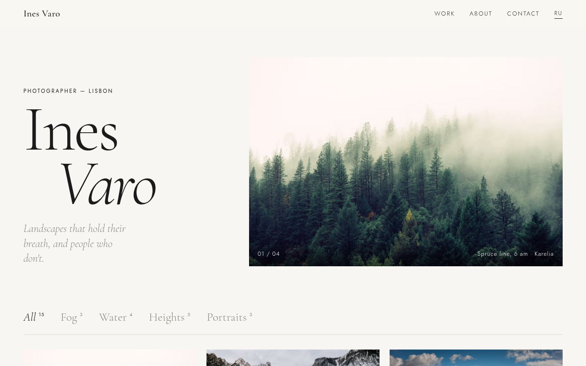

<!-- generated by scripts/build-docs.mjs from templates.json — edit there -->
# 07 · Ines Varo — Photographer

[Русская версия](README.ru.md) · [Live demo](https://unicorn-rm.github.io/vibe-templates/07-photographer/) · [All templates](../../README.md)



- **Style:** Airy minimal
- **Stack:** SvelteKit 3 · Svelte 5
- **Fonts:** [Cormorant Garamond](https://fonts.google.com/specimen/Cormorant+Garamond), [Jost](https://fonts.google.com/specimen/Jost) (Latin + Cyrillic)
- **Signature block:** Masonry gallery with series filter and a keyboard/swipe lightbox showing EXIF

## Run it

```bash
npm install          # Node 22.17+
npm run dev
npm run build   # ./build
```

## Blocks inside

- minimal header
- name + crossfading hero slideshow
- series tabs with counts
- masonry grid with hover captions
- lightbox with EXIF, arrows, Esc, swipe
- about with portrait, clients, exhibitions
- centered contact
- footer

## Where things live

| File | What to edit there |
|---|---|
| `src/lib/content.js` | photos (Unsplash ids, ratio, EXIF), series, all copy (EN + RU) |
| `src/routes/+page.svelte` | the whole page and lightbox |
| `src/app.css` | tokens at the top |
| `vite.config.js` | SvelteKit 3 config lives in the Vite plugin |

The page speaks English by default. Russian: the language button, or `?lang=ru`.

## Make it yours with AI

Open this folder in Claude Code, Cursor, Copilot or any coding agent and paste:

```text
You are adapting the "07-photographer" template from vibe-templates.
Read DESIGN.md and AGENTS.md in this folder first and keep every rule in DESIGN.md.
My project: <what it is, who it is for, 2–3 sentences>.
Replace all copy and data in src/lib/content.js with content for my project, in English and Russian.
Keep the layout, the fonts, the signature block and the motion. You may change the palette tokens only if you keep the same number of accents and contrast of at least 4.5:1 for body text.
Do not add new dependencies. When done, list what you changed.
```

Design rules the agent must keep are in [DESIGN.md](DESIGN.md).

## License

MIT — use it for anything, credit appreciated. 
