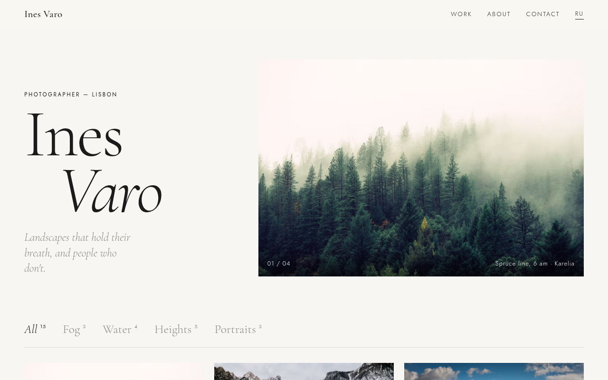

<!-- generated by scripts/build-docs.mjs from templates.json — edit there -->
# 07 · Ines Varo — Фотограф

[English version](README.md) · [Демо](https://unicorn-rm.github.io/vibe-templates/07-photographer/) · [Все шаблоны](../../README.ru.md)



- **Стиль:** Воздушный минимализм
- **Стек:** SvelteKit 3 · Svelte 5
- **Шрифты:** [Cormorant Garamond](https://fonts.google.com/specimen/Cormorant+Garamond), [Jost](https://fonts.google.com/specimen/Jost) (латиница + кириллица)
- **Фирменный блок:** Masonry-галерея с фильтром серий и лайтбоксом (клавиатура/свайп) с данными EXIF

## Запуск

```bash
npm install          # Node 22.17+
npm run dev
npm run build   # ./build
```

## Какие блоки внутри

- minimal header
- name + crossfading hero slideshow
- series tabs with counts
- masonry grid with hover captions
- lightbox with EXIF, arrows, Esc, swipe
- about with portrait, clients, exhibitions
- centered contact
- footer

## Где что лежит

| Файл | Что там менять |
|---|---|
| `src/lib/content.js` | photos (Unsplash ids, ratio, EXIF), series, all copy (EN + RU) |
| `src/routes/+page.svelte` | the whole page and lightbox |
| `src/app.css` | tokens at the top |
| `vite.config.js` | SvelteKit 3 config lives in the Vite plugin |

По умолчанию страница на английском. Русский — кнопкой языка или `?lang=ru`.

## Переделать под себя с ИИ

Откройте эту папку в Claude Code, Cursor, Copilot или другом агенте и вставьте:

```text
Ты адаптируешь шаблон "07-photographer" из vibe-templates.
Сначала прочитай DESIGN.md и AGENTS.md в этой папке и соблюдай все правила из DESIGN.md.
Мой проект: <что это, для кого, 2–3 предложения>.
Замени весь текст и данные в src/lib/content.js на контент моего проекта, на английском и русском.
Сохрани сетку, шрифты, фирменный блок и анимации. Палитру можно менять только в токенах, сохранив число акцентов и контраст текста не ниже 4.5:1.
Не добавляй новые зависимости. В конце перечисли, что изменил.
```

Правила дизайна, которые агент должен сохранить, — в [DESIGN.md](DESIGN.md).

## Лицензия

MIT — используйте как угодно, ссылка на репозиторий приветствуется. 
