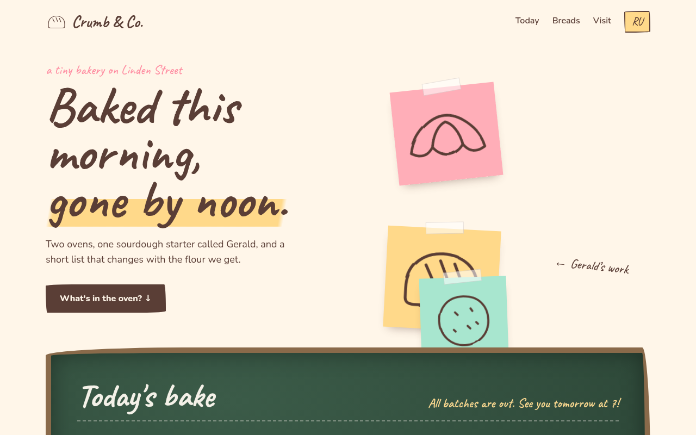

<!-- generated by scripts/build-docs.mjs from templates.json — edit there -->
# 08 · Crumb & Co. — Home bakery

[Русская версия](README.ru.md) · [Live demo](https://unicorn-rm.github.io/vibe-templates/08-bakery/) · [All templates](../../README.md)



- **Style:** Hand-drawn pastel
- **Stack:** Tailwind CSS 4 · Alpine.js · Vite
- **Fonts:** [Caveat](https://fonts.google.com/specimen/Caveat), [Nunito](https://fonts.google.com/specimen/Nunito) (Latin + Cyrillic)
- **Signature block:** Chalkboard of today's bake with a live countdown to the next batch + allergen filters

## Run it

```bash
npm install
npm run dev
npm run build   # ./dist
```

## Blocks inside

- doodle logo header
- handwritten hero with sticky notes
- chalkboard menu with sold-out strikes
- allergen filter chips
- tilted product cards with stamps
- how-it's-made steps with drawn arrows
- neighbour notes wall
- hand-drawn map
- footer

## Where things live

| File | What to edit there |
|---|---|
| `src/content.js` | products, batches, notes, all copy (EN + RU) |
| `src/main.js` | Alpine component, doodles, countdown |
| `index.html` | markup with Alpine directives |
| `src/style.css` | tokens in Tailwind `@theme` + hand-drawn utilities |

The page speaks English by default. Russian: the language button, or `?lang=ru`.

## Make it yours with AI

Open this folder in Claude Code, Cursor, Copilot or any coding agent and paste:

```text
You are adapting the "08-bakery" template from vibe-templates.
Read DESIGN.md and AGENTS.md in this folder first and keep every rule in DESIGN.md.
My project: <what it is, who it is for, 2–3 sentences>.
Replace all copy and data in src/content.js with content for my project, in English and Russian.
Keep the layout, the fonts, the signature block and the motion. You may change the palette tokens only if you keep the same number of accents and contrast of at least 4.5:1 for body text.
Do not add new dependencies. When done, list what you changed.
```

Design rules the agent must keep are in [DESIGN.md](DESIGN.md).

## License

MIT — use it for anything, credit appreciated. 
