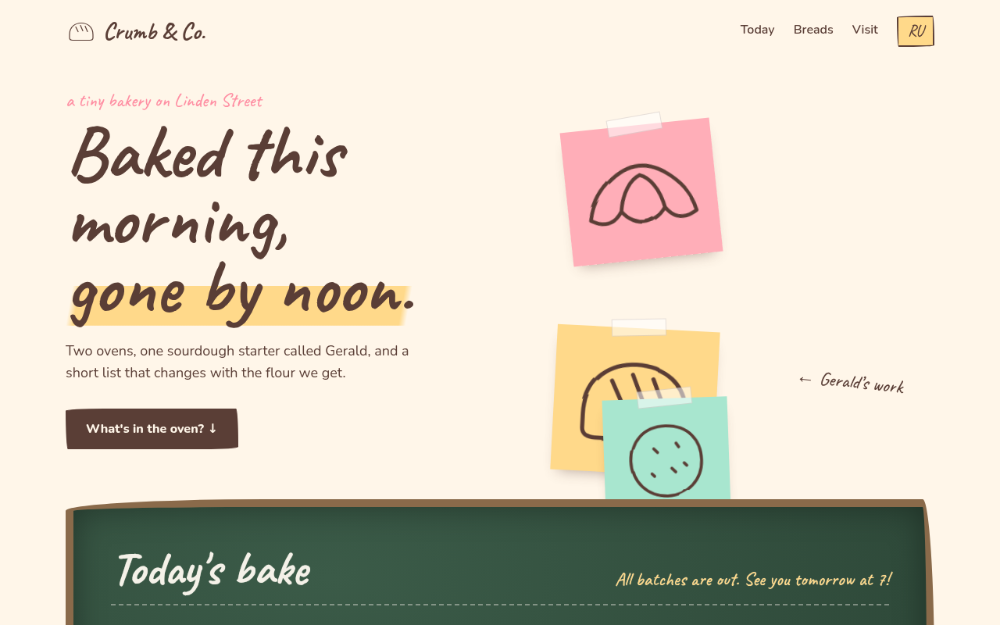

<!-- generated by scripts/build-docs.mjs from templates.json — edit there -->
# 08 · Crumb & Co. — Домашняя пекарня

[English version](README.md) · [Демо](https://unicorn-rm.github.io/vibe-templates/08-bakery/) · [Все шаблоны](../../README.ru.md)



- **Стиль:** Рисованная пастель
- **Стек:** Tailwind CSS 4 · Alpine.js · Vite
- **Шрифты:** [Caveat](https://fonts.google.com/specimen/Caveat), [Nunito](https://fonts.google.com/specimen/Nunito) (латиница + кириллица)
- **Фирменный блок:** Меловая доска «сегодня в печи» с живым отсчётом до следующей партии + фильтр по аллергенам

## Запуск

```bash
npm install
npm run dev
npm run build   # ./dist
```

## Какие блоки внутри

- doodle logo header
- handwritten hero with sticky notes
- chalkboard menu with sold-out strikes
- allergen filter chips
- tilted product cards with stamps
- how-it's-made steps with drawn arrows
- neighbour notes wall
- hand-drawn map
- footer

## Где что лежит

| Файл | Что там менять |
|---|---|
| `src/content.js` | products, batches, notes, all copy (EN + RU) |
| `src/main.js` | Alpine component, doodles, countdown |
| `index.html` | markup with Alpine directives |
| `src/style.css` | tokens in Tailwind `@theme` + hand-drawn utilities |

По умолчанию страница на английском. Русский — кнопкой языка или `?lang=ru`.

## Переделать под себя с ИИ

Откройте эту папку в Claude Code, Cursor, Copilot или другом агенте и вставьте:

```text
Ты адаптируешь шаблон "08-bakery" из vibe-templates.
Сначала прочитай DESIGN.md и AGENTS.md в этой папке и соблюдай все правила из DESIGN.md.
Мой проект: <что это, для кого, 2–3 предложения>.
Замени весь текст и данные в src/content.js на контент моего проекта, на английском и русском.
Сохрани сетку, шрифты, фирменный блок и анимации. Палитру можно менять только в токенах, сохранив число акцентов и контраст текста не ниже 4.5:1.
Не добавляй новые зависимости. В конце перечисли, что изменил.
```

Правила дизайна, которые агент должен сохранить, — в [DESIGN.md](DESIGN.md).

## Лицензия

MIT — используйте как угодно, ссылка на репозиторий приветствуется. 
