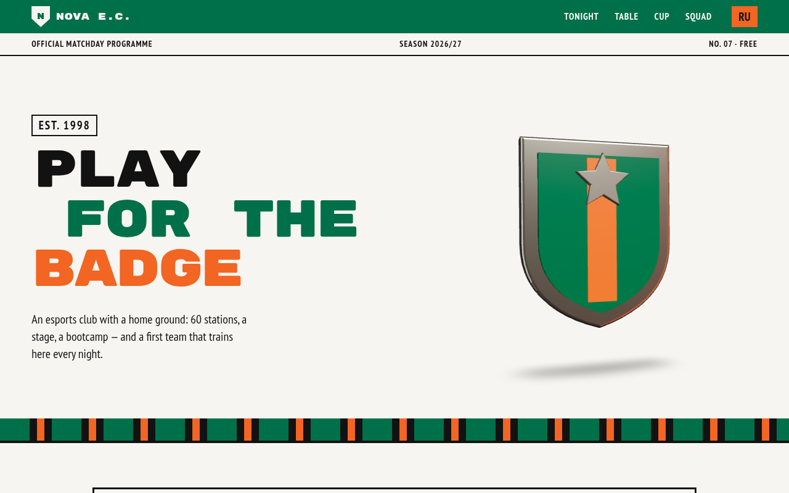

<!-- generated by scripts/build-docs.mjs from templates.json — edit there -->
# 09 · NOVA E.C. — Esports club

[Русская версия](README.ru.md) · [Live demo](https://unicorn-rm.github.io/vibe-templates/09-esports-club/) · [All templates](../../README.md)



- **Style:** Football matchday programme
- **Stack:** React 19 · Three.js (R3F) · Vite
- **Fonts:** [Rubik Mono One](https://fonts.google.com/specimen/Rubik+Mono+One), [PT Sans Narrow](https://fonts.google.com/specimen/PT+Sans+Narrow) (Latin + Cyrillic)
- **Signature block:** 3D enamel club crest built from extruded shapes (no model files) + clickable cup bracket

## Run it

```bash
npm install
npm run dev
npm run build   # ./dist
```

## Blocks inside

- club-colour top bar
- programme cover with 3D crest
- kit stripes
- fixture ticket with notches
- league table
- ground guide
- cup bracket with path highlight
- sticker-album squad cards
- join band
- sponsor strip
- footer

## Where things live

| File | What to edit there |
|---|---|
| `src/content.js` | club, fixtures, table, bracket scores, squad, all copy (EN + RU) |
| `src/App.jsx` | page sections and the bracket |
| `src/Scene.jsx` | 3D crest (React Three Fiber) |
| `src/styles.css` | tokens at the top |

The page speaks English by default. Russian: the language button, or `?lang=ru`.

## Make it yours with AI

Open this folder in Claude Code, Cursor, Copilot or any coding agent and paste:

```text
You are adapting the "09-esports-club" template from vibe-templates.
Read DESIGN.md and AGENTS.md in this folder first and keep every rule in DESIGN.md.
My project: <what it is, who it is for, 2–3 sentences>.
Replace all copy and data in src/content.js with content for my project, in English and Russian.
Keep the layout, the fonts, the signature block and the motion. You may change the palette tokens only if you keep the same number of accents and contrast of at least 4.5:1 for body text.
Do not add new dependencies. When done, list what you changed.
```

Design rules the agent must keep are in [DESIGN.md](DESIGN.md).

## License

MIT — use it for anything, credit appreciated. 
