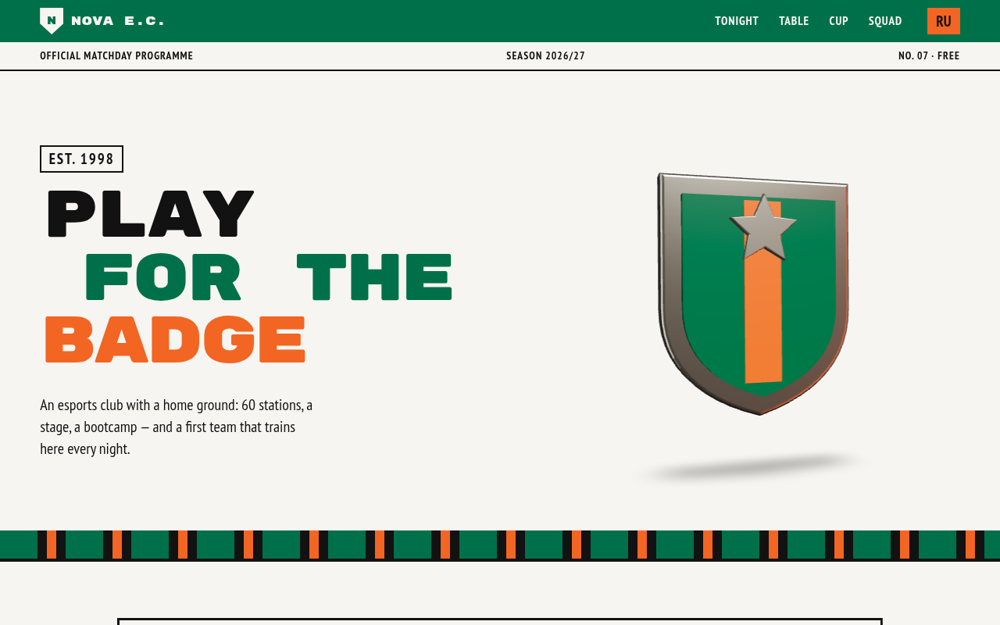

<!-- generated by scripts/build-docs.mjs from templates.json — edit there -->
# 09 · NOVA E.C. — Киберспорт-клуб

[English version](README.md) · [Демо](https://unicorn-rm.github.io/vibe-templates/09-esports-club/) · [Все шаблоны](../../README.ru.md)



- **Стиль:** Программка футбольного матча
- **Стек:** React 19 · Three.js (R3F) · Vite
- **Шрифты:** [Rubik Mono One](https://fonts.google.com/specimen/Rubik+Mono+One), [PT Sans Narrow](https://fonts.google.com/specimen/PT+Sans+Narrow) (латиница + кириллица)
- **Фирменный блок:** 3D-эмалевый герб клуба из выдавленных фигур (без файлов моделей) + кликабельная сетка кубка

## Запуск

```bash
npm install
npm run dev
npm run build   # ./dist
```

## Какие блоки внутри

- club-colour top bar
- programme cover with 3D crest
- kit stripes
- fixture ticket with notches
- league table
- ground guide
- cup bracket with path highlight
- sticker-album squad cards
- join band
- sponsor strip
- footer

## Где что лежит

| Файл | Что там менять |
|---|---|
| `src/content.js` | club, fixtures, table, bracket scores, squad, all copy (EN + RU) |
| `src/App.jsx` | page sections and the bracket |
| `src/Scene.jsx` | 3D crest (React Three Fiber) |
| `src/styles.css` | tokens at the top |

По умолчанию страница на английском. Русский — кнопкой языка или `?lang=ru`.

## Переделать под себя с ИИ

Откройте эту папку в Claude Code, Cursor, Copilot или другом агенте и вставьте:

```text
Ты адаптируешь шаблон "09-esports-club" из vibe-templates.
Сначала прочитай DESIGN.md и AGENTS.md в этой папке и соблюдай все правила из DESIGN.md.
Мой проект: <что это, для кого, 2–3 предложения>.
Замени весь текст и данные в src/content.js на контент моего проекта, на английском и русском.
Сохрани сетку, шрифты, фирменный блок и анимации. Палитру можно менять только в токенах, сохранив число акцентов и контраст текста не ниже 4.5:1.
Не добавляй новые зависимости. В конце перечисли, что изменил.
```

Правила дизайна, которые агент должен сохранить, — в [DESIGN.md](DESIGN.md).

## Лицензия

MIT — используйте как угодно, ссылка на репозиторий приветствуется. 
