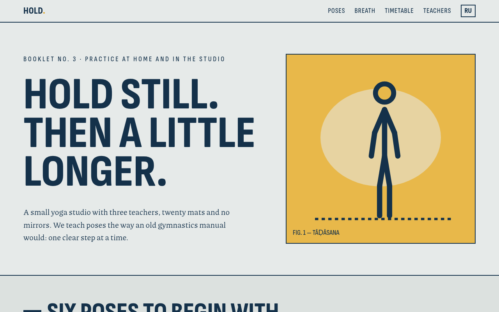

<!-- generated by scripts/build-docs.mjs from templates.json — edit there -->
# 10 · Hold Studio — Yoga & wellness

[Русская версия](README.ru.md) · [Live demo](https://unicorn-rm.github.io/vibe-templates/10-yoga-wellness/) · [All templates](../../README.md)



- **Style:** 1960s exercise booklet
- **Stack:** Astro 7 · Tailwind CSS 4
- **Fonts:** [Sofia Sans Condensed](https://fonts.google.com/specimen/Sofia+Sans+Condensed), [Piazzolla](https://fonts.google.com/specimen/Piazzolla) (Latin + Cyrillic)
- **Signature block:** Stick-figure pose diagram that morphs between six poses + a 4-4-6 breath counter

## Run it

```bash
npm install          # Node 22.23+ (Astro 7)
npm run dev
npm run build   # ./dist
```

## Blocks inside

- condensed booklet header
- cover with figure on a printed sun
- morphing pose diagram with numbered list and cues
- breath circle with phases
- timetable with level filter
- teacher cards
- footer

## Where things live

| File | What to edit there |
|---|---|
| `src/content.ts` | poses (joint coordinates), breath phases, timetable, teachers, all copy (EN + RU) |
| `src/pages/index.astro` | page markup + client script (morph, breath, filter) |
| `src/styles/global.css` | tokens in Tailwind `@theme` + diagram styles |
| `src/components/T.astro` | bilingual text helper |

The page speaks English by default. Russian: the language button, or `?lang=ru`.

## Make it yours with AI

Open this folder in Claude Code, Cursor, Copilot or any coding agent and paste:

```text
You are adapting the "10-yoga-wellness" template from vibe-templates.
Read DESIGN.md and AGENTS.md in this folder first and keep every rule in DESIGN.md.
My project: <what it is, who it is for, 2–3 sentences>.
Replace all copy and data in src/content.ts with content for my project, in English and Russian.
Keep the layout, the fonts, the signature block and the motion. You may change the palette tokens only if you keep the same number of accents and contrast of at least 4.5:1 for body text.
Do not add new dependencies. When done, list what you changed.
```

Design rules the agent must keep are in [DESIGN.md](DESIGN.md).

## License

MIT — use it for anything, credit appreciated. 
