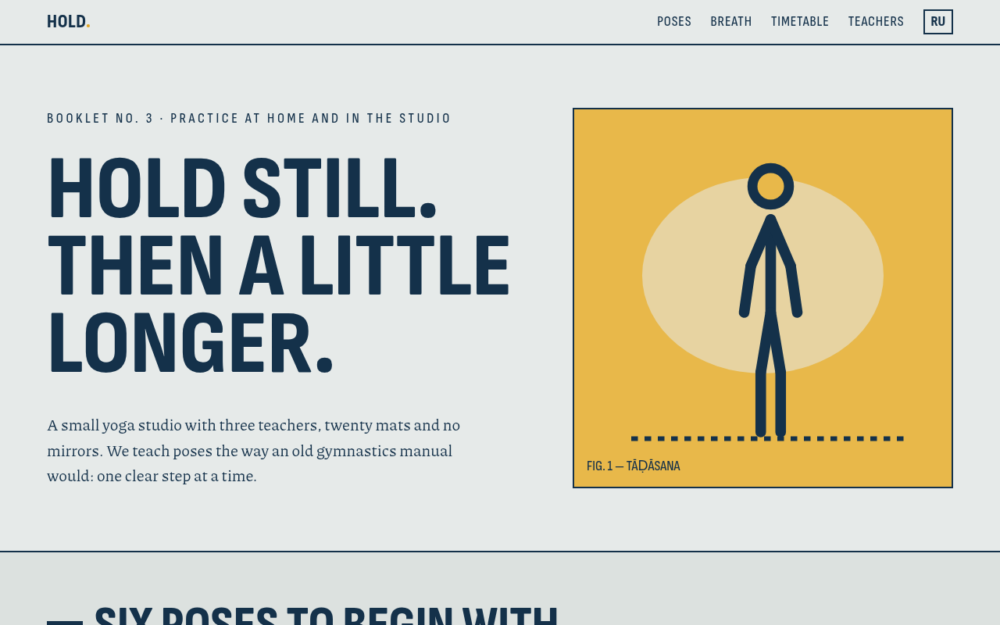

<!-- generated by scripts/build-docs.mjs from templates.json — edit there -->
# 10 · Hold Studio — Йога и велнес

[English version](README.md) · [Демо](https://unicorn-rm.github.io/vibe-templates/10-yoga-wellness/) · [Все шаблоны](../../README.ru.md)



- **Стиль:** Гимнастическая брошюра 1960-х
- **Стек:** Astro 7 · Tailwind CSS 4
- **Шрифты:** [Sofia Sans Condensed](https://fonts.google.com/specimen/Sofia+Sans+Condensed), [Piazzolla](https://fonts.google.com/specimen/Piazzolla) (латиница + кириллица)
- **Фирменный блок:** Схема-человечек, плавно перетекающий между шестью позами, + дыхательный счётчик 4-4-6

## Запуск

```bash
npm install          # Node 22.23+ (Astro 7)
npm run dev
npm run build   # ./dist
```

## Какие блоки внутри

- condensed booklet header
- cover with figure on a printed sun
- morphing pose diagram with numbered list and cues
- breath circle with phases
- timetable with level filter
- teacher cards
- footer

## Где что лежит

| Файл | Что там менять |
|---|---|
| `src/content.ts` | poses (joint coordinates), breath phases, timetable, teachers, all copy (EN + RU) |
| `src/pages/index.astro` | page markup + client script (morph, breath, filter) |
| `src/styles/global.css` | tokens in Tailwind `@theme` + diagram styles |
| `src/components/T.astro` | bilingual text helper |

По умолчанию страница на английском. Русский — кнопкой языка или `?lang=ru`.

## Переделать под себя с ИИ

Откройте эту папку в Claude Code, Cursor, Copilot или другом агенте и вставьте:

```text
Ты адаптируешь шаблон "10-yoga-wellness" из vibe-templates.
Сначала прочитай DESIGN.md и AGENTS.md в этой папке и соблюдай все правила из DESIGN.md.
Мой проект: <что это, для кого, 2–3 предложения>.
Замени весь текст и данные в src/content.ts на контент моего проекта, на английском и русском.
Сохрани сетку, шрифты, фирменный блок и анимации. Палитру можно менять только в токенах, сохранив число акцентов и контраст текста не ниже 4.5:1.
Не добавляй новые зависимости. В конце перечисли, что изменил.
```

Правила дизайна, которые агент должен сохранить, — в [DESIGN.md](DESIGN.md).

## Лицензия

MIT — используйте как угодно, ссылка на репозиторий приветствуется. 
