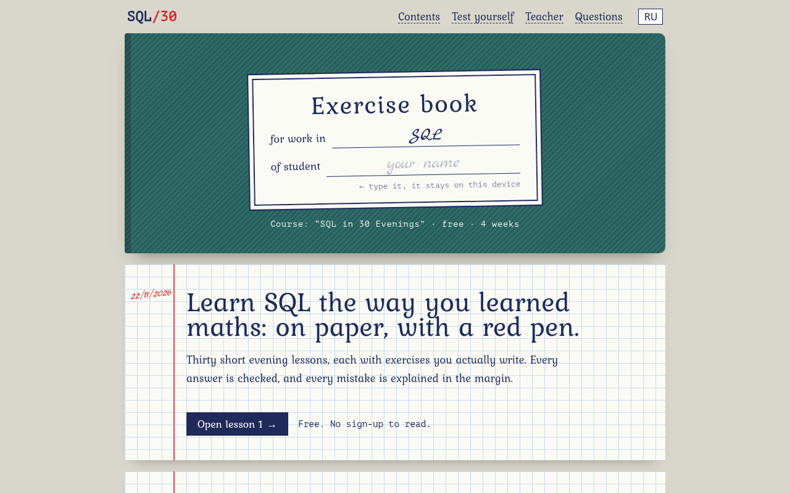

<!-- generated by scripts/build-docs.mjs from templates.json — edit there -->
# 11 · SQL in 30 Evenings — Online course

[Русская версия](README.ru.md) · [Live demo](https://unicorn-rm.github.io/vibe-templates/11-online-course/) · [All templates](../../README.md)



- **Style:** Squared exercise book, red pen
- **Stack:** Vue 3 · Vite
- **Fonts:** [Kurale](https://fonts.google.com/specimen/Kurale), [Marck Script](https://fonts.google.com/specimen/Marck+Script), [PT Mono](https://fonts.google.com/specimen/PT+Mono) (Latin + Cyrillic)
- **Signature block:** A quiz graded by the teacher's red pen: ticks, crosses, ringed right answers and a circled school mark

## Run it

```bash
npm install
npm run dev
npm run build   # ./dist
```

## Blocks inside

- notebook cover with a name label you can fill
- first page with margin date
- contents with dotted leaders
- red-pen graded quiz
- teacher's handwritten note
- stats
- FAQ (details)
- footer

## Where things live

| File | What to edit there |
|---|---|
| `src/content.js` | syllabus, quiz questions and answers, all copy (EN + RU) |
| `src/App.vue` | whole page: cover, contents, graded quiz |
| `src/style.css` | tokens at the top, grid paper and pen marks |

The page speaks English by default. Russian: the language button, or `?lang=ru`.

## Make it yours with AI

Open this folder in Claude Code, Cursor, Copilot or any coding agent and paste:

```text
You are adapting the "11-online-course" template from vibe-templates.
Read DESIGN.md and AGENTS.md in this folder first and keep every rule in DESIGN.md.
My project: <what it is, who it is for, 2–3 sentences>.
Replace all copy and data in src/content.js with content for my project, in English and Russian.
Keep the layout, the fonts, the signature block and the motion. You may change the palette tokens only if you keep the same number of accents and contrast of at least 4.5:1 for body text.
Do not add new dependencies. When done, list what you changed.
```

Design rules the agent must keep are in [DESIGN.md](DESIGN.md).

## License

MIT — use it for anything, credit appreciated. 
