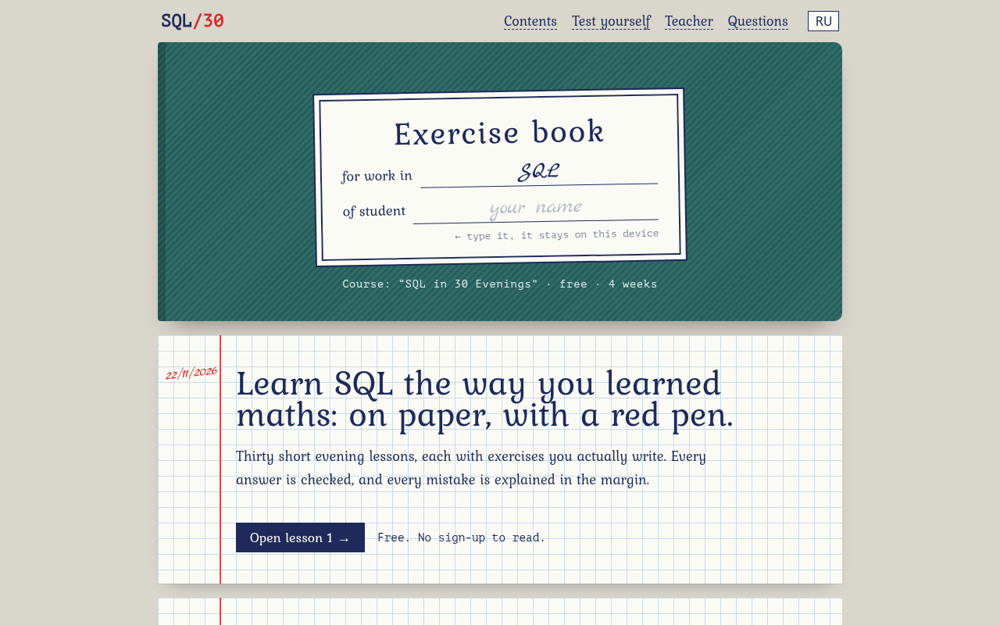

<!-- generated by scripts/build-docs.mjs from templates.json — edit there -->
# 11 · SQL in 30 Evenings — Онлайн-курс

[English version](README.md) · [Демо](https://unicorn-rm.github.io/vibe-templates/11-online-course/) · [Все шаблоны](../../README.ru.md)



- **Стиль:** Тетрадь в клетку, красная ручка
- **Стек:** Vue 3 · Vite
- **Шрифты:** [Kurale](https://fonts.google.com/specimen/Kurale), [Marck Script](https://fonts.google.com/specimen/Marck+Script), [PT Mono](https://fonts.google.com/specimen/PT+Mono) (латиница + кириллица)
- **Фирменный блок:** Квиз, который проверяет красная ручка учителя: галочки, крестики, обведённый верный ответ и оценка в кружке

## Запуск

```bash
npm install
npm run dev
npm run build   # ./dist
```

## Какие блоки внутри

- notebook cover with a name label you can fill
- first page with margin date
- contents with dotted leaders
- red-pen graded quiz
- teacher's handwritten note
- stats
- FAQ (details)
- footer

## Где что лежит

| Файл | Что там менять |
|---|---|
| `src/content.js` | syllabus, quiz questions and answers, all copy (EN + RU) |
| `src/App.vue` | whole page: cover, contents, graded quiz |
| `src/style.css` | tokens at the top, grid paper and pen marks |

По умолчанию страница на английском. Русский — кнопкой языка или `?lang=ru`.

## Переделать под себя с ИИ

Откройте эту папку в Claude Code, Cursor, Copilot или другом агенте и вставьте:

```text
Ты адаптируешь шаблон "11-online-course" из vibe-templates.
Сначала прочитай DESIGN.md и AGENTS.md в этой папке и соблюдай все правила из DESIGN.md.
Мой проект: <что это, для кого, 2–3 предложения>.
Замени весь текст и данные в src/content.js на контент моего проекта, на английском и русском.
Сохрани сетку, шрифты, фирменный блок и анимации. Палитру можно менять только в токенах, сохранив число акцентов и контраст текста не ниже 4.5:1.
Не добавляй новые зависимости. В конце перечисли, что изменил.
```

Правила дизайна, которые агент должен сохранить, — в [DESIGN.md](DESIGN.md).

## Лицензия

MIT — используйте как угодно, ссылка на репозиторий приветствуется. 
