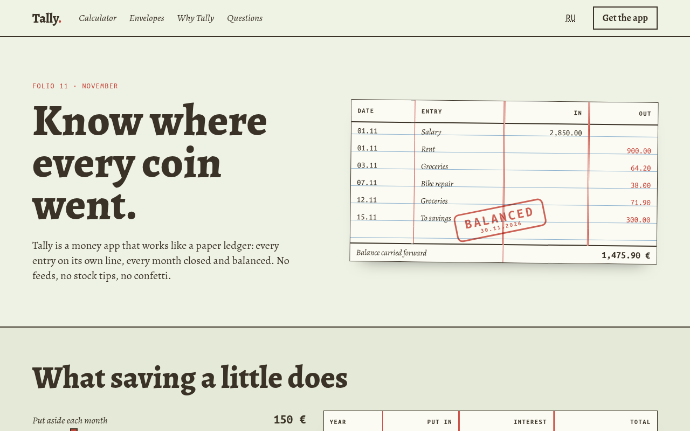

<!-- generated by scripts/build-docs.mjs from templates.json — edit there -->
# 12 · Tally — Personal finance app

[Русская версия](README.ru.md) · [Live demo](https://unicorn-rm.github.io/vibe-templates/12-finance-app/) · [All templates](../../README.md)



- **Style:** Accountant's ledger
- **Stack:** React 19 · Tailwind CSS 4 · Recharts · Vite
- **Fonts:** [Alegreya](https://fonts.google.com/specimen/Alegreya), [Ubuntu Mono](https://fonts.google.com/specimen/Ubuntu+Mono) (Latin + Cyrillic)
- **Signature block:** Savings calculator that writes each year into ledger rows and plots the curve like pen on graph paper

## Run it

```bash
npm install
npm run dev
npm run build   # ./dist
```

## Blocks inside

- ledger-page hero with rubber stamp
- ruler sliders
- ledger table of projections
- graph-paper chart (Recharts)
- budget envelopes
- feature list with dotted leaders
- FAQ
- double-rule footer

## Where things live

| File | What to edit there |
|---|---|
| `src/content.js` | envelopes, ledger entries, all copy (EN + RU) |
| `src/App.jsx` | page sections and the calculator |
| `src/index.css` | tokens in Tailwind `@theme` + ledger, stamp, graph-paper utilities |

The page speaks English by default. Russian: the language button, or `?lang=ru`.

## Make it yours with AI

Open this folder in Claude Code, Cursor, Copilot or any coding agent and paste:

```text
You are adapting the "12-finance-app" template from vibe-templates.
Read DESIGN.md and AGENTS.md in this folder first and keep every rule in DESIGN.md.
My project: <what it is, who it is for, 2–3 sentences>.
Replace all copy and data in src/content.js with content for my project, in English and Russian.
Keep the layout, the fonts, the signature block and the motion. You may change the palette tokens only if you keep the same number of accents and contrast of at least 4.5:1 for body text.
Do not add new dependencies. When done, list what you changed.
```

Design rules the agent must keep are in [DESIGN.md](DESIGN.md).

## License

MIT — use it for anything, credit appreciated. 
