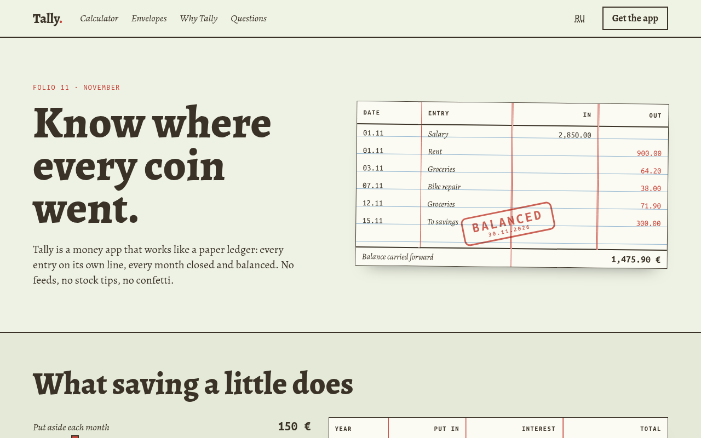

<!-- generated by scripts/build-docs.mjs from templates.json — edit there -->
# 12 · Tally — Приложение финансов

[English version](README.md) · [Демо](https://unicorn-rm.github.io/vibe-templates/12-finance-app/) · [Все шаблоны](../../README.ru.md)



- **Стиль:** Бухгалтерская книга
- **Стек:** React 19 · Tailwind CSS 4 · Recharts · Vite
- **Шрифты:** [Alegreya](https://fonts.google.com/specimen/Alegreya), [Ubuntu Mono](https://fonts.google.com/specimen/Ubuntu+Mono) (латиница + кириллица)
- **Фирменный блок:** Калькулятор накоплений, который вписывает каждый год строкой в книгу и чертит кривую, как пером на миллиметровке

## Запуск

```bash
npm install
npm run dev
npm run build   # ./dist
```

## Какие блоки внутри

- ledger-page hero with rubber stamp
- ruler sliders
- ledger table of projections
- graph-paper chart (Recharts)
- budget envelopes
- feature list with dotted leaders
- FAQ
- double-rule footer

## Где что лежит

| Файл | Что там менять |
|---|---|
| `src/content.js` | envelopes, ledger entries, all copy (EN + RU) |
| `src/App.jsx` | page sections and the calculator |
| `src/index.css` | tokens in Tailwind `@theme` + ledger, stamp, graph-paper utilities |

По умолчанию страница на английском. Русский — кнопкой языка или `?lang=ru`.

## Переделать под себя с ИИ

Откройте эту папку в Claude Code, Cursor, Copilot или другом агенте и вставьте:

```text
Ты адаптируешь шаблон "12-finance-app" из vibe-templates.
Сначала прочитай DESIGN.md и AGENTS.md в этой папке и соблюдай все правила из DESIGN.md.
Мой проект: <что это, для кого, 2–3 предложения>.
Замени весь текст и данные в src/content.js на контент моего проекта, на английском и русском.
Сохрани сетку, шрифты, фирменный блок и анимации. Палитру можно менять только в токенах, сохранив число акцентов и контраст текста не ниже 4.5:1.
Не добавляй новые зависимости. В конце перечисли, что изменил.
```

Правила дизайна, которые агент должен сохранить, — в [DESIGN.md](DESIGN.md).

## Лицензия

MIT — используйте как угодно, ссылка на репозиторий приветствуется. 
