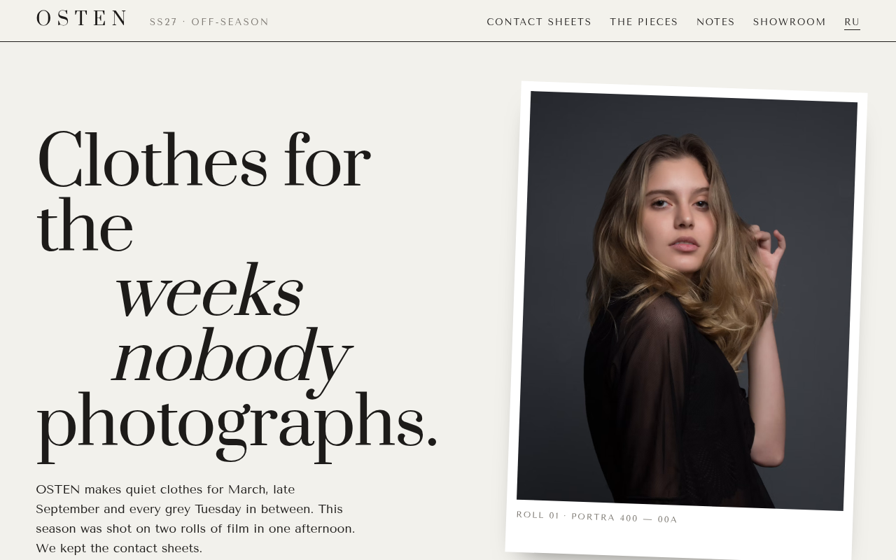

<!-- generated by scripts/build-docs.mjs from templates.json — edit there -->
# 13 · OSTEN — Fashion brand

[Русская версия](README.ru.md) · [Live demo](https://unicorn-rm.github.io/vibe-templates/13-fashion-lookbook/) · [All templates](../../README.md)



- **Style:** 35mm contact sheet on a light table
- **Stack:** Next.js 16 · TypeScript · plain CSS
- **Fonts:** [Prata](https://fonts.google.com/specimen/Prata), [Tenor Sans](https://fonts.google.com/specimen/Tenor+Sans) (Latin + Cyrillic)
- **Signature block:** Lookbook as film contact sheets: black-and-white frames, grease-pencil circles on selects, crosses on rejects, a round loupe that shows the frame in colour

## Run it

```bash
npm install
npm run dev
npm run build   # static export to ./out
```

## Blocks inside

- thin masthead
- headline + print laid on the table
- film strips with sprocket holes and edge print
- grease-pencil marks
- loupe modal (keyboard)
- pieces table linked to frames
- founder note
- showroom
- footer

## Where things live

| File | What to edit there |
|---|---|
| `lib/content.ts` | rolls, frames (Unsplash ids, select/reject), all copy (EN + RU) |
| `app/page.tsx` | page, contact strips, loupe |
| `app/globals.css` | tokens and film/loupe styles |
| `app/layout.tsx` | fonts and metadata |

The page speaks English by default. Russian: the language button, or `?lang=ru`.

## Make it yours with AI

Open this folder in Claude Code, Cursor, Copilot or any coding agent and paste:

```text
You are adapting the "13-fashion-lookbook" template from vibe-templates.
Read DESIGN.md and AGENTS.md in this folder first and keep every rule in DESIGN.md.
My project: <what it is, who it is for, 2–3 sentences>.
Replace all copy and data in lib/content.ts with content for my project, in English and Russian.
Keep the layout, the fonts, the signature block and the motion. You may change the palette tokens only if you keep the same number of accents and contrast of at least 4.5:1 for body text.
Do not add new dependencies. When done, list what you changed.
```

Design rules the agent must keep are in [DESIGN.md](DESIGN.md).

## License

MIT — use it for anything, credit appreciated. 
