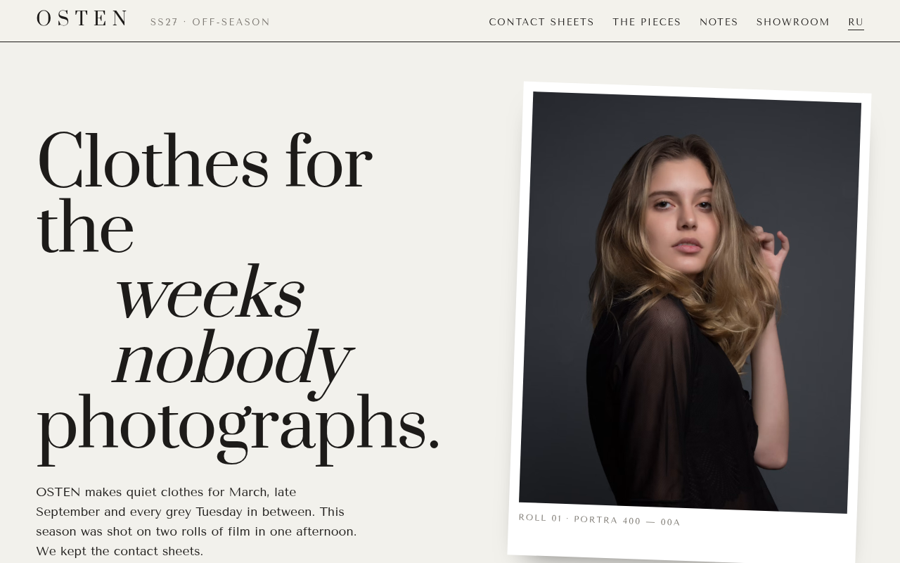

<!-- generated by scripts/build-docs.mjs from templates.json — edit there -->
# 13 · OSTEN — Модный бренд

[English version](README.md) · [Демо](https://unicorn-rm.github.io/vibe-templates/13-fashion-lookbook/) · [Все шаблоны](../../README.ru.md)



- **Стиль:** Контактный лист 35 мм на световом столе
- **Стек:** Next.js 16 · TypeScript · plain CSS
- **Шрифты:** [Prata](https://fonts.google.com/specimen/Prata), [Tenor Sans](https://fonts.google.com/specimen/Tenor+Sans) (латиница + кириллица)
- **Фирменный блок:** Лукбук как контактные листы плёнки: чёрно-белые кадры, круги жирным карандашом на отобранных, крестики на отбракованных и круглая лупа, показывающая кадр в цвете

## Запуск

```bash
npm install
npm run dev
npm run build   # static export to ./out
```

## Какие блоки внутри

- thin masthead
- headline + print laid on the table
- film strips with sprocket holes and edge print
- grease-pencil marks
- loupe modal (keyboard)
- pieces table linked to frames
- founder note
- showroom
- footer

## Где что лежит

| Файл | Что там менять |
|---|---|
| `lib/content.ts` | rolls, frames (Unsplash ids, select/reject), all copy (EN + RU) |
| `app/page.tsx` | page, contact strips, loupe |
| `app/globals.css` | tokens and film/loupe styles |
| `app/layout.tsx` | fonts and metadata |

По умолчанию страница на английском. Русский — кнопкой языка или `?lang=ru`.

## Переделать под себя с ИИ

Откройте эту папку в Claude Code, Cursor, Copilot или другом агенте и вставьте:

```text
Ты адаптируешь шаблон "13-fashion-lookbook" из vibe-templates.
Сначала прочитай DESIGN.md и AGENTS.md в этой папке и соблюдай все правила из DESIGN.md.
Мой проект: <что это, для кого, 2–3 предложения>.
Замени весь текст и данные в lib/content.ts на контент моего проекта, на английском и русском.
Сохрани сетку, шрифты, фирменный блок и анимации. Палитру можно менять только в токенах, сохранив число акцентов и контраст текста не ниже 4.5:1.
Не добавляй новые зависимости. В конце перечисли, что изменил.
```

Правила дизайна, которые агент должен сохранить, — в [DESIGN.md](DESIGN.md).

## Лицензия

MIT — используйте как угодно, ссылка на репозиторий приветствуется. 
