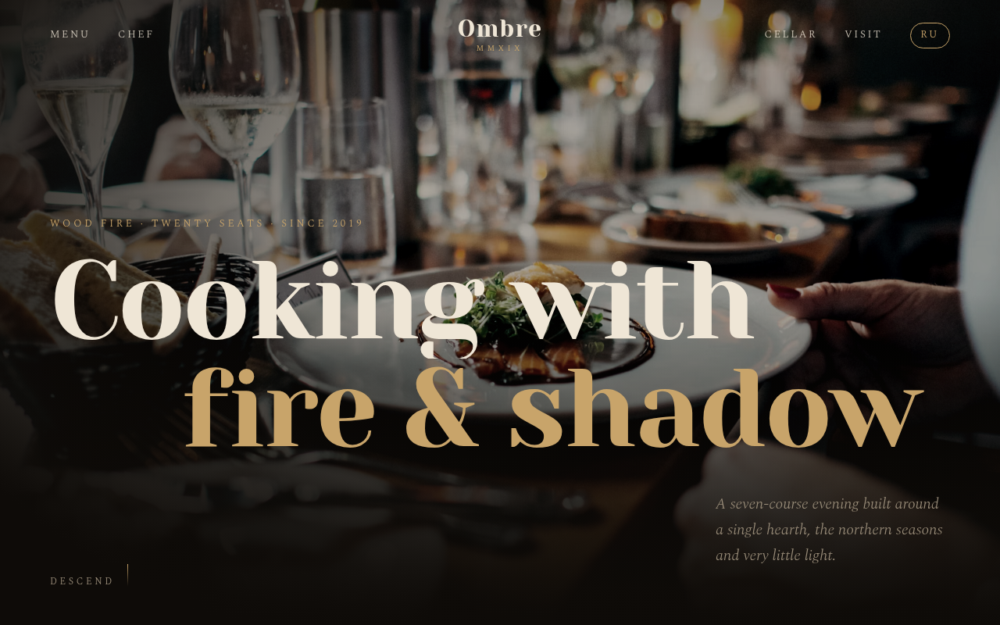

<!-- generated by scripts/build-docs.mjs from templates.json — edit there -->
# 14 · Ombre — Fine-dining restaurant

[Русская версия](README.ru.md) · [Live demo](https://unicorn-rm.github.io/vibe-templates/14-fine-dining/) · [All templates](../../README.md)



- **Style:** Dark luxury, candlelight
- **Stack:** HTML · CSS · GSAP + ScrollTrigger
- **Fonts:** [Yeseva One](https://fonts.google.com/specimen/Yeseva+One), [Spectral](https://fonts.google.com/specimen/Spectral) (Latin + Cyrillic)
- **Signature block:** Pinned tasting menu: a sticky photo and roman numeral change with every course you scroll past

## Run it

```bash
open index.html   # or any static server: npx serve .
```

## Blocks inside

- split navigation with centered logo
- full-bleed hero with line reveal
- word-by-word quote reveal
- drop-cap story columns
- pinned tasting menu
- chef portrait clip reveal
- count-up stats
- asymmetric parallax gallery
- press quotes
- hours table
- footer

## Where things live

| File | What to edit there |
|---|---|
| `content.js` | courses with photos + Russian copy (English lives in the HTML) |
| `main.js` | language switch, menu sync, GSAP choreography with no-GSAP fallback |
| `styles.css` | tokens at the top |
| `index.html` | page skeleton and English copy |

The page speaks English by default. Russian: the language button, or `?lang=ru`.

## Make it yours with AI

Open this folder in Claude Code, Cursor, Copilot or any coding agent and paste:

```text
You are adapting the "14-fine-dining" template from vibe-templates.
Read DESIGN.md and AGENTS.md in this folder first and keep every rule in DESIGN.md.
My project: <what it is, who it is for, 2–3 sentences>.
Replace all copy and data in content.js with content for my project, in English and Russian.
Keep the layout, the fonts, the signature block and the motion. You may change the palette tokens only if you keep the same number of accents and contrast of at least 4.5:1 for body text.
Do not add new dependencies. When done, list what you changed.
```

Design rules the agent must keep are in [DESIGN.md](DESIGN.md).

## License

MIT — use it for anything, credit appreciated. Demo photos are from [Unsplash](https://unsplash.com/license) and hot-linked; replace them with your own.
