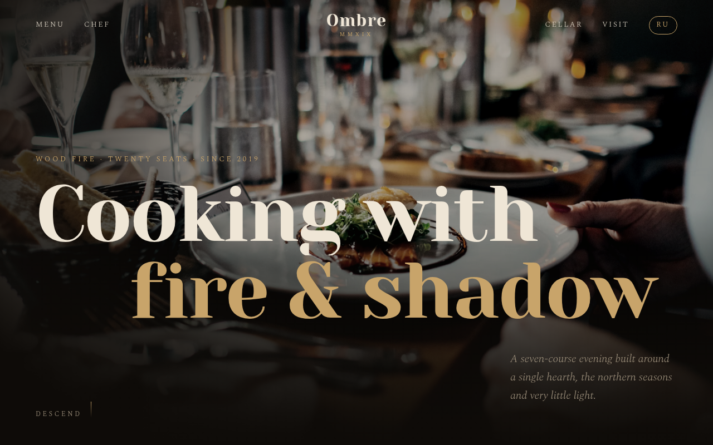

<!-- generated by scripts/build-docs.mjs from templates.json — edit there -->
# 14 · Ombre — Ресторан высокой кухни

[English version](README.md) · [Демо](https://unicorn-rm.github.io/vibe-templates/14-fine-dining/) · [Все шаблоны](../../README.ru.md)



- **Стиль:** Тёмная роскошь, свет свечи
- **Стек:** HTML · CSS · GSAP + ScrollTrigger
- **Шрифты:** [Yeseva One](https://fonts.google.com/specimen/Yeseva+One), [Spectral](https://fonts.google.com/specimen/Spectral) (латиница + кириллица)
- **Фирменный блок:** Закреплённое дегустационное меню: фото и римская цифра меняются на каждом блюде при прокрутке

## Запуск

```bash
open index.html   # or any static server: npx serve .
```

## Какие блоки внутри

- split navigation with centered logo
- full-bleed hero with line reveal
- word-by-word quote reveal
- drop-cap story columns
- pinned tasting menu
- chef portrait clip reveal
- count-up stats
- asymmetric parallax gallery
- press quotes
- hours table
- footer

## Где что лежит

| Файл | Что там менять |
|---|---|
| `content.js` | courses with photos + Russian copy (English lives in the HTML) |
| `main.js` | language switch, menu sync, GSAP choreography with no-GSAP fallback |
| `styles.css` | tokens at the top |
| `index.html` | page skeleton and English copy |

По умолчанию страница на английском. Русский — кнопкой языка или `?lang=ru`.

## Переделать под себя с ИИ

Откройте эту папку в Claude Code, Cursor, Copilot или другом агенте и вставьте:

```text
Ты адаптируешь шаблон "14-fine-dining" из vibe-templates.
Сначала прочитай DESIGN.md и AGENTS.md в этой папке и соблюдай все правила из DESIGN.md.
Мой проект: <что это, для кого, 2–3 предложения>.
Замени весь текст и данные в content.js на контент моего проекта, на английском и русском.
Сохрани сетку, шрифты, фирменный блок и анимации. Палитру можно менять только в токенах, сохранив число акцентов и контраст текста не ниже 4.5:1.
Не добавляй новые зависимости. В конце перечисли, что изменил.
```

Правила дизайна, которые агент должен сохранить, — в [DESIGN.md](DESIGN.md).

## Лицензия

MIT — используйте как угодно, ссылка на репозиторий приветствуется. Демо-фото с [Unsplash](https://unsplash.com/license), подключены ссылками; замените своими.
