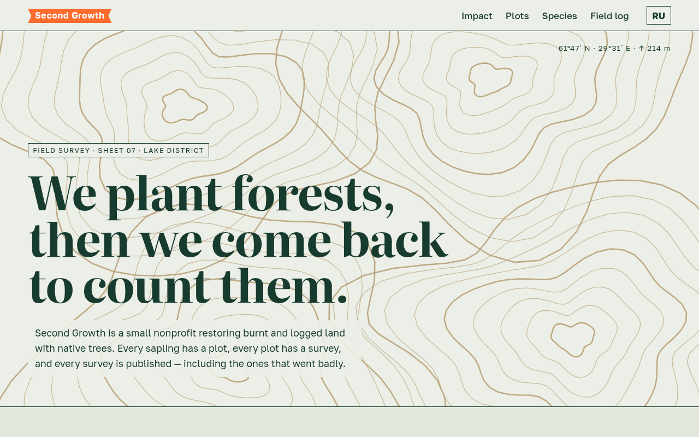

<!-- generated by scripts/build-docs.mjs from templates.json — edit there -->
# 15 · Second Growth — Eco nonprofit

[Русская версия](README.ru.md) · [Live demo](https://unicorn-rm.github.io/vibe-templates/15-eco-nonprofit/) · [All templates](../../README.md)



- **Style:** Field survey notebook
- **Stack:** Astro 7
- **Fonts:** [Literata](https://fonts.google.com/specimen/Literata), [Golos Text](https://fonts.google.com/specimen/Golos+Text) (Latin + Cyrillic)
- **Signature block:** Tree-ring impact chart: one ring per year, width = trees planted, tap a ring for the numbers

## Run it

```bash
npm install          # Node 22.23+ (Astro 7)
npm run dev
npm run build   # ./dist
```

## Blocks inside

- flagging-tape logo
- hero over a generated contour map
- tree-ring chart with info panel
- plot map with flags + synced list
- specimen tags
- field log
- volunteer note
- footer

## Where things live

| File | What to edit there |
|---|---|
| `src/content.ts` | rings (per-year data), plots, species, log, all copy (EN + RU) |
| `src/pages/index.astro` | contour + ring generators, markup, client script |
| `src/styles/global.css` | tokens at the top |
| `src/components/T.astro` | bilingual text helper |

The page speaks English by default. Russian: the language button, or `?lang=ru`.

## Make it yours with AI

Open this folder in Claude Code, Cursor, Copilot or any coding agent and paste:

```text
You are adapting the "15-eco-nonprofit" template from vibe-templates.
Read DESIGN.md and AGENTS.md in this folder first and keep every rule in DESIGN.md.
My project: <what it is, who it is for, 2–3 sentences>.
Replace all copy and data in src/content.ts with content for my project, in English and Russian.
Keep the layout, the fonts, the signature block and the motion. You may change the palette tokens only if you keep the same number of accents and contrast of at least 4.5:1 for body text.
Do not add new dependencies. When done, list what you changed.
```

Design rules the agent must keep are in [DESIGN.md](DESIGN.md).

## License

MIT — use it for anything, credit appreciated. 
