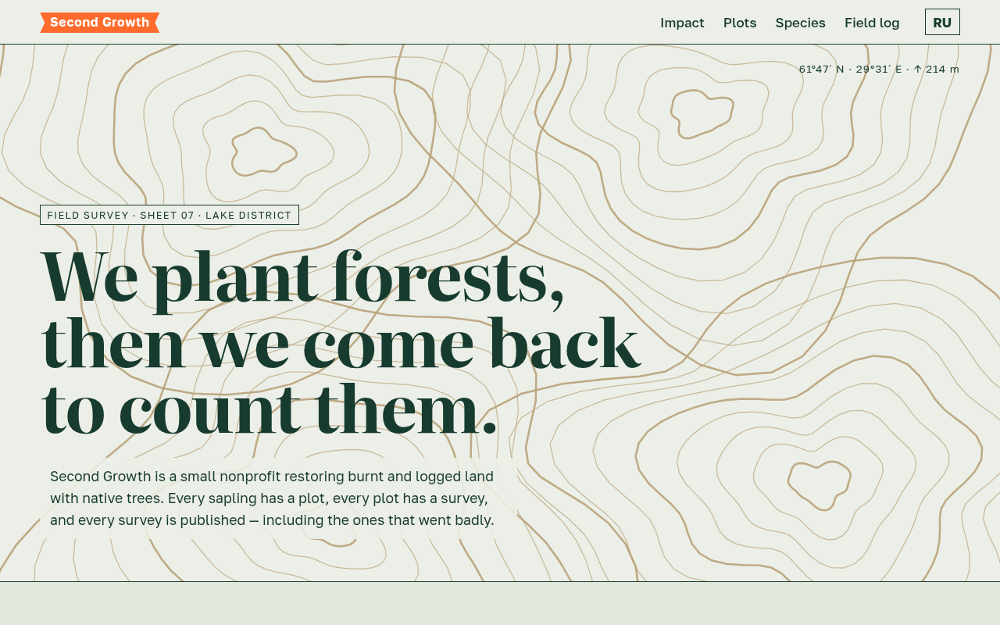

<!-- generated by scripts/build-docs.mjs from templates.json — edit there -->
# 15 · Second Growth — Эко-НКО

[English version](README.md) · [Демо](https://unicorn-rm.github.io/vibe-templates/15-eco-nonprofit/) · [Все шаблоны](../../README.ru.md)



- **Стиль:** Полевой дневник
- **Стек:** Astro 7
- **Шрифты:** [Literata](https://fonts.google.com/specimen/Literata), [Golos Text](https://fonts.google.com/specimen/Golos+Text) (латиница + кириллица)
- **Фирменный блок:** Годовые кольца как отчёт: одно кольцо на год, ширина — число посаженных деревьев, нажмите на кольцо, чтобы увидеть цифры

## Запуск

```bash
npm install          # Node 22.23+ (Astro 7)
npm run dev
npm run build   # ./dist
```

## Какие блоки внутри

- flagging-tape logo
- hero over a generated contour map
- tree-ring chart with info panel
- plot map with flags + synced list
- specimen tags
- field log
- volunteer note
- footer

## Где что лежит

| Файл | Что там менять |
|---|---|
| `src/content.ts` | rings (per-year data), plots, species, log, all copy (EN + RU) |
| `src/pages/index.astro` | contour + ring generators, markup, client script |
| `src/styles/global.css` | tokens at the top |
| `src/components/T.astro` | bilingual text helper |

По умолчанию страница на английском. Русский — кнопкой языка или `?lang=ru`.

## Переделать под себя с ИИ

Откройте эту папку в Claude Code, Cursor, Copilot или другом агенте и вставьте:

```text
Ты адаптируешь шаблон "15-eco-nonprofit" из vibe-templates.
Сначала прочитай DESIGN.md и AGENTS.md в этой папке и соблюдай все правила из DESIGN.md.
Мой проект: <что это, для кого, 2–3 предложения>.
Замени весь текст и данные в src/content.ts на контент моего проекта, на английском и русском.
Сохрани сетку, шрифты, фирменный блок и анимации. Палитру можно менять только в токенах, сохранив число акцентов и контраст текста не ниже 4.5:1.
Не добавляй новые зависимости. В конце перечисли, что изменил.
```

Правила дизайна, которые агент должен сохранить, — в [DESIGN.md](DESIGN.md).

## Лицензия

MIT — используйте как угодно, ссылка на репозиторий приветствуется. 
