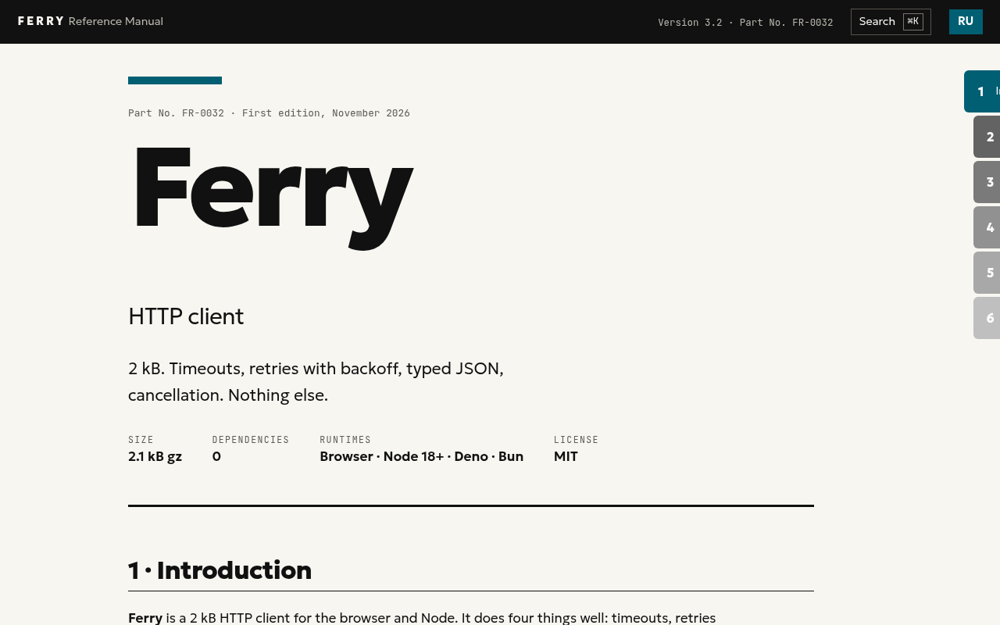

<!-- generated by scripts/build-docs.mjs from templates.json — edit there -->
# 16 · Ferry — Open-source library

[Русская версия](README.ru.md) · [Live demo](https://unicorn-rm.github.io/vibe-templates/16-oss-docs/) · [All templates](../../README.md)



- **Style:** 1980s printed reference manual
- **Stack:** Astro 7 · MDX
- **Fonts:** [Geologica](https://fonts.google.com/specimen/Geologica), [JetBrains Mono](https://fonts.google.com/specimen/JetBrains+Mono) (Latin + Cyrillic)
- **Signature block:** Thumb-index tabs on the page edge that track the chapter you're reading + ⌘K search over the manual

## Run it

```bash
npm install          # Node 22.23+ (Astro 7)
npm run dev
npm run build   # ./dist
```

## Blocks inside

- black spine bar
- manual cover with part number and specs
- MDX chapters (EN + RU files)
- install tabs with copy
- NOTE / CAUTION boxes
- SVG retry-timeline figure
- API table
- changelog
- ⌘K search dialog

## Where things live

| File | What to edit there |
|---|---|
| `src/content/guide.en.mdx` | English chapters |
| `src/content/guide.ru.mdx` | Russian chapters |
| `src/pages/index.astro` | layout, thumb tabs, search and copy script |
| `src/components/` | Install tabs, RetryFigure, Note |
| `src/styles/global.css` | tokens at the top |

The page speaks English by default. Russian: the language button, or `?lang=ru`.

## Make it yours with AI

Open this folder in Claude Code, Cursor, Copilot or any coding agent and paste:

```text
You are adapting the "16-oss-docs" template from vibe-templates.
Read DESIGN.md and AGENTS.md in this folder first and keep every rule in DESIGN.md.
My project: <what it is, who it is for, 2–3 sentences>.
Replace all copy and data in src/content/guide.en.mdx with content for my project, in English and Russian.
Keep the layout, the fonts, the signature block and the motion. You may change the palette tokens only if you keep the same number of accents and contrast of at least 4.5:1 for body text.
Do not add new dependencies. When done, list what you changed.
```

Design rules the agent must keep are in [DESIGN.md](DESIGN.md).

## License

MIT — use it for anything, credit appreciated. 
