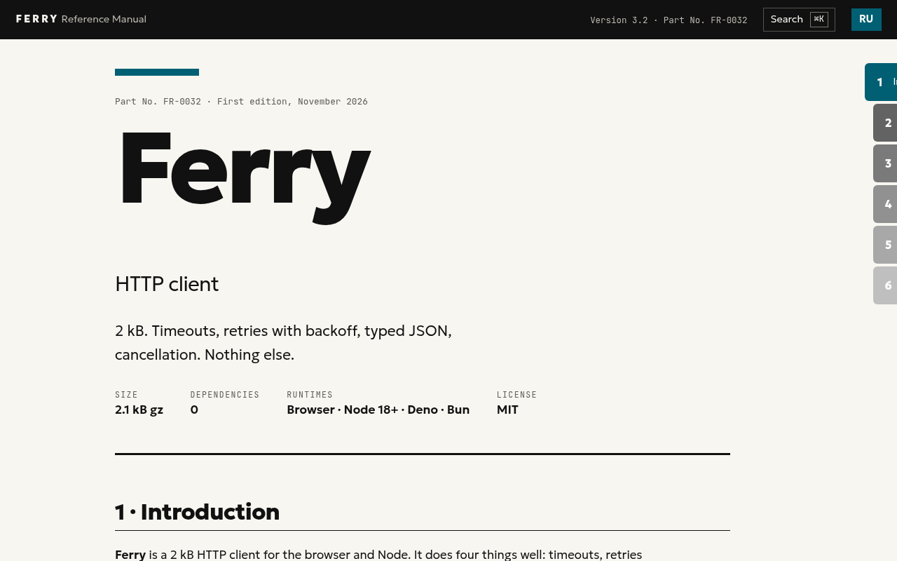

<!-- generated by scripts/build-docs.mjs from templates.json — edit there -->
# 16 · Ferry — Open-source библиотека

[English version](README.md) · [Демо](https://unicorn-rm.github.io/vibe-templates/16-oss-docs/) · [Все шаблоны](../../README.ru.md)



- **Стиль:** Печатный справочник 1980-х
- **Стек:** Astro 7 · MDX
- **Шрифты:** [Geologica](https://fonts.google.com/specimen/Geologica), [JetBrains Mono](https://fonts.google.com/specimen/JetBrains+Mono) (латиница + кириллица)
- **Фирменный блок:** Вырубные закладки-индексы по краю страницы, отслеживающие текущую главу, + поиск по ⌘K

## Запуск

```bash
npm install          # Node 22.23+ (Astro 7)
npm run dev
npm run build   # ./dist
```

## Какие блоки внутри

- black spine bar
- manual cover with part number and specs
- MDX chapters (EN + RU files)
- install tabs with copy
- NOTE / CAUTION boxes
- SVG retry-timeline figure
- API table
- changelog
- ⌘K search dialog

## Где что лежит

| Файл | Что там менять |
|---|---|
| `src/content/guide.en.mdx` | English chapters |
| `src/content/guide.ru.mdx` | Russian chapters |
| `src/pages/index.astro` | layout, thumb tabs, search and copy script |
| `src/components/` | Install tabs, RetryFigure, Note |
| `src/styles/global.css` | tokens at the top |

По умолчанию страница на английском. Русский — кнопкой языка или `?lang=ru`.

## Переделать под себя с ИИ

Откройте эту папку в Claude Code, Cursor, Copilot или другом агенте и вставьте:

```text
Ты адаптируешь шаблон "16-oss-docs" из vibe-templates.
Сначала прочитай DESIGN.md и AGENTS.md в этой папке и соблюдай все правила из DESIGN.md.
Мой проект: <что это, для кого, 2–3 предложения>.
Замени весь текст и данные в src/content/guide.en.mdx на контент моего проекта, на английском и русском.
Сохрани сетку, шрифты, фирменный блок и анимации. Палитру можно менять только в токенах, сохранив число акцентов и контраст текста не ниже 4.5:1.
Не добавляй новые зависимости. В конце перечисли, что изменил.
```

Правила дизайна, которые агент должен сохранить, — в [DESIGN.md](DESIGN.md).

## Лицензия

MIT — используйте как угодно, ссылка на репозиторий приветствуется. 
