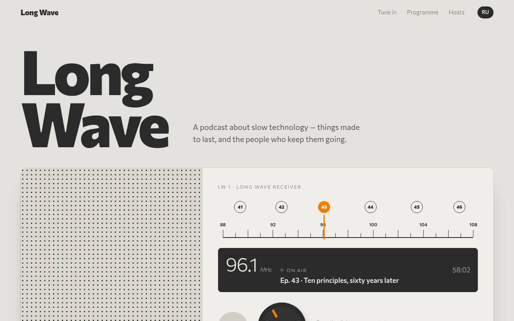

<!-- generated by scripts/build-docs.mjs from templates.json — edit there -->
# 17 · Long Wave — Подкаст

[English version](README.md) · [Демо](https://unicorn-rm.github.io/vibe-templates/17-podcast/) · [Все шаблоны](../../README.ru.md)



- **Стиль:** Радиоприёмник эпохи Braun
- **Стек:** SvelteKit 3 · Svelte 5 · Web Audio
- **Шрифты:** [Commissioner](https://fonts.google.com/specimen/Commissioner) (латиница + кириллица)
- **Фирменный блок:** Выпуски — станции на шкале частот: крутите ручку настройки (или стрелками) — между станциями шум, на станции тон

## Запуск

```bash
npm install          # Node 22.17+
npm run dev
npm run build   # ./build
```

## Какие блоки внутри

- minimal header
- big wordmark + tagline
- radio: speaker grille, frequency scale, display, power, tuning knob
- programme guide list
- hosts
- listen-on links
- footer

## Где что лежит

| Файл | Что там менять |
|---|---|
| `src/lib/content.js` | episodes with frequencies, hosts, all copy (EN + RU) |
| `src/routes/+page.svelte` | page, tuner logic, Web Audio |
| `src/app.css` | tokens at the top |
| `vite.config.js` | SvelteKit 3 config lives in the Vite plugin |

По умолчанию страница на английском. Русский — кнопкой языка или `?lang=ru`.

## Переделать под себя с ИИ

Откройте эту папку в Claude Code, Cursor, Copilot или другом агенте и вставьте:

```text
Ты адаптируешь шаблон "17-podcast" из vibe-templates.
Сначала прочитай DESIGN.md и AGENTS.md в этой папке и соблюдай все правила из DESIGN.md.
Мой проект: <что это, для кого, 2–3 предложения>.
Замени весь текст и данные в src/lib/content.js на контент моего проекта, на английском и русском.
Сохрани сетку, шрифты, фирменный блок и анимации. Палитру можно менять только в токенах, сохранив число акцентов и контраст текста не ниже 4.5:1.
Не добавляй новые зависимости. В конце перечисли, что изменил.
```

Правила дизайна, которые агент должен сохранить, — в [DESIGN.md](DESIGN.md).

## Лицензия

MIT — используйте как угодно, ссылка на репозиторий приветствуется. 
