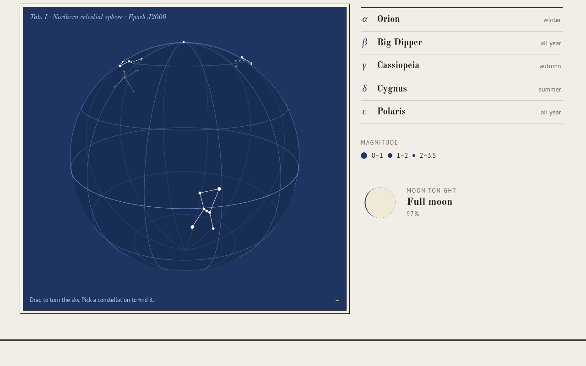

<!-- generated by scripts/build-docs.mjs from templates.json — edit there -->
# 18 · Kepler Hall — Space museum

[Русская версия](README.ru.md) · [Live demo](https://unicorn-rm.github.io/vibe-templates/18-space-museum/) · [All templates](../../README.md)



- **Style:** Printed star atlas
- **Stack:** Vanilla JS · Three.js · Vite
- **Fonts:** [Old Standard TT](https://fonts.google.com/specimen/Old+Standard+TT), [PT Sans](https://fonts.google.com/specimen/PT+Sans) (Latin + Cyrillic)
- **Signature block:** Draggable 3D celestial sphere drawn as an atlas plate — RA/Dec grid, real constellations; pick one and the sky turns to it

## Run it

```bash
npm install
npm run dev
npm run build   # ./dist
```

## Blocks inside

- double-rule header
- serif headline
- atlas plate with 3D sphere
- constellation index (Greek letters)
- magnitude legend
- tonight's moon phase (computed)
- exhibit catalogue
- dome show schedule
- visit

## Where things live

| File | What to edit there |
|---|---|
| `src/content.js` | constellations, exhibits, shows, all copy (EN + RU) |
| `src/sky.js` | star coordinates, stick figures, moon phase |
| `src/sphere.js` | Three.js celestial sphere |
| `src/main.js` | rendering, language, moon |
| `src/style.css` | tokens at the top |

The page speaks English by default. Russian: the language button, or `?lang=ru`.

## Make it yours with AI

Open this folder in Claude Code, Cursor, Copilot or any coding agent and paste:

```text
You are adapting the "18-space-museum" template from vibe-templates.
Read DESIGN.md and AGENTS.md in this folder first and keep every rule in DESIGN.md.
My project: <what it is, who it is for, 2–3 sentences>.
Replace all copy and data in src/content.js with content for my project, in English and Russian.
Keep the layout, the fonts, the signature block and the motion. You may change the palette tokens only if you keep the same number of accents and contrast of at least 4.5:1 for body text.
Do not add new dependencies. When done, list what you changed.
```

Design rules the agent must keep are in [DESIGN.md](DESIGN.md).

## License

MIT — use it for anything, credit appreciated. 
