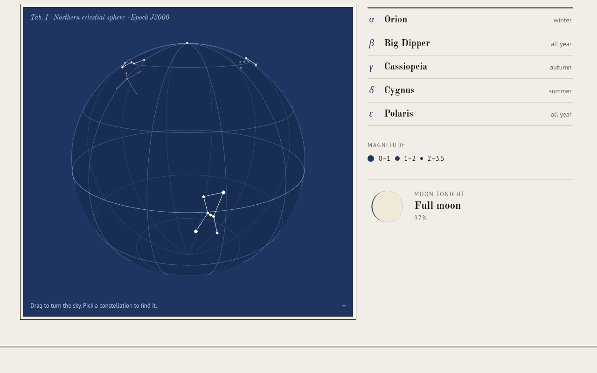

<!-- generated by scripts/build-docs.mjs from templates.json — edit there -->
# 18 · Kepler Hall — Музей космоса

[English version](README.md) · [Демо](https://unicorn-rm.github.io/vibe-templates/18-space-museum/) · [Все шаблоны](../../README.ru.md)



- **Стиль:** Печатный звёздный атлас
- **Стек:** Vanilla JS · Three.js · Vite
- **Шрифты:** [Old Standard TT](https://fonts.google.com/specimen/Old+Standard+TT), [PT Sans](https://fonts.google.com/specimen/PT+Sans) (латиница + кириллица)
- **Фирменный блок:** Перетаскиваемая 3D-небесная сфера, нарисованная как лист атласа: сетка координат, настоящие созвездия; выберите созвездие — и небо повернётся к нему

## Запуск

```bash
npm install
npm run dev
npm run build   # ./dist
```

## Какие блоки внутри

- double-rule header
- serif headline
- atlas plate with 3D sphere
- constellation index (Greek letters)
- magnitude legend
- tonight's moon phase (computed)
- exhibit catalogue
- dome show schedule
- visit

## Где что лежит

| Файл | Что там менять |
|---|---|
| `src/content.js` | constellations, exhibits, shows, all copy (EN + RU) |
| `src/sky.js` | star coordinates, stick figures, moon phase |
| `src/sphere.js` | Three.js celestial sphere |
| `src/main.js` | rendering, language, moon |
| `src/style.css` | tokens at the top |

По умолчанию страница на английском. Русский — кнопкой языка или `?lang=ru`.

## Переделать под себя с ИИ

Откройте эту папку в Claude Code, Cursor, Copilot или другом агенте и вставьте:

```text
Ты адаптируешь шаблон "18-space-museum" из vibe-templates.
Сначала прочитай DESIGN.md и AGENTS.md в этой папке и соблюдай все правила из DESIGN.md.
Мой проект: <что это, для кого, 2–3 предложения>.
Замени весь текст и данные в src/content.js на контент моего проекта, на английском и русском.
Сохрани сетку, шрифты, фирменный блок и анимации. Палитру можно менять только в токенах, сохранив число акцентов и контраст текста не ниже 4.5:1.
Не добавляй новые зависимости. В конце перечисли, что изменил.
```

Правила дизайна, которые агент должен сохранить, — в [DESIGN.md](DESIGN.md).

## Лицензия

MIT — используйте как угодно, ссылка на репозиторий приветствуется. 
