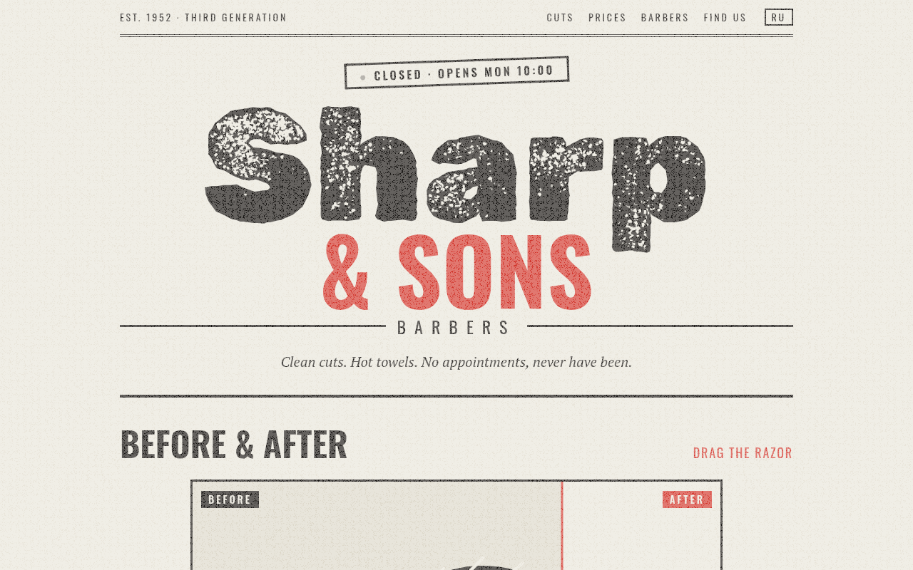

<!-- generated by scripts/build-docs.mjs from templates.json — edit there -->
# 19 · Sharp & Sons — Barbershop / tattoo

[Русская версия](README.ru.md) · [Live demo](https://unicorn-rm.github.io/vibe-templates/19-barbershop/) · [All templates](../../README.md)



- **Style:** Wood-type letterpress broadside
- **Stack:** Tailwind CSS 4 · Alpine.js · Vite
- **Fonts:** [Oswald](https://fonts.google.com/specimen/Oswald), [Rubik Dirt](https://fonts.google.com/specimen/Rubik+Dirt), [PT Serif](https://fonts.google.com/specimen/PT+Serif) (Latin + Cyrillic)
- **Signature block:** Woodcut before/after: drag the razor across two hand-drawn profiles (shaggy vs. fresh cut)

## Run it

```bash
npm install
npm run dev
npm run build   # ./dist
```

## Blocks inside

- double-rule header
- live open/closed sign
- broadside masthead
- woodcut before/after slider
- price list with leaders
- walk-ins band
- barber cards
- hours with today highlighted
- footer

## Where things live

| File | What to edit there |
|---|---|
| `src/main.js` | Alpine component: hours, services, all copy (EN + RU), slider |
| `index.html` | markup and woodcut SVGs |
| `src/style.css` | tokens in Tailwind `@theme` + print effects |

The page speaks English by default. Russian: the language button, or `?lang=ru`.

## Make it yours with AI

Open this folder in Claude Code, Cursor, Copilot or any coding agent and paste:

```text
You are adapting the "19-barbershop" template from vibe-templates.
Read DESIGN.md and AGENTS.md in this folder first and keep every rule in DESIGN.md.
My project: <what it is, who it is for, 2–3 sentences>.
Replace all copy and data in src/main.js with content for my project, in English and Russian.
Keep the layout, the fonts, the signature block and the motion. You may change the palette tokens only if you keep the same number of accents and contrast of at least 4.5:1 for body text.
Do not add new dependencies. When done, list what you changed.
```

Design rules the agent must keep are in [DESIGN.md](DESIGN.md).

## License

MIT — use it for anything, credit appreciated. 
