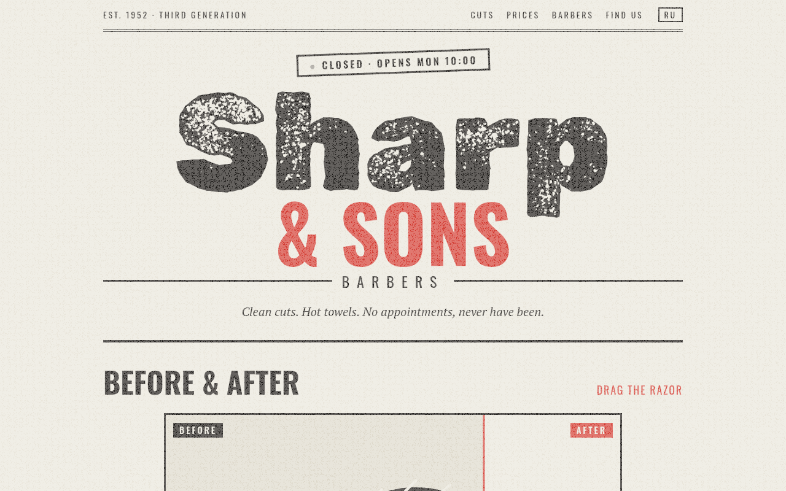

<!-- generated by scripts/build-docs.mjs from templates.json — edit there -->
# 19 · Sharp & Sons — Барбершоп / тату

[English version](README.md) · [Демо](https://unicorn-rm.github.io/vibe-templates/19-barbershop/) · [Все шаблоны](../../README.ru.md)



- **Стиль:** Афиша из деревянного шрифта
- **Стек:** Tailwind CSS 4 · Alpine.js · Vite
- **Шрифты:** [Oswald](https://fonts.google.com/specimen/Oswald), [Rubik Dirt](https://fonts.google.com/specimen/Rubik+Dirt), [PT Serif](https://fonts.google.com/specimen/PT+Serif) (латиница + кириллица)
- **Фирменный блок:** Гравюра «до и после»: тяните бритву по двум профилям (лохматый и после стрижки)

## Запуск

```bash
npm install
npm run dev
npm run build   # ./dist
```

## Какие блоки внутри

- double-rule header
- live open/closed sign
- broadside masthead
- woodcut before/after slider
- price list with leaders
- walk-ins band
- barber cards
- hours with today highlighted
- footer

## Где что лежит

| Файл | Что там менять |
|---|---|
| `src/main.js` | Alpine component: hours, services, all copy (EN + RU), slider |
| `index.html` | markup and woodcut SVGs |
| `src/style.css` | tokens in Tailwind `@theme` + print effects |

По умолчанию страница на английском. Русский — кнопкой языка или `?lang=ru`.

## Переделать под себя с ИИ

Откройте эту папку в Claude Code, Cursor, Copilot или другом агенте и вставьте:

```text
Ты адаптируешь шаблон "19-barbershop" из vibe-templates.
Сначала прочитай DESIGN.md и AGENTS.md в этой папке и соблюдай все правила из DESIGN.md.
Мой проект: <что это, для кого, 2–3 предложения>.
Замени весь текст и данные в src/main.js на контент моего проекта, на английском и русском.
Сохрани сетку, шрифты, фирменный блок и анимации. Палитру можно менять только в токенах, сохранив число акцентов и контраст текста не ниже 4.5:1.
Не добавляй новые зависимости. В конце перечисли, что изменил.
```

Правила дизайна, которые агент должен сохранить, — в [DESIGN.md](DESIGN.md).

## Лицензия

MIT — используйте как угодно, ссылка на репозиторий приветствуется. 
