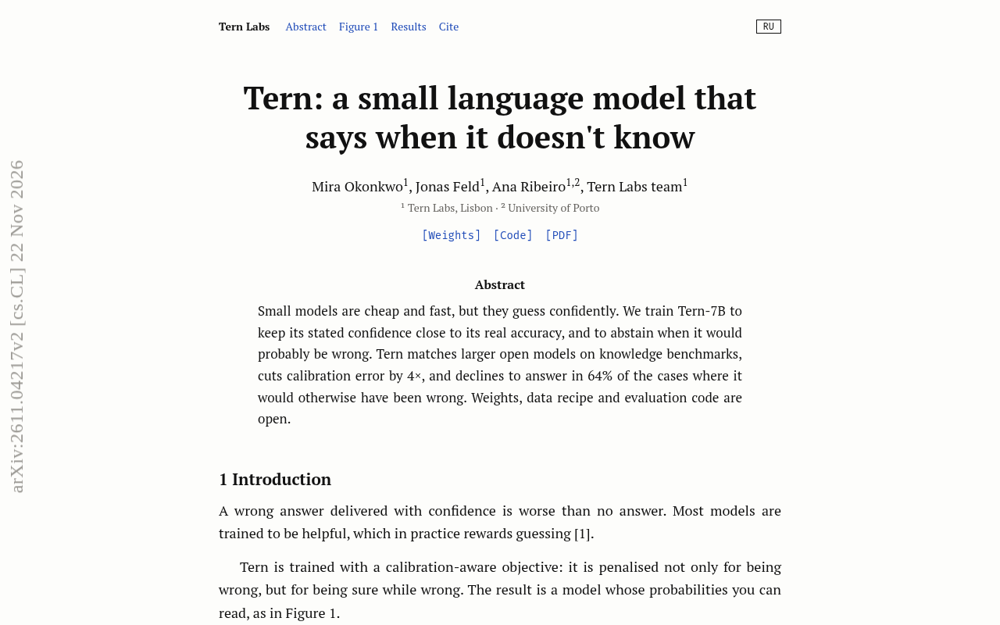

<!-- generated by scripts/build-docs.mjs from templates.json — edit there -->
# 20 · Tern — AI startup

[Русская версия](README.ru.md) · [Live demo](https://unicorn-rm.github.io/vibe-templates/20-ai-startup/) · [All templates](../../README.md)



- **Style:** arXiv research paper
- **Stack:** Next.js 16 · Tailwind CSS 4 · TypeScript
- **Fonts:** [PT Serif](https://fonts.google.com/specimen/PT+Serif), [Fira Code](https://fonts.google.com/specimen/Fira+Code) (Latin + Cyrillic)
- **Signature block:** Figure 1: the model's answer streams token by token, underlined by confidence; hover a token for alternatives — low confidence triggers an honest 'I don't know'

## Run it

```bash
npm install
npm run dev
npm run build   # static export to ./out
```

## Blocks inside

- arXiv side stamp
- title, authors, affiliations
- abstract
- numbered sections
- interactive token-confidence figure
- MathML equation
- booktabs results table
- BibTeX with copy
- references

## Where things live

| File | What to edit there |
|---|---|
| `lib/content.ts` | paper copy (EN + RU), demo tokens with probabilities, results, BibTeX |
| `app/page.tsx` | paper layout and the Figure component |
| `app/globals.css` | tokens in Tailwind `@theme`, token underlines, booktabs |
| `mathml.d.ts` | MathML element types for TSX |

The page speaks English by default. Russian: the language button, or `?lang=ru`.

## Make it yours with AI

Open this folder in Claude Code, Cursor, Copilot or any coding agent and paste:

```text
You are adapting the "20-ai-startup" template from vibe-templates.
Read DESIGN.md and AGENTS.md in this folder first and keep every rule in DESIGN.md.
My project: <what it is, who it is for, 2–3 sentences>.
Replace all copy and data in lib/content.ts with content for my project, in English and Russian.
Keep the layout, the fonts, the signature block and the motion. You may change the palette tokens only if you keep the same number of accents and contrast of at least 4.5:1 for body text.
Do not add new dependencies. When done, list what you changed.
```

Design rules the agent must keep are in [DESIGN.md](DESIGN.md).

## License

MIT — use it for anything, credit appreciated. 
