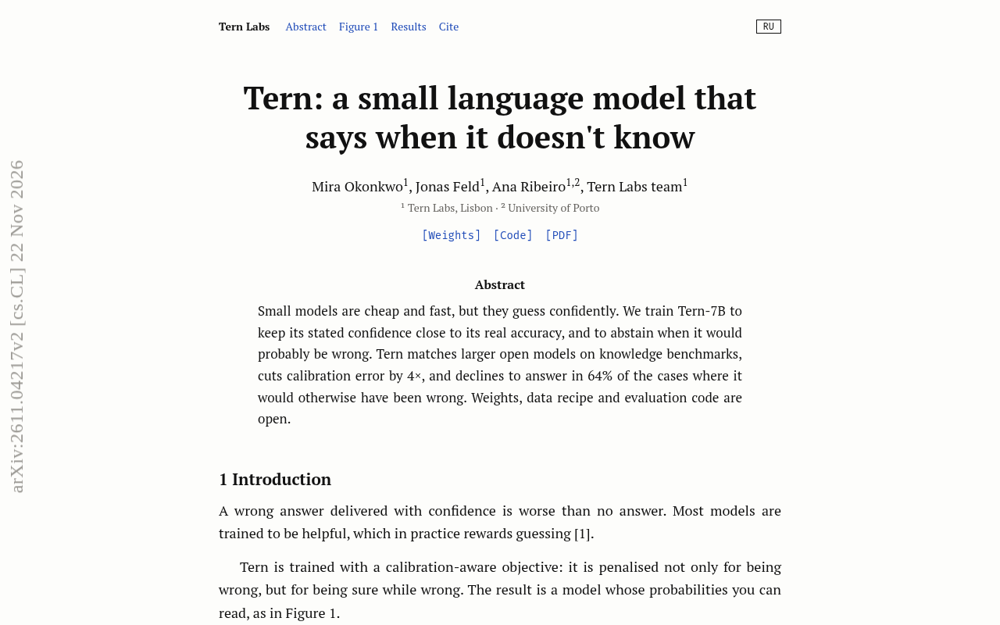

<!-- generated by scripts/build-docs.mjs from templates.json — edit there -->
# 20 · Tern — ИИ-стартап

[English version](README.md) · [Демо](https://unicorn-rm.github.io/vibe-templates/20-ai-startup/) · [Все шаблоны](../../README.ru.md)



- **Стиль:** Научная статья в духе arXiv
- **Стек:** Next.js 16 · Tailwind CSS 4 · TypeScript
- **Шрифты:** [PT Serif](https://fonts.google.com/specimen/PT+Serif), [Fira Code](https://fonts.google.com/specimen/Fira+Code) (латиница + кириллица)
- **Фирменный блок:** Рисунок 1: ответ модели печатается по токенам с подчёркиванием по уверенности; при наведении — альтернативы, а низкая уверенность ведёт к честному «не знаю»

## Запуск

```bash
npm install
npm run dev
npm run build   # static export to ./out
```

## Какие блоки внутри

- arXiv side stamp
- title, authors, affiliations
- abstract
- numbered sections
- interactive token-confidence figure
- MathML equation
- booktabs results table
- BibTeX with copy
- references

## Где что лежит

| Файл | Что там менять |
|---|---|
| `lib/content.ts` | paper copy (EN + RU), demo tokens with probabilities, results, BibTeX |
| `app/page.tsx` | paper layout and the Figure component |
| `app/globals.css` | tokens in Tailwind `@theme`, token underlines, booktabs |
| `mathml.d.ts` | MathML element types for TSX |

По умолчанию страница на английском. Русский — кнопкой языка или `?lang=ru`.

## Переделать под себя с ИИ

Откройте эту папку в Claude Code, Cursor, Copilot или другом агенте и вставьте:

```text
Ты адаптируешь шаблон "20-ai-startup" из vibe-templates.
Сначала прочитай DESIGN.md и AGENTS.md в этой папке и соблюдай все правила из DESIGN.md.
Мой проект: <что это, для кого, 2–3 предложения>.
Замени весь текст и данные в lib/content.ts на контент моего проекта, на английском и русском.
Сохрани сетку, шрифты, фирменный блок и анимации. Палитру можно менять только в токенах, сохранив число акцентов и контраст текста не ниже 4.5:1.
Не добавляй новые зависимости. В конце перечисли, что изменил.
```

Правила дизайна, которые агент должен сохранить, — в [DESIGN.md](DESIGN.md).

## Лицензия

MIT — используйте как угодно, ссылка на репозиторий приветствуется. 
