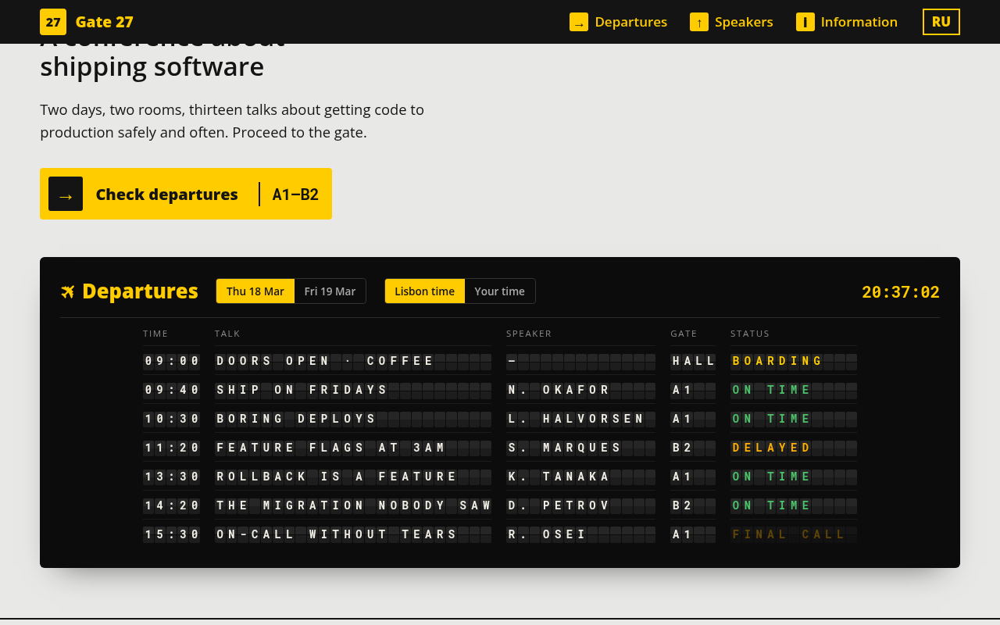

<!-- generated by scripts/build-docs.mjs from templates.json — edit there -->
# 21 · Gate 27 — Tech conference

[Русская версия](README.ru.md) · [Live demo](https://unicorn-rm.github.io/vibe-templates/21-tech-conference/) · [All templates](../../README.md)



- **Style:** Airport wayfinding
- **Stack:** React 19 · Vite
- **Fonts:** [Open Sans](https://fonts.google.com/specimen/Open+Sans), [Roboto Mono](https://fonts.google.com/specimen/Roboto+Mono) (Latin + Cyrillic)
- **Signature block:** Schedule as a split-flap departures board: letters flip when you switch day or time zone; statuses like BOARDING and FINAL CALL

## Run it

```bash
npm install
npm run dev
npm run build   # ./dist
```

## Blocks inside

- overhead sign bar with pictograms
- giant gate number hero
- wayfinding CTA
- split-flap board with day + timezone switch
- boarding-pass speaker cards
- information pictograms
- footer

## Where things live

| File | What to edit there |
|---|---|
| `src/content.js` | schedule, speakers, all copy (EN + RU) |
| `src/App.jsx` | split-flap components, board, passes |
| `src/styles.css` | tokens at the top |

The page speaks English by default. Russian: the language button, or `?lang=ru`.

## Make it yours with AI

Open this folder in Claude Code, Cursor, Copilot or any coding agent and paste:

```text
You are adapting the "21-tech-conference" template from vibe-templates.
Read DESIGN.md and AGENTS.md in this folder first and keep every rule in DESIGN.md.
My project: <what it is, who it is for, 2–3 sentences>.
Replace all copy and data in src/content.js with content for my project, in English and Russian.
Keep the layout, the fonts, the signature block and the motion. You may change the palette tokens only if you keep the same number of accents and contrast of at least 4.5:1 for body text.
Do not add new dependencies. When done, list what you changed.
```

Design rules the agent must keep are in [DESIGN.md](DESIGN.md).

## License

MIT — use it for anything, credit appreciated. 
