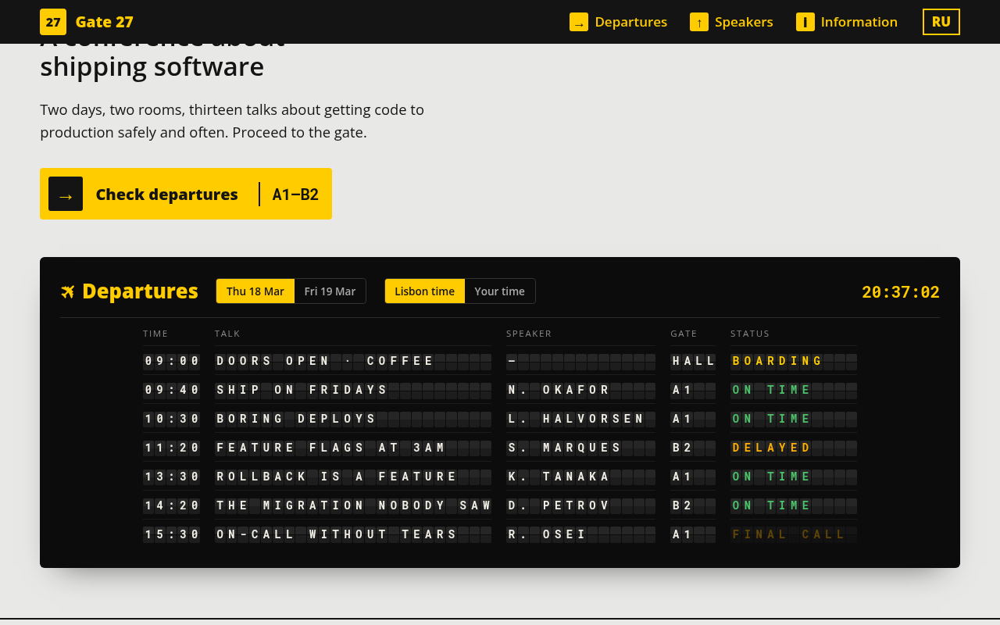

<!-- generated by scripts/build-docs.mjs from templates.json — edit there -->
# 21 · Gate 27 — IT-конференция

[English version](README.md) · [Демо](https://unicorn-rm.github.io/vibe-templates/21-tech-conference/) · [Все шаблоны](../../README.ru.md)



- **Стиль:** Навигация аэропорта
- **Стек:** React 19 · Vite
- **Шрифты:** [Open Sans](https://fonts.google.com/specimen/Open+Sans), [Roboto Mono](https://fonts.google.com/specimen/Roboto+Mono) (латиница + кириллица)
- **Фирменный блок:** Расписание как табло вылетов с перекидными пластинками: буквы перещёлкиваются при смене дня или часового пояса; статусы «Посадка» и «Последний вызов»

## Запуск

```bash
npm install
npm run dev
npm run build   # ./dist
```

## Какие блоки внутри

- overhead sign bar with pictograms
- giant gate number hero
- wayfinding CTA
- split-flap board with day + timezone switch
- boarding-pass speaker cards
- information pictograms
- footer

## Где что лежит

| Файл | Что там менять |
|---|---|
| `src/content.js` | schedule, speakers, all copy (EN + RU) |
| `src/App.jsx` | split-flap components, board, passes |
| `src/styles.css` | tokens at the top |

По умолчанию страница на английском. Русский — кнопкой языка или `?lang=ru`.

## Переделать под себя с ИИ

Откройте эту папку в Claude Code, Cursor, Copilot или другом агенте и вставьте:

```text
Ты адаптируешь шаблон "21-tech-conference" из vibe-templates.
Сначала прочитай DESIGN.md и AGENTS.md в этой папке и соблюдай все правила из DESIGN.md.
Мой проект: <что это, для кого, 2–3 предложения>.
Замени весь текст и данные в src/content.js на контент моего проекта, на английском и русском.
Сохрани сетку, шрифты, фирменный блок и анимации. Палитру можно менять только в токенах, сохранив число акцентов и контраст текста не ниже 4.5:1.
Не добавляй новые зависимости. В конце перечисли, что изменил.
```

Правила дизайна, которые агент должен сохранить, — в [DESIGN.md](DESIGN.md).

## Лицензия

MIT — используйте как угодно, ссылка на репозиторий приветствуется. 
