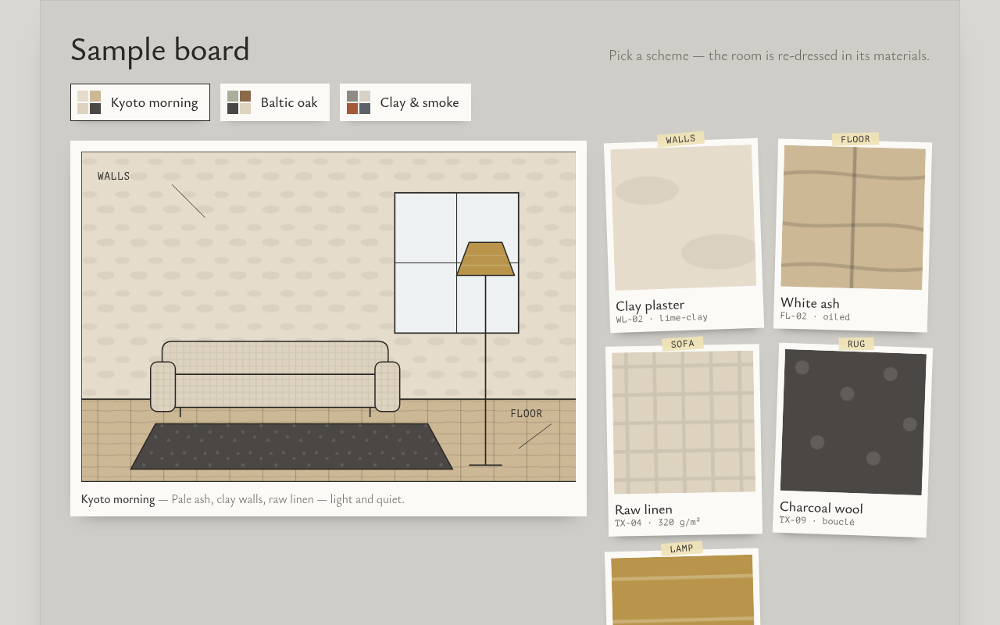

<!-- generated by scripts/build-docs.mjs from templates.json — edit there -->
# 22 · Atelier Hira — Interior studio

[Русская версия](README.ru.md) · [Live demo](https://unicorn-rm.github.io/vibe-templates/22-interior-studio/) · [All templates](../../README.md)



- **Style:** Architect's material sample board
- **Stack:** Nuxt 4 · Vue 3
- **Fonts:** [Ysabeau](https://fonts.google.com/specimen/Ysabeau), [PT Mono](https://fonts.google.com/specimen/PT+Mono) (Latin + Cyrillic)
- **Signature block:** Room elevation re-dressed by material schemes: walls, floor, sofa, rug and lamp switch to textured swatches (oak, linen, terrazzo, plaster)

## Run it

```bash
npm install          # Node 22.22.3+ (Nuxt 4)
npm run dev
npm run build   # nuxt generate → ./dist
```

## Blocks inside

- quiet header
- large light headline
- scheme picker
- SVG room elevation with textured patterns
- pinned swatches with tape labels and spec codes
- work list
- four-step process
- contact

## Where things live

| File | What to edit there |
|---|---|
| `app/content.ts` | materials, schemes, all copy (EN + RU) |
| `app/app.vue` | whole page, room SVG and patterns |
| `app/assets/main.css` | tokens at the top |
| `nuxt.config.ts` | head, fonts, static generate |

The page speaks English by default. Russian: the language button, or `?lang=ru`.

## Make it yours with AI

Open this folder in Claude Code, Cursor, Copilot or any coding agent and paste:

```text
You are adapting the "22-interior-studio" template from vibe-templates.
Read DESIGN.md and AGENTS.md in this folder first and keep every rule in DESIGN.md.
My project: <what it is, who it is for, 2–3 sentences>.
Replace all copy and data in app/content.ts with content for my project, in English and Russian.
Keep the layout, the fonts, the signature block and the motion. You may change the palette tokens only if you keep the same number of accents and contrast of at least 4.5:1 for body text.
Do not add new dependencies. When done, list what you changed.
```

Design rules the agent must keep are in [DESIGN.md](DESIGN.md).

## License

MIT — use it for anything, credit appreciated. 
