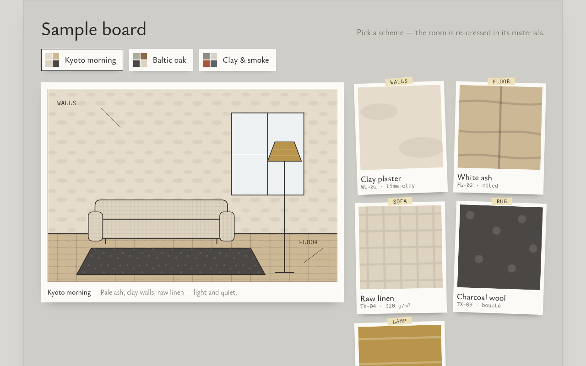

<!-- generated by scripts/build-docs.mjs from templates.json — edit there -->
# 22 · Atelier Hira — Студия интерьеров

[English version](README.md) · [Демо](https://unicorn-rm.github.io/vibe-templates/22-interior-studio/) · [Все шаблоны](../../README.ru.md)



- **Стиль:** Планшет образцов архитектора
- **Стек:** Nuxt 4 · Vue 3
- **Шрифты:** [Ysabeau](https://fonts.google.com/specimen/Ysabeau), [PT Mono](https://fonts.google.com/specimen/PT+Mono) (латиница + кириллица)
- **Фирменный блок:** Развёртка комнаты, которая переодевается по схемам материалов: стены, пол, диван, ковёр и лампа получают фактуры образцов (дуб, лён, терраццо, штукатурка)

## Запуск

```bash
npm install          # Node 22.22.3+ (Nuxt 4)
npm run dev
npm run build   # nuxt generate → ./dist
```

## Какие блоки внутри

- quiet header
- large light headline
- scheme picker
- SVG room elevation with textured patterns
- pinned swatches with tape labels and spec codes
- work list
- four-step process
- contact

## Где что лежит

| Файл | Что там менять |
|---|---|
| `app/content.ts` | materials, schemes, all copy (EN + RU) |
| `app/app.vue` | whole page, room SVG and patterns |
| `app/assets/main.css` | tokens at the top |
| `nuxt.config.ts` | head, fonts, static generate |

По умолчанию страница на английском. Русский — кнопкой языка или `?lang=ru`.

## Переделать под себя с ИИ

Откройте эту папку в Claude Code, Cursor, Copilot или другом агенте и вставьте:

```text
Ты адаптируешь шаблон "22-interior-studio" из vibe-templates.
Сначала прочитай DESIGN.md и AGENTS.md в этой папке и соблюдай все правила из DESIGN.md.
Мой проект: <что это, для кого, 2–3 предложения>.
Замени весь текст и данные в app/content.ts на контент моего проекта, на английском и русском.
Сохрани сетку, шрифты, фирменный блок и анимации. Палитру можно менять только в токенах, сохранив число акцентов и контраст текста не ниже 4.5:1.
Не добавляй новые зависимости. В конце перечисли, что изменил.
```

Правила дизайна, которые агент должен сохранить, — в [DESIGN.md](DESIGN.md).

## Лицензия

MIT — используйте как угодно, ссылка на репозиторий приветствуется. 
