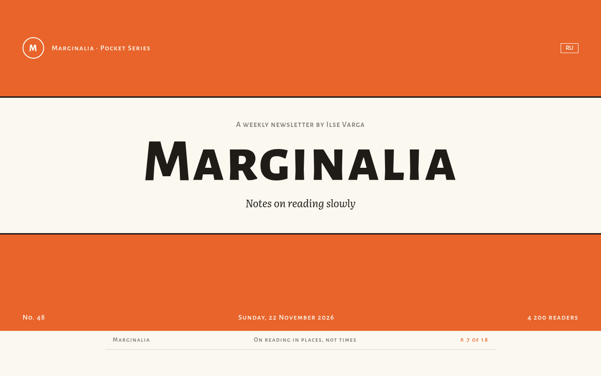

<!-- generated by scripts/build-docs.mjs from templates.json — edit there -->
# 23 · Marginalia — Блог и рассылка

[English version](README.md) · [Демо](https://unicorn-rm.github.io/vibe-templates/23-blog-newsletter/) · [Все шаблоны](../../README.ru.md)



- **Стиль:** Карманная книга в мягкой обложке
- **Стек:** Astro 7 · MDX
- **Шрифты:** [Literata](https://fonts.google.com/specimen/Literata), [Alegreya Sans SC](https://fonts.google.com/specimen/Alegreya+Sans+SC) (латиница + кириллица)
- **Фирменный блок:** Сноски на полях, которые на телефоне раскрываются по нажатию, + счётчик «с. 9 из 18» вместо полосы прогресса

## Запуск

```bash
npm install          # Node 22.23+ (Astro 7)
npm run dev
npm run build   # ./dist
```

## Какие блоки внутри

- tri-band paperback cover
- sticky running head with page number
- contents with dotted leaders
- essay with drop cap and small-caps first line
- sidenotes
- dinkus
- colophon with subscribe links
- footer band

## Где что лежит

| Файл | Что там менять |
|---|---|
| `src/content/essay.en.mdx` | English essay |
| `src/content/essay.ru.mdx` | Russian essay |
| `src/pages/index.astro` | cover, contents, page counter script |
| `src/components/Fn.astro` | sidenote component |
| `src/styles/global.css` | tokens at the top |

По умолчанию страница на английском. Русский — кнопкой языка или `?lang=ru`.

## Переделать под себя с ИИ

Откройте эту папку в Claude Code, Cursor, Copilot или другом агенте и вставьте:

```text
Ты адаптируешь шаблон "23-blog-newsletter" из vibe-templates.
Сначала прочитай DESIGN.md и AGENTS.md в этой папке и соблюдай все правила из DESIGN.md.
Мой проект: <что это, для кого, 2–3 предложения>.
Замени весь текст и данные в src/content/essay.en.mdx на контент моего проекта, на английском и русском.
Сохрани сетку, шрифты, фирменный блок и анимации. Палитру можно менять только в токенах, сохранив число акцентов и контраст текста не ниже 4.5:1.
Не добавляй новые зависимости. В конце перечисли, что изменил.
```

Правила дизайна, которые агент должен сохранить, — в [DESIGN.md](DESIGN.md).

## Лицензия

MIT — используйте как угодно, ссылка на репозиторий приветствуется. 
