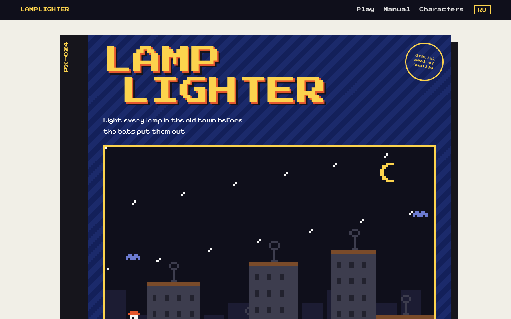

<!-- generated by scripts/build-docs.mjs from templates.json — edit there -->
# 24 · LAMPLIGHTER — Indie game

[Русская версия](README.ru.md) · [Live demo](https://unicorn-rm.github.io/vibe-templates/24-pixel-game/) · [All templates](../../README.md)



- **Style:** 8-bit cartridge box & manual
- **Stack:** Vanilla JS · Canvas · Vite
- **Fonts:** [Press Start 2P](https://fonts.google.com/specimen/Press+Start+2P), [Pixelify Sans](https://fonts.google.com/specimen/Pixelify+Sans) (Latin + Cyrillic)
- **Signature block:** A playable one-screen 8-bit game on canvas (keyboard + touch pad): light lamps across the rooftops, dodge bats

## Run it

```bash
npm install
npm run dev
npm run build   # ./dist
```

## Blocks inside

- cartridge box front with spine and seal
- box art rendered by the game engine
- playable game screen with HUD
- touch D-pad for phones
- instruction manual pages with controller diagram
- hints and warning
- character sprite sheet

## Where things live

| File | What to edit there |
|---|---|
| `src/game.js` | game engine, palette and sprites |
| `src/main.js` | page logic, all copy (EN + RU), sprite sheet |
| `index.html` | box, screen, manual markup |
| `src/style.css` | tokens at the top |

The page speaks English by default. Russian: the language button, or `?lang=ru`.

## Make it yours with AI

Open this folder in Claude Code, Cursor, Copilot or any coding agent and paste:

```text
You are adapting the "24-pixel-game" template from vibe-templates.
Read DESIGN.md and AGENTS.md in this folder first and keep every rule in DESIGN.md.
My project: <what it is, who it is for, 2–3 sentences>.
Replace all copy and data in src/game.js with content for my project, in English and Russian.
Keep the layout, the fonts, the signature block and the motion. You may change the palette tokens only if you keep the same number of accents and contrast of at least 4.5:1 for body text.
Do not add new dependencies. When done, list what you changed.
```

Design rules the agent must keep are in [DESIGN.md](DESIGN.md).

## License

MIT — use it for anything, credit appreciated. 
