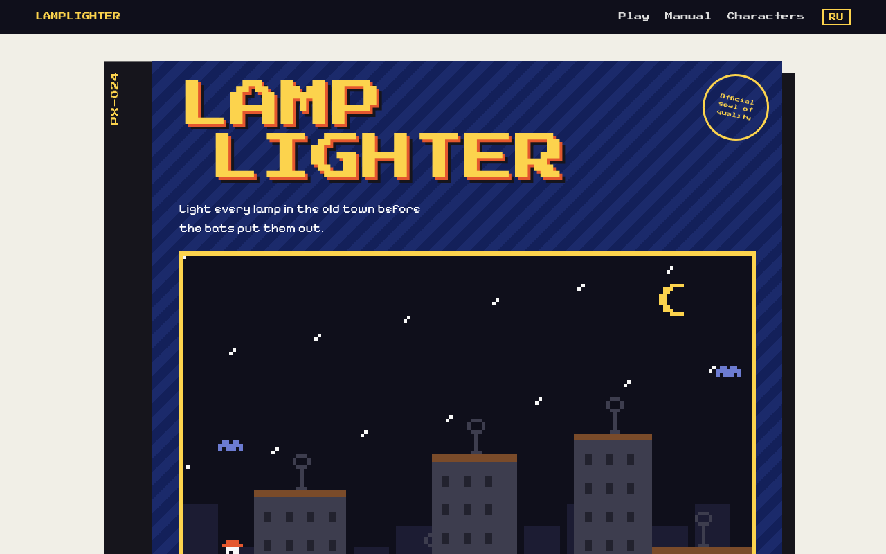

<!-- generated by scripts/build-docs.mjs from templates.json — edit there -->
# 24 · LAMPLIGHTER — Инди-игра

[English version](README.md) · [Демо](https://unicorn-rm.github.io/vibe-templates/24-pixel-game/) · [Все шаблоны](../../README.ru.md)



- **Стиль:** Коробка и инструкция 8-битного картриджа
- **Стек:** Vanilla JS · Canvas · Vite
- **Шрифты:** [Press Start 2P](https://fonts.google.com/specimen/Press+Start+2P), [Pixelify Sans](https://fonts.google.com/specimen/Pixelify+Sans) (латиница + кириллица)
- **Фирменный блок:** Играбельная 8-битная игра на одном экране (клавиатура + сенсорные кнопки): зажигайте фонари на крышах и уворачивайтесь от летучих мышей

## Запуск

```bash
npm install
npm run dev
npm run build   # ./dist
```

## Какие блоки внутри

- cartridge box front with spine and seal
- box art rendered by the game engine
- playable game screen with HUD
- touch D-pad for phones
- instruction manual pages with controller diagram
- hints and warning
- character sprite sheet

## Где что лежит

| Файл | Что там менять |
|---|---|
| `src/game.js` | game engine, palette and sprites |
| `src/main.js` | page logic, all copy (EN + RU), sprite sheet |
| `index.html` | box, screen, manual markup |
| `src/style.css` | tokens at the top |

По умолчанию страница на английском. Русский — кнопкой языка или `?lang=ru`.

## Переделать под себя с ИИ

Откройте эту папку в Claude Code, Cursor, Copilot или другом агенте и вставьте:

```text
Ты адаптируешь шаблон "24-pixel-game" из vibe-templates.
Сначала прочитай DESIGN.md и AGENTS.md в этой папке и соблюдай все правила из DESIGN.md.
Мой проект: <что это, для кого, 2–3 предложения>.
Замени весь текст и данные в src/game.js на контент моего проекта, на английском и русском.
Сохрани сетку, шрифты, фирменный блок и анимации. Палитру можно менять только в токенах, сохранив число акцентов и контраст текста не ниже 4.5:1.
Не добавляй новые зависимости. В конце перечисли, что изменил.
```

Правила дизайна, которые агент должен сохранить, — в [DESIGN.md](DESIGN.md).

## Лицензия

MIT — используйте как угодно, ссылка на репозиторий приветствуется. 
